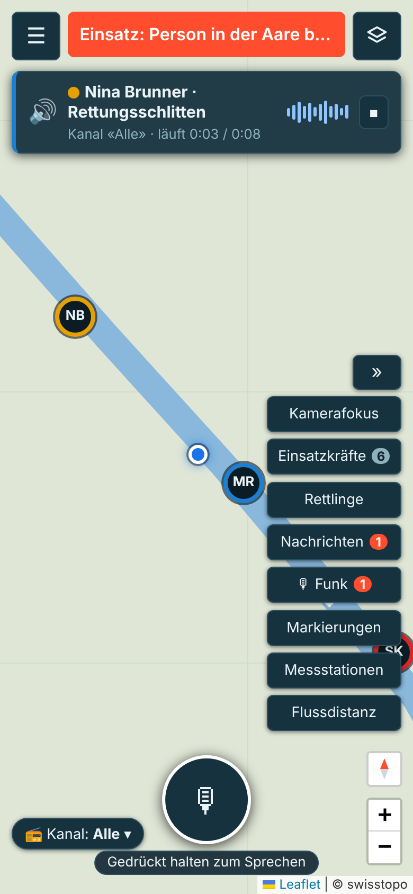
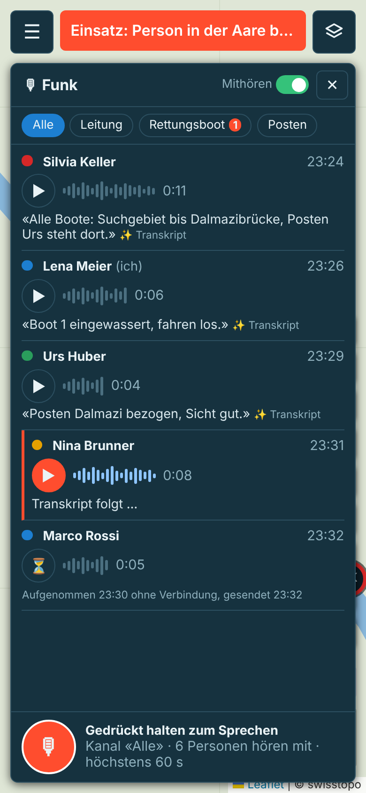
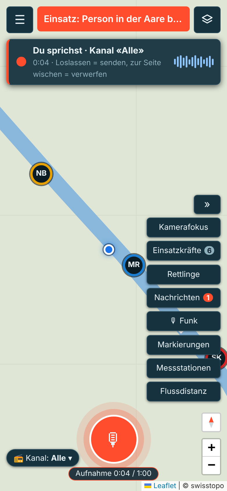
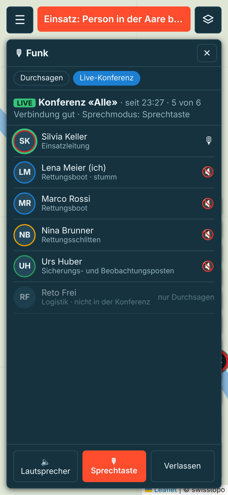
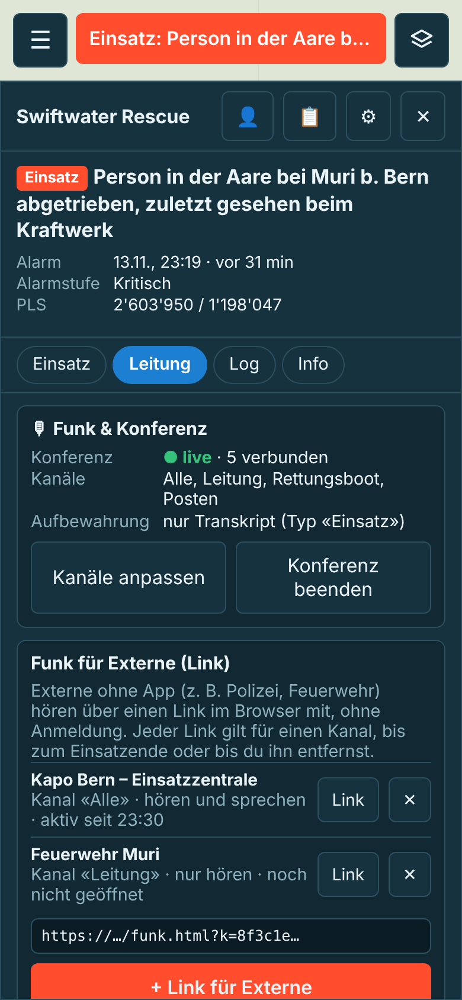
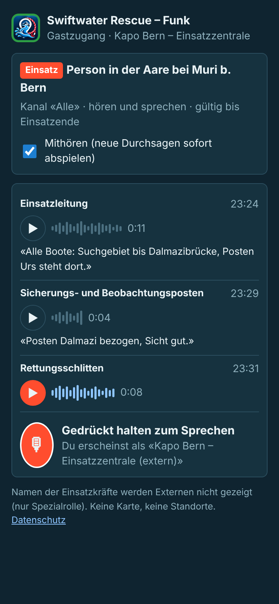
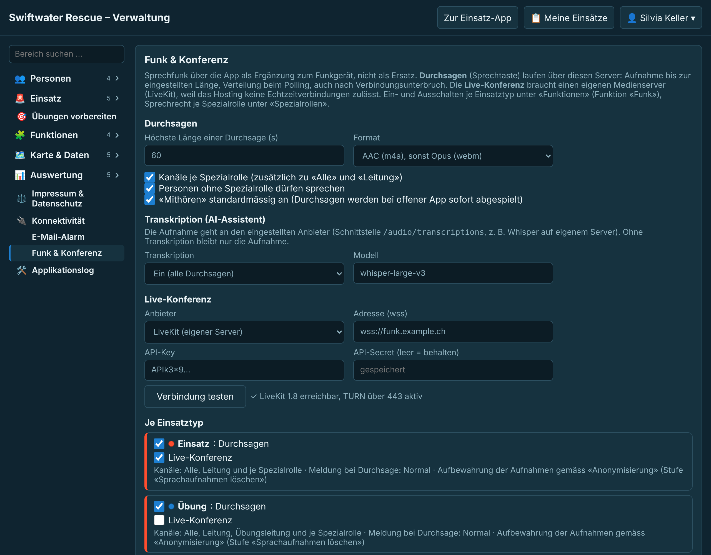

# Konzept: Sprachchat / Konferenzgespräch für Einsatz und Übung (Issue #113)

Stand: 14.11.2026, Version 2 mit den Antworten des Auftraggebers (PR #194). Nur Konzept, noch kein Code. Die Bilder sind Mockups: in die laufende Einsatz-App bzw. Verwaltung eingesetzt, Kartenhintergrund und Fluss nachgebildet (ohne Kartenkacheln).

## Entscheide des Auftraggebers (Antworten auf die offenen Fragen)
1. Live-Konferenz **von Anfang an** (nicht erst in einer späteren Stufe).
2. Ein **eigener Server für LiveKit** wird betrieben.
3. Durchsagen werden aufbewahrt: **Aufnahme oder Transkript**, wählbar.
4. Transkription **ja, konfigurierbar**.
5. Kanäle **konfigurierbar**.
6. Externe per Link **konfigurierbar**.

## Ausgangslage und Rahmen
- **Hosting cyon «Webhosting Single»:** PHP und MySQL, keine WebSockets, kein Dauerprozess. Echtzeit-Audio läuft deshalb über den eigenen LiveKit-Server; der PHP-Server stellt nur Zugangstokens aus und verwaltet Durchsagen, Kanäle, Rechte, Log und Aufbewahrung.
- Die App kennt bereits Nachrichten mit Empfängerwahl nach Spezialrolle, Push (Web und FCM/APNs), Polling alle 4 s, Einsatzlog, Replay, Anonymisierung in Stufen, öffentliche Ansicht per Link und einen AI-Assistenten mit frei wählbarem Anbieter.
- Das Funkgerät bleibt das primäre Mittel; die App **ergänzt** es (Kräfte ausser Funkreichweite, Externe ohne Funk, nachvollziehbare Durchsagen).

## Zwei Wege, ein Funk
| | **Live-Konferenz** (WebRTC über LiveKit) | **Durchsagen** (Sprechtaste, Aufnahme) |
|---|---|---|
| Wofür | laufende Absprache in Echtzeit | kurze Meldungen, Funkloch, Nachvollziehbarkeit |
| Läuft über | eigener LiveKit-Server | cyon (PHP, Polling) |
| Verzögerung | < 0.5 s | 2–6 s (bei offenem Funk-Fenster ca. 1.5 s) |
| Funkloch | Abbruch, automatisch neu verbinden | Aufnahme wird nachgesendet |
| Log, Replay, AAR | nur Beitritt/Austritt | Aufnahme und/oder Transkript |

Beide teilen dieselben **Kanäle**, Rechte und dieselbe Sprechtaste. Wer in der Konferenz eines Kanals ist, hört live; wer nicht verbunden ist (Funkloch, App im Hintergrund, Konferenz für den Typ aus), erhält die Durchsage. Damit gehen Meldungen nicht verloren.

**Variante C** (WebRTC direkt zwischen Geräten, Signalisierung über PHP-Polling) wird nicht weiterverfolgt: nur bis ca. 4 Personen, langsamer Aufbau, bricht in Mobilnetzen oft ab.

## Bedienung in der Einsatz-App (Web und nativ)

- Kartenknopf **«🎙 Funk»** (Zähler = ungehörte Durchsagen) öffnet das Seitenfenster `panel` `'vx'` mit den Registern «Durchsagen» und «Live-Konferenz».
- **Sprechtaste** unten in der Mitte der Karte (einblendbar im Fenster «Ansicht») und im Funk-Fenster: gedrückt halten = sprechen, loslassen = Ende. In der Konferenz geht der Ton live raus und wird zusätzlich als Durchsage gespeichert, sofern der Einsatztyp das vorsieht; ohne Konferenz nur als Durchsage. Zur Seite wischen verwirft eine Aufnahme. Für Handschuhe: «Antippen zum Starten/Stoppen» im Profil.
- **Kanal-Chip** links unten wählt den Sprechkanal. Gehört werden alle Kanäle, in denen man Mitglied ist.
- **Konferenz:** Beitritt mit einem Tipp (Standard stumm, Sprechtaste), Anzeige, wer spricht, Lautsprecher/Hörer, Verlassen. Wer nicht verbunden ist, steht ausgegraut mit «nur Durchsagen».
- **Mithören:** bei offener App werden Durchsagen sofort nacheinander abgespielt, oben die Leiste «🔊 Name · Rolle · Kanal» mit Stopp.
- **Funkloch:** Aufnahmen bleiben im Gerät und gehen später raus («aufgenommen …, gesendet …»); die Konferenz verbindet sich selbst neu.
- Verlauf je Kanal mit ▶, Dauer, Wellenform und Transkript (✨), je nach Aufbewahrung nur Transkript.

## Kanäle (konfigurierbar)
- Verwaltung → Konnektivität → «Funk & Konferenz» → **Kanäle**: Liste mit Name, Reihenfolge, Mitgliedern und Sprechrecht. Mitglieder nach Spezialrollen, Einrückoptionen, «Einsatzleitung» (`canManage`), «Übungsleitung» (`exLead`) oder «alle Teilnehmenden». Je Kanal: wer hört, wer spricht (z. B. «Leitung»: alle hören, nur die Leitung spricht).
- Vorgaben: «Alle», «Leitung», je Spezialrolle (abschaltbar), «Übungsleitung» (nur Typen mit vorbereiteten Übungen).
- **Je Einsatztyp** wählt die Verwaltung die Kanäle (`inc_kinds.voice_ch`). Im laufenden Einsatz kann die Einsatzleitung Kanäle ein-/ausblenden («Kanäle anpassen», Log `voicech`).
- Tabelle `voice_channels` (`name`, `sort`, `members` JSON, `speak` JSON, `active`), Konferenzraum je Kanal: `sw-<Server>-<Einsatz>-<Kanal>`.

## Server (`api/index.php`)
- Funktion `voice` in `FEATURES` (je Einsatztyp), dazu je Typ die Schalter Durchsagen, Live-Konferenz, Transkription, Links für Externe. Routen in `FEATURE_ROUTES`:
  - `incident/voice` (Upload Base64 oder `multipart/form-data`; Prüfung Länge, Grösse, Typ, Kanal und Sprechrecht),
  - `incident/voice/get` (Audio mit Rechteprüfung, nie direkt aus `api/data/`),
  - `incident/voice/heard`,
  - `incident/voice/join` (LiveKit-Token: JWT HS256 mit API-Key/Secret, ohne Bibliothek wie `vapidJwt`; Rechte `canPublish` nur mit Sprechrecht, `canSubscribe` je Kanal; kurze Gültigkeit, Erneuerung beim Polling),
  - `incident/voice/channels` (Einsatzleitung).
- Tabelle `voice` (`incident_id`, `user_id` bzw. `guest_id`, `channel_id`, `rec_at`, `sent_at`, `dur_ms`, `mime`, `bytes`, `file`, `transcript`, `tr_state`, `audio_del`, `removed`). Dateien in `api/data/voice/<Einsatz>/` (`.htaccess` sperrt den Ordner).
- `incident/state` liefert neue Durchsagen inkrementell (nur Metadaten), `voice_ch` (meine Kanäle mit Hören/Sprechen), `voice_conf` (wer in welcher Konferenz ist, aus LiveKit-Webhooks oder der Room-API). Bei offenem Funk-Fenster oder Mithören pollt die App alle 1.5 s.
- LiveKit-Webhook `voice/hook&key=` (ohne Anmeldung, signiert mit dem API-Secret) für Beitritt/Austritt → Log und `voice_conf`. Room-API-Aufrufe (Teilnehmende entfernen bei «aus Einsatz entfernt», Raum schliessen bei Einsatzende) über curl.
- Push mit Schlüssel `v:` und Stufe `inc_kinds.voice_lvl` (wie `msg_lvl`, #168), nur für Kanäle, die man hört, nicht bei offener App.
- Log: «spricht auf Kanal «Alle» (0:11)» mit Transkript und ▶, «tritt der Konferenz «Alle» bei / verlässt sie». Replay: Durchsage am Zeitstrahl, abspielbar (sofern die Aufnahme noch besteht).
- Applikationslog: Token, Webhook, Upload abgelehnt, Transkription fehlgeschlagen, LiveKit nicht erreichbar (ohne Inhalt).

## Aufbewahrung und Transkription (konfigurierbar)
- **Je Einsatztyp** «Aufbewahrung» (`inc_kinds.voice_keep`):
  - *Aufnahme und Transkript*,
  - *Nur Transkript* – die Aufnahme wird nach dem Einsatzende gelöscht, sobald das Transkript vorliegt (ohne Transkript bleibt sie bis zur Anonymisierungsfrist),
  - *Nur Aufnahme* (keine Transkription),
  - *Nichts* – Aufnahmen werden nach dem Einsatzende gelöscht, im Log bleibt «Durchsage (0:11)».
- **Transkription** je Einsatztyp ein/aus, Dienst global: OpenAI-kompatibles `/audio/transcriptions` (z. B. eigener Whisper-Server) mit eigenem Schlüssel getrennt in `settings` oder über die Anbieter des AI-Assistenten (neue AI-Funktion `tr`, Datenschutz je Typ wie `aiPriv`). Läuft im Nachlauf `after()`; Konferenzbeiträge werden nur transkribiert, wenn sie als Durchsage gespeichert werden.
- Anonymisierung: neue Stufe **`voice` «Sprachaufnahmen löschen»** in `ANON_STEPS` (Vorgabe 90/30 Tage, vor `replay`); Transkripte wie Nachrichten über `log`/`texts` (Namen ersetzen, «(Text entfernt)»).
- Die Konferenz selbst wird **nicht aufgezeichnet** (LiveKit Egress bleibt aus).

## Externe per Link (konfigurierbar)

- Je Einsatztyp ein/aus und «Externe dürfen: nur hören / hören und sprechen» (Standard: aus).
- Die Einsatzleitung erzeugt im Register «Leitung» → «Funk für Externe» je Organisation einen Link: Bezeichnung, Kanal, Recht, gültig bis Einsatzende oder Entfernen. Tabelle `voice_guests` (`incident_id`, `token`, `label`, `channel_id`, `speak`, `opened_at`, `removed`), Log `voiceguest`.
- Gastseite `funk.html?k=<token>` ohne Anmeldung (wie `public.html`, `referrer` `strict-origin`): Verlauf und Mithören des Kanals, Sprechtaste (falls erlaubt), Beitritt zur Konferenz des Kanals mit eingeschränktem Token. **Keine Karte, keine Standorte**, Einsatzkräfte nur mit Spezialrolle (anonym wie die öffentliche Ansicht). Durchsagen der Gäste erscheinen als «Bezeichnung (extern)», z. B. «Kapo Bern – Einsatzzentrale (extern)».
- Routen vor der Anmeldeprüfung: `guest/state`, `guest/voice`, `guest/voice/get`, `guest/voice/join`, mit Rate-Limit je Token.

## Native App (Issue #108)
- Flutter: `livekit_client` (Konferenz), `record` (Durchsagen, AAC-LC mono 24 kbit/s in m4a, 60 s ≈ 180 KB).
- **Android:** Vordergrunddienst mit Typ `microphone` und `mediaPlayback` während der Konferenz; Durchsagen über den bestehenden Dienst.
- **iOS:** Konferenz über **CallKit** (erscheint wie ein Anruf, läuft bei gesperrtem Bildschirm), Durchsagen über das **PushToTalk-Framework** (ab iOS 16, APNs-Typ `pushtotalk`, Sprechtaste auf dem Sperrbildschirm). *Abklärung:* FCM sendet `pushtotalk` nicht, es braucht direkten APNs-Versand (Schlüssel `.p8`).
- Headset-/Bluetooth-Knopf als Sprechtaste.

## Web-App
- `livekit-client` über jsDelivr (feste Version), geladen erst beim ersten Beitritt (`loadJs`).
- Durchsagen mit `MediaRecorder`: `audio/mp4` bevorzugt, sonst `audio/webm;codecs=opus`. Der Server wandelt nicht um (kein ffmpeg auf cyon). *Offen:* Wiedergabe von webm auf älteren iPhones; falls nötig nur mp4.
- Hintergrund: Der Browser hält die Konferenz nur bei offener Seite; ohne native App gibt es bei gesperrtem Handy nur Durchsagen per Push.

## Verwaltung, Datenschutz

- Verwaltung → Konnektivität → **«Funk & Konferenz»** (Recht `cfg_conn`, `NAV`/`NAV_PERM`, `SETTING_PERMS`): Medienserver (Anbieter, Adresse, API-Key, API-Secret getrennt und nie an Geräte, «Verbindung testen» über `voice/test`), Kanäle, Transkriptionsdienst, je Einsatztyp Durchsagen/Konferenz/Transkription/Externe, Kanäle, Aufbewahrung, Recht der Externen, Höchstlänge, Mithören-Standard.
- Sprechrecht zusätzlich je Spezialrolle (`roles.can_voice`) und `voice_no_role` wie bei Nachrichten; `canManage` darf immer.
- `legal.html`: Sprachaufnahmen und Transkripte, Aufbewahrung je Typ, Medienserver und Transkriptionsdienst als Empfänger, Gastzugang.
- Öffentliche Ansicht: keine Durchsagen.

## Anforderungen (Vorschlag für `docs/REQUIREMENTS.md`, neuer Bereich FU)
- FU-01 Teilnehmende sprechen per Sprechtaste auf einem Kanal; die Kanäle sind in der Verwaltung konfigurierbar und je Einsatztyp wählbar.
- FU-02 Live-Konferenz je Kanal über einen eigenen Medienserver.
- FU-03 Wer nicht in der Konferenz ist, erhält Durchsagen; mit «Mithören» spielt die offene App sie automatisch ab, sonst Meldung (Stufe je Einsatztyp).
- FU-04 Ohne Verbindung aufgenommene Durchsagen werden nachgesendet und mit Aufnahmezeit angezeigt.
- FU-05 Aufbewahrung je Einsatztyp: Aufnahme und Transkript, nur Transkript, nur Aufnahme oder nichts.
- FU-06 Transkription je Einsatztyp ein- und ausschaltbar.
- FU-07 Durchsagen stehen im Einsatzlog und im Replay; Beitritt und Austritt der Konferenz im Log.
- FU-08 Die Einsatzleitung gibt Externen per Link Zugang zu einem Kanal (hören oder hören und sprechen), je Einsatztyp erlaubt oder nicht.
- FU-09 Sprachaufnahmen werden nach einstellbarer Frist gelöscht (Anonymisierungsstufe).

## Etappen (grob)
1. LiveKit-Server einrichten (Docker, TURN 443, Webhook), Tokens, Kanäle, Verwaltung: mittel.
2. Konferenz und Durchsagen in der Web-App, Log, Rechte: gross.
3. Konferenz und Durchsagen nativ (Android-Dienst, iOS CallKit): gross.
4. Aufbewahrung, Transkription, Anonymisierungsstufe, `legal.html`: mittel.
5. Externe per Link (Gastseite, Routen, Rate-Limit): mittel.
6. iOS PushToTalk-Framework für Durchsagen bei gesperrtem Bildschirm: mittel bis gross.

## Noch offen
- Rechenleistung des LiveKit-Servers: Für Audio genügen 2 vCPU/2 GB für mehrere gleichzeitige Einsätze; mit TURN über 443 braucht er eine eigene Domain mit Zertifikat.
- APNs-Schlüssel für PushToTalk (Apple-Entwicklerkonto).
- Wiedergabe von webm/Opus auf älteren iPhones.
