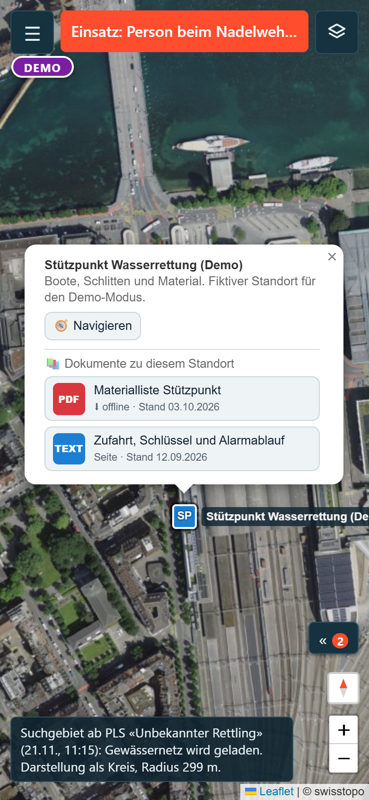
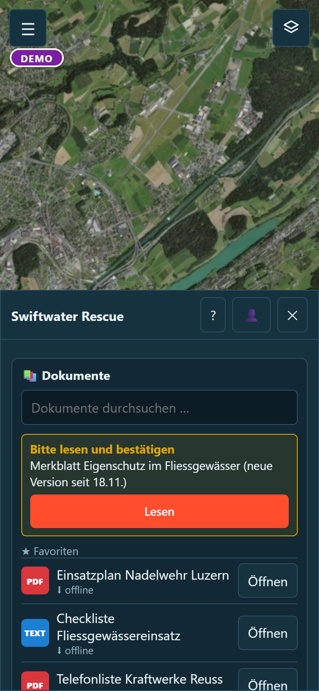
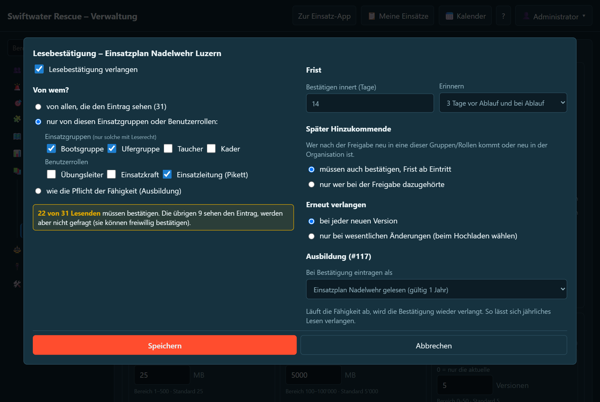
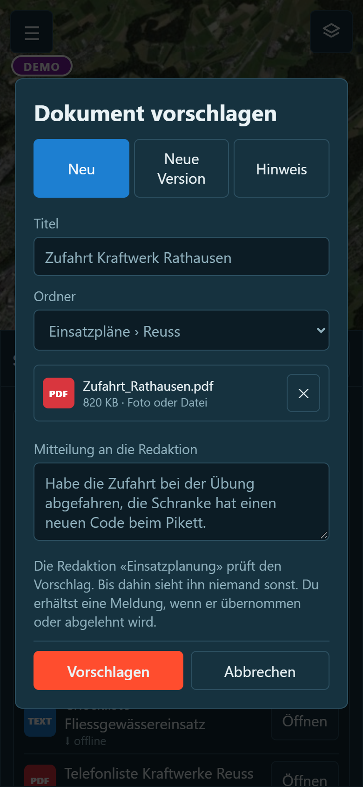
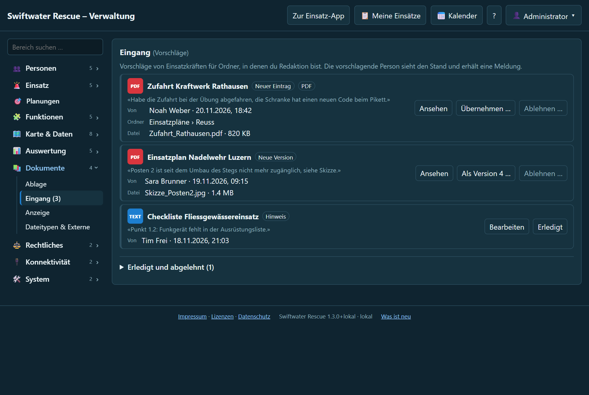
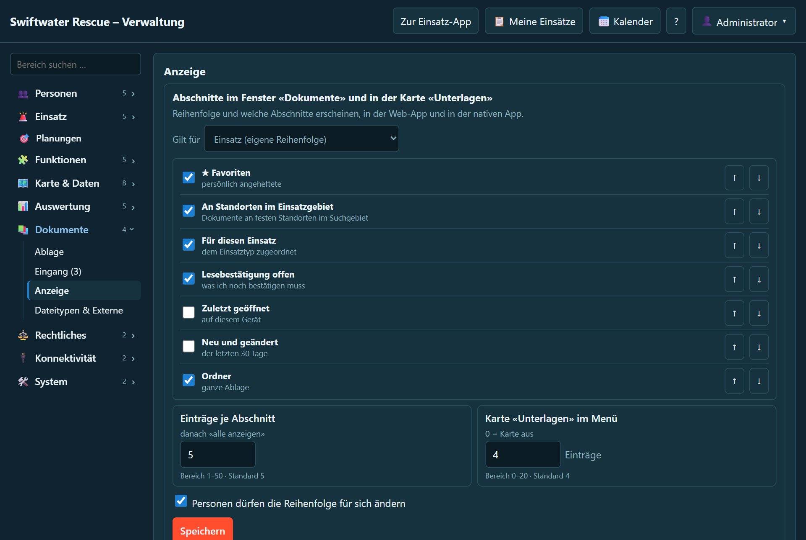
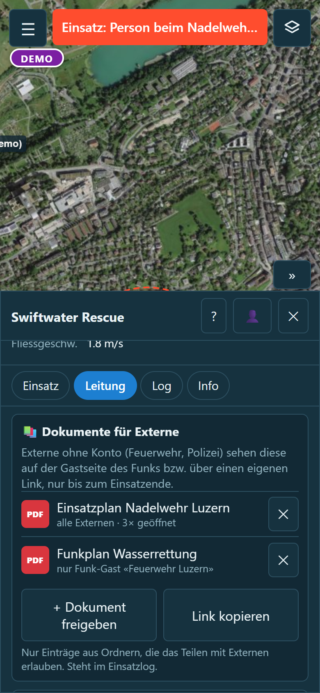
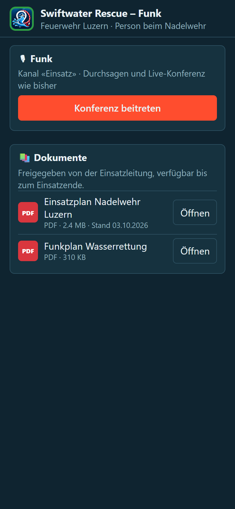
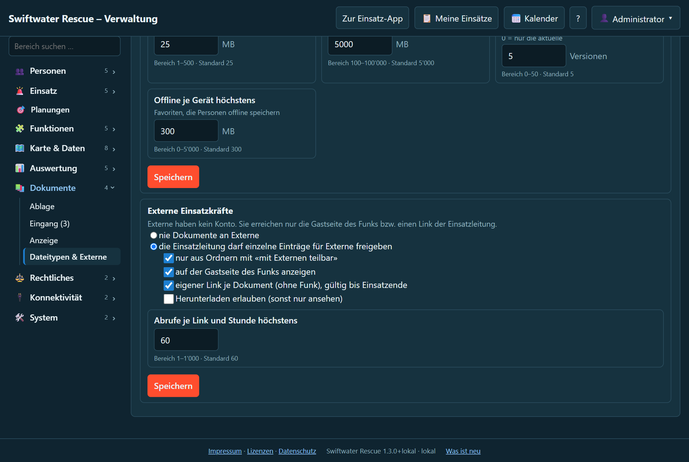
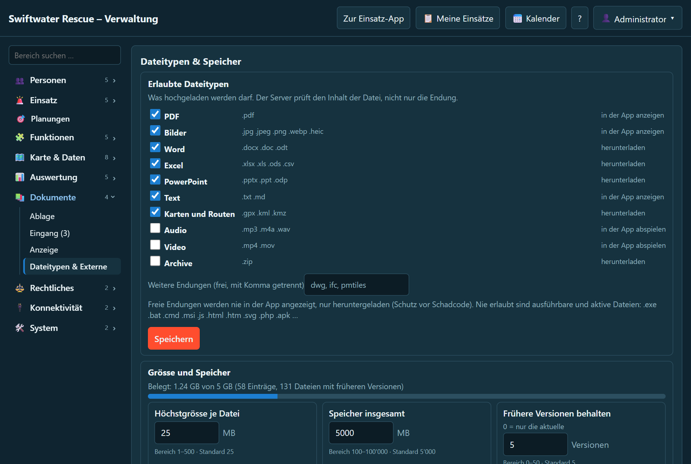

# Konzept: Dokumentenablage / Wissensdatenbank (Issue #229)

Version 3 vom 21.11.2026. Grundlage: Issue #229 und die Antworten des Auftraggebers auf die Versionen 1 und 2.
Das ist ein Konzept, noch kein Code. Die Bilder sind Mockups: die echte App (Demo-Modus bzw. Verwaltung mit Beispieldaten), die neuen Teile eingesetzt.

**Entscheide des Auftraggebers**
- «Berechtigungsgruppe» = **Benutzerrolle** (`uroles`). Freigaben also über Einsatzgruppen und Benutzerrollen, keine dritte Art von Gruppen.
- **Redaktion je Ordner**.
- **Dateitypen vorgegeben und einstellbar**, dazu **freie Endungen** erlaubt.
- **Keine Stufen**: alles wird in einem Schritt umgesetzt (Ablage, Freigaben, Standorte, Einsatztypen, Offline, Suche im PDF-Text, Versionen, Überprüfung, Lesebestätigung, Vorschläge, Externe, Web und nativ).
- Neu in Version 3 (Antworten auf Version 2):
  - Lesebestätigung **nur von bestimmten Gruppen/Rollen** (mehr Personen dürfen sehen) und Regel für **später Hinzukommende** → [Lesebestätigung](#lesebestätigung).
  - **Lesebestätigung mit Ausbildung (#117)** verknüpfbar → [Lesebestätigung](#lesebestätigung).
  - Die Abschnitte im Fenster «Dokumente» sind **konfigurierbar und sortierbar** → [Anzeige](#anzeige).
  - **Externe**: Vorschlag, konfigurierbar → [Externe Einsatzkräfte](#externe-einsatzkräfte).
  - **Vorschläge** von Einsatzkräften mit Eingang der Redaktion → [Vorschläge](#vorschläge).

## Ziel
Eine **Ablage je Organisation** (= je Server) für Unterlagen, die man im Einsatz, in der Übung und in der Ausbildung schnell braucht: Einsatzpläne für Wehre und Kraftwerke, Checklisten, Merkblätter, Ausbildungsunterlagen, Kontaktlisten, Reglemente. Erreichbar aus **allen Systemen**: Einsatz-App (Web/PWA), native App (Android/iOS), Verwaltung. Was jemand sieht, wird je **Einsatzgruppe** und je **Benutzerrolle** freigegeben.

## Begriffe
- **Ordner**: Baum mit beliebiger Tiefe (z. B. «Einsatzpläne › Reuss»). Freigaben und Redaktion hängen am Ordner.
- **Eintrag**, drei Arten:
  - **Datei** mit Versionen (PDF, Bilder, Office, Text, Karten … gemäss Einstellung).
  - **Seite**: Text direkt in der App, Markdown mit dem Renderer der Bedienungsanleitung (`md()` aus `hilfe.html`, Bilder eingebettet). Für Checklisten, die man am Handy lesen muss, ohne ein PDF zu öffnen.
  - **Link** auf eine externe Seite.
- Jeder Eintrag: Titel, Beschreibung, Schlagwörter, Stand, optional «überprüfen bis», Einsatztypen, feste Standorte, Lesebestätigung, Offline.

## Einsatz-App (Web und nativ)

### Fenster «Dokumente»
Neuer Kartenknopf **«Dokumente»** (Seitenfenster `panel` `'doc'`, gleicher Aufbau wie «Markierungen», Gruppen einklappbar). Zuoberst die Suche, darunter:
- **★ Favoriten** (pro Person angeheftet, Stern je Eintrag),
- **An Standorten im Einsatzgebiet**: Einträge an festen Standorten, die im Einsatzgebiet liegen (`areaIn` wie im Fenster «Markierungen»),
- **Für diesen Einsatz**: Einträge, die dem Einsatztyp zugeordnet sind,
- **Ordner** (nur sichtbare, 🔒 = eingeschränkt).

Welche Abschnitte erscheinen und in welcher Reihenfolge, stellt die Verwaltung ein (siehe [Anzeige](#anzeige)); zur Wahl stehen zusätzlich «Lesebestätigung offen», «Zuletzt geöffnet» und «Neu und geändert».

«⬇ offline» zeigt, was auf dem Gerät gespeichert ist. Ohne Einsatz steht der Knopf ebenfalls zur Verfügung (Favoriten und Ordner). Unten im Fenster und bei jedem Eintrag gibt es **«Vorschlagen …»** (siehe [Vorschläge](#vorschläge)).

 

Die **Suche** findet Titel, Beschreibung, Schlagwörter, Text der Seiten und **Text der PDFs** (beim Hochladen im Browser mit pdf.js ausgelesen), mit Fundstelle und Seitenzahl. Nur, was die Person sehen darf.

### Feste Standorte
Ein Eintrag kann an feste Standorte gehängt werden (`place_docs`). Im Popup des Standorts erscheinen die Dokumente: Man tippt auf das Wehr und hat den Einsatzplan. Das gilt auch für Standorte einer vorbereiteten Übung (Kopieren übernimmt die Verknüpfung) und nativ im Info-Blatt des Standorts.

Im Bild der Stützpunkt des Demo-Modus mit zwei Dokumenten.

### Ansehen
- **Seiten** direkt gerendert, mit Hinweis- und Warnblöcken wie in der Bedienungsanleitung. Bei verlangter Lesebestätigung unten «Gelesen und verstanden».
- **PDF und Bilder** in einer Vollbild-Ansicht in der App (Web: pdf.js, nativ: eigener Viewer), blättern, zoomen, «Teilen» bzw. «Herunterladen». Funktioniert offline, wenn gespeichert.
- **Übrige Dateien** (Office, freie Endungen) werden heruntergeladen bzw. über das System geöffnet/geteilt (`saveBlob`, nativ share_plus).

 

### Menü
- **Im Einsatz**: Karte **«📚 Unterlagen»** im Register «Einsatz» mit den Einträgen an Standorten im Einsatzgebiet und für den Einsatztyp, «Alle Dokumente» öffnet das Fenster.
- **Ohne Einsatz**: Karte **«📚 Dokumente»** mit Suche, offenen **Lesebestätigungen** und Favoriten.

 

### Offline
Favoriten lassen sich **offline speichern** (je Eintrag erlaubt oder von der Redaktion für alle vorgegeben). Web/PWA: eigener Zwischenspeicher `docs` im Service Worker (`sw.js`), nach Version; nativ: Kopie im App-Speicher je Konto, nachgeführt beim Start und nach `pollAll`, wenn sich die Version ändert. Höchstgrösse je Gerät einstellbar. Entzieht man die Freigabe oder deaktiviert den Eintrag, löscht das Gerät die Kopie bei der nächsten Verbindung.

## Verwaltung

### Ablage
Neue Kategorie **«Dokumente»** in `NAV` mit den Bereichen **«Ablage»** (`#dokumente`), **«Eingang»** (`#dokumente-eingang`, Vorschläge, Zahl der offenen im Namen), **«Anzeige»** (`#dokumente-anzeige`) und **«Dateitypen & Externe»** (`#dokumente-einstellungen`). Links der Ordnerbaum (mit «Alle Dokumente», «Überprüfung fällig», Ordner ziehen zum Verschieben), rechts Angaben zum Ordner (wer sieht ihn, wer pflegt ihn) und die Einträge als Karten `ent()` mit Chips (Art, Version, offline, Überprüfung fällig, Standorte, Lesebestätigung), Deaktivierte in `offGrp`. Hochladen per Knopf oder Ziehen, mehrere Dateien auf einmal.

Sichtbar mit dem Recht **`docs`** «Dokumentenablage verwalten» oder als **Redaktion** mindestens eines Ordners (dann nur diese Ordner).

### Ordner und Freigaben
- **Lesen** je Ordner: «alle Angemeldeten» oder Einsatzgruppen **oder** Benutzerrollen (es genügt eine davon). Ein Unterordner übernimmt die Freigabe und kann **nur weiter einschränken**: sichtbar ist ein Ordner, wenn die Person die Freigaben aller übergeordneten Ordner erfüllt. Der Dialog zeigt, wie viele aktive Personen ihn sehen.
- **Redaktion** je Ordner (Einsatzgruppen/Benutzerrollen): Einträge anlegen, ändern, neue Versionen, deaktivieren, in diesem Ordner und darunter. Keine Freigaben ändern, keine Ordner anlegen oder verschieben.
- Mit dem Recht `docs`: alles. Schutz vor Ausweitung wie bei den Rollen: nur Gruppen/Rollen wählbar, die man selbst vergeben darf.
- **Vorschläge**: wer im Ordner vorschlagen darf (alle, die ihn sehen; niemand; bestimmte Gruppen/Rollen).
- **Externe**: «mit Externen teilbar». Nur aus solchen Ordnern kann die Einsatzleitung Einträge für Externe freigeben.

### Eintrag
Art (Datei/Seite/Link), Titel, Ordner, Schlagwörter, Beschreibung; bei Dateien die **Versionen** (wiederherstellen, entfernen, «Text für die Suche erkannt»). Rechts: **Einsatztypen** («Für diesen Einsatz»), **feste Standorte**, **«Überprüfen bis»**, **Lesebestätigung**, **Offline**, Aktiv. Seiten werden im selben Dialog mit Vorschau bearbeitet (Bilder einfügen wie im AAR).

### Lesebestätigung
Ein Eintrag kann eine Lesebestätigung verlangen (z. B. neuer Einsatzplan, neues Merkblatt). Im Dialog des Eintrags steht eine Zusammenfassung, eingestellt wird im eigenen Dialog «Lesebestätigung».

**Nur bestimmte Gruppen müssen lesen, mehr dürfen sehen**: Ja. Sehen regelt der Ordner, Bestätigen der Eintrag:
- **von allen, die den Eintrag sehen**, oder
- **nur von bestimmten Einsatzgruppen oder Benutzerrollen** (nur solche, die den Eintrag auch sehen; der Dialog zeigt «22 von 31 Lesenden»), oder
- **wie die Pflicht der verknüpften Fähigkeit** (`skills.req`/`req_grp` aus #117).

Die übrigen Lesenden sehen den Eintrag ohne Hinweis und können freiwillig bestätigen (in der Übersicht getrennt gezählt).

**Später Hinzukommende** (neu in einer der Gruppen/Rollen oder neu in der Organisation), je Eintrag wählbar:
- **müssen auch bestätigen, Frist ab Eintritt** (Vorgabe). Rückwirkend in dem Sinn, dass auch, wer später kommt, den geltenden Stand bestätigen muss, aber mit eigener Frist ab dem Tag, an dem die Person dazukommt, nie «schon überfällig».
- **nur wer bei der Freigabe dazugehörte**: gut für einmalige Mitteilungen («ab 1.12. neuer Funkkanal»), die Neue nicht mehr betreffen.

Weitere Regeln:
- **Frist** in Tagen (leer = keine), Erinnerung per Push vor Ablauf und bei Ablauf; danach «überfällig» (rot) in der Übersicht und im Menü der Person.
- **Erneut verlangen** bei jeder neuen Version oder nur bei wesentlichen Änderungen (beim Hochladen ankreuzen, sonst bleibt die Bestätigung gültig).
- **Wer die Gruppe verlässt**, muss nicht mehr bestätigen. Bisherige Bestätigungen bleiben im Verlauf. Kommt die Person zurück, gilt die frühere Frist weiter.
- **Ausbildung (#117)**: optional eine Fähigkeit wählen. Die Bestätigung trägt sie bei der Person ein (`user_skills`, Notiz «Lesebestätigung Version 3», `created_by` = die Person). Läuft die Fähigkeit ab (z. B. jährlich), wird die Bestätigung erneut verlangt; so lässt sich jährliches Lesen verlangen. Die Ausbildungsübersicht zeigt den Stand wie bei jeder anderen Fähigkeit.

Die Übersicht zeigt je Eintrag Offene (überfällig, neu dazugekommen mit Datum, Frist), Bestätigte und Freiwillige, mit «Erinnern» (Push an die Offenen) und CSV.

### Vorschläge
Einsatzkräfte ohne Redaktion können **vorschlagen**: einen neuen Eintrag (Datei oder Foto, z. B. vom Handy direkt im Gelände), eine neue Version eines bestehenden Eintrags oder nur einen **Hinweis** («Funkgerät fehlt auf der Checkliste»). Wer vorschlagen darf, steht am Ordner.
- Den Vorschlag sieht niemand ausser der Redaktion des Ordners (und `docs`). Datei-Prüfungen (Typ, Grösse, Inhalt) wie beim Hochladen. Vorschläge zählen zum Speicher, abgelehnte werden nach 30 Tagen gelöscht.
- Die Redaktion erhält einen Hinweis (Menü, Verwaltung, Push Stufe normal) und arbeitet im **Eingang**: ansehen, **übernehmen** (öffnet den Eintragsdialog vorausgefüllt, bei neuer Version mit Vergleich), **ablehnen** mit Begründung, Hinweise als «erledigt» markieren.
- Die vorschlagende Person sieht ihre Vorschläge mit Stand und erhält eine Meldung, wenn er übernommen oder abgelehnt wurde.
- Höchstens 10 offene Vorschläge je Person (gegen Missbrauch), Applikationslog ohne Inhalt.

### Anzeige
Die Abschnitte im Fenster «Dokumente» und in der Menü-Karte «Unterlagen» sind **ein-/ausschaltbar und mit ↑/↓ sortierbar**: Favoriten, An Standorten im Einsatzgebiet, Für diesen Einsatz, Lesebestätigung offen, Zuletzt geöffnet, Neu und geändert, Ordner. Es gibt eine **Standard**-Reihenfolge (auch ohne Einsatz) und optional eine eigene **je Einsatztyp** (z. B. im Einsatz die Standorte zuoberst, in der Übung die Favoriten). Dazu: Einträge je Abschnitt, Anzahl in der Karte «Unterlagen» (0 = Karte aus) und ob Personen die Reihenfolge für sich ändern dürfen (dann gemerkt in `doc_view` je Person, «Zurücksetzen» im Fenster). Web und nativ lesen dieselbe Einstellung.

### Externe Einsatzkräfte
Externe (Feuerwehr, Polizei, Nachbarorganisation) haben **kein Konto**. Heute erreichen sie nur die Gastseite des Funks (`funk.html?k=`). Vorschlag, alles konfigurierbar:
- **Global** (Dateitypen & Externe): nie Dokumente an Externe, oder die Einsatzleitung darf einzelne Einträge freigeben. Dazu: nur aus Ordnern mit «mit Externen teilbar», auf der Gastseite des Funks anzeigen, eigener Link je Dokument (für Externe ohne Funk), Herunterladen erlauben (sonst nur ansehen), Abrufe je Link und Stunde.
- **Im Einsatz** (Register «Leitung», Karte «Dokumente für Externe»): die Einsatzleitung gibt einzelne Einträge frei, für alle Externen oder nur einen Funk-Gast, dazu ein eigener Link (QR-Code) für Externe ohne Funk. Alles steht im Einsatzlog, mit der Zahl der Abrufe.
- **Gültig bis Einsatzende**: danach liefern Links und Gastseite nichts mehr. Externe sehen nur die freigegebene Version, ohne Suche, Ordner, Lesebestätigung und Offline.
- Nicht in der öffentlichen Ansicht (die bleibt ohne Dokumente).

 

### Dateitypen und Speicher
- **Katalog** fester Typen, je ein-/ausschaltbar (Vorgabe: PDF, Bilder, Word, Excel, PowerPoint, Text, Karten/Routen an; Audio, Video, Archive aus). PDF, Bilder und Text werden in der App angezeigt, Audio/Video abgespielt, der Rest heruntergeladen.
- **Freie Endungen** (Feld, mit Komma getrennt, z. B. `dwg, ifc`): erlaubt, aber **nie in der App angezeigt**, immer nur als Download (`Content-Disposition: attachment`, `X-Content-Type-Options: nosniff`, Typ `application/octet-stream`).
- **Nie erlaubt**, auch nicht als freie Endung: ausführbare und aktive Dateien (`.exe .bat .cmd .com .msi .ps1 .sh .js .mjs .html .htm .xhtml .svg .php .phtml .jar .apk .app .dmg .vbs .scr .lnk .hta` …). Liste fest im Server.
- Der Server prüft den **Inhalt** (Signatur, `finfo`), nicht nur die Endung; eine PDF muss eine PDF sein. Office-Dateien mit Makros (`.docm`, `.xlsm`) nur, wenn ausdrücklich als freie Endung eingetragen.
- **Höchstgrösse je Datei** (Standard 25 MB), **Speicher insgesamt** (Standard 5 GB, mit Belegung), **frühere Versionen behalten** (Standard 5), **offline je Gerät** (Standard 300 MB).

## Server (`api/index.php`)

**Tabellen**
- `doc_folders`: `parent_id`, `name`, `descr`, `sort`, `active`, `read_grp`/`read_role` (JSON, NULL = alle Angemeldeten), `edit_grp`/`edit_role`, `sug` (all|none|list) mit `sug_grp`/`sug_role`, `ext` (mit Externen teilbar).
- `docs`: `folder_id`, `kind` file|page|link, `title`, `descr`, `tags`, `body` (Markdown), `url`, `kinds` (JSON Einsatztypen), `review_at`, `offline` (0 nein, 1 erlaubt, 2 automatisch), `search` (Text für die Suche, inkl. PDF-Text), `sort`, `active`, `created_*`, `updated_*`. Lesebestätigung: `ack` (0/1), `ack_ver` (Version, ab der sie gilt), `ack_by` (read|list|skill), `ack_grp`/`ack_role` (JSON, nur bei `list`), `ack_days` (Frist, NULL = keine), `ack_new` (1 = später Hinzukommende auch, Vorgabe), `ack_major` (nur wesentliche Änderungen), `ack_skill` (Fähigkeit aus #117, NULL = keine).
- `doc_files`: `doc_id`, `ver`, `name`, `ext`, `mime`, `bytes`, `pages`, `sha256`, `file`, `at`, `by`.
- `doc_imgs`: Bilder in Seiten (wie `aar_img`).
- `doc_user`: `user_id`, `doc_id`, `fav`, `ack_at`, `ack_ver`, `ack_free` (freiwillig bestätigt).
- `doc_ack_due`: `doc_id`, `user_id`, `ver`, `since`, `due_at`, `reminded`. Bei der Freigabe einer Version für alle Verlangten angelegt (`since` = Freigabe), danach **verzögert** nachgeführt (bei `me`, `docs`, `doc/acks` und im Nachlauf höchstens stündlich): Wer neu verlangt ist und keine Zeile hat, erhält sie mit `since` = jetzt, sofern `ack_new`; bei `ack_new` 0 kommt niemand mehr dazu. Grund: Mitgliedschaften (`inc_group_members`, `user_uroles`) haben heute keinen Zeitpunkt. Beide erhalten deshalb eine Spalte `at` (bestehende NULL = schon immer), damit «neu seit» stimmt.
- `doc_sug`: `folder_id`, `doc_id` (NULL = neuer Eintrag), `kind` new|ver|note, `title`, `note`, `file`/`name`/`mime`/`bytes`/`sha256`, `user_id`, `at`, `state` open|taken|rejected|done, `reason`, `done_by`, `done_at`.
- `doc_ext`: `incident_id`, `doc_id`, `ver`, `guest_id` (NULL = alle Externen), `token` (eigener Link), `hits`, `by`, `at`, `removed`.
- `doc_view`: `user_id`, `kid` (Einsatztyp, 0 = Standard), `secs` (JSON, eigene Reihenfolge).
- `place_docs`: `place_id`, `doc_id`.

**Dateien** in `api/data/docs/<Eintrag>/<Version>.<ext>` (über `.htaccess` gesperrt, nie direkt ausgeliefert). Abruf nur über `doc/get` mit Rechteprüfung, `ETag` = sha256, `Range` für grosse PDFs. Hochladen in Stücken wie `aar/arch/put` (je Stück unter dem PHP-Limit von cyon), Abschluss mit sha256- und Inhaltsprüfung, Prüfung von Höchstgrösse und Speicher vor dem ersten Stück.

**Rechteprüfung** `docSee($folder)`: Systemadministrator und `docs` immer; sonst alle Ordner bis zur Wurzel erfüllt (`userGrps`, `userRoles`). `docEdit($folder)`: `docs` oder Redaktion dieses oder eines übergeordneten Ordners. `docSug($folder)`: sieht den Ordner und erfüllt `sug`. `docAckMust($doc, $user)`: sieht den Eintrag und erfüllt `ack_by`. Externe: `docExt($token|$guest)` nur im laufenden Einsatz, Freigabe in `doc_ext` nicht entfernt, Ordner mit `ext`, Einstellung `ext` an.

**Routen**: `docs` (sichtbarer Baum mit Einträgen; `q` Suche, `folder`), `doc` (ein Eintrag mit Versionen), `doc/get` (Datei, kein JSON), `doc/save`, `doc/move`, `doc/remove`, `doc/upload/put|done`, `doc/ver/remove|restore`, `doc/img/add|remove`, `doc/folder/save|move|remove`, `doc/fav`, `doc/ack`, `doc/acks` (Stand der Bestätigungen), `doc/ack/cfg` (Lesebestätigung einstellen), `doc/remind`, `doc/sug` (vorschlagen, Datei in Stücken wie oben), `doc/sugs` (Eingang bzw. eigene), `doc/sug/take|reject|done`, `doc/view` (eigene Reihenfolge), `docs/cfg`, `docs/cfg/save`. Einsatzleitung: `incident/doc/ext/save|remove` (`canManage`, Log `doc`). Ohne Anmeldung (vor der Anmeldeprüfung wie `guest/*`): `guest/docs` (Liste für einen Funk-Gast), `ext/doc` (`k` = Token des Links, neue Seite `dok.html?k=` ohne Karte), `ext/doc/get` (Datei, Rate-Limit je Token, `referrer` `no-referrer`).

`incident/state` liefert `docs_inc` (für den Einsatztyp, sichtbar) und je festem Standort `docs` (Kurzangaben); `me` liefert `docs` (`on`, Favoriten, offene Lesebestätigungen, Offline-Liste mit Version) und `docs_cfg` (Typen, Höchstgrössen).

**Funktion** `docs` in `FEATURES` (je Einsatztyp): betrifft nur Kartenknopf, Karte «Unterlagen» und Popups im Einsatz; die Ablage selbst bleibt erreichbar.

**Einstellung** `docs` (Recht `docs`): `types` (Katalog an/aus), `free` (Endungen), `max_mb`, `quota_mb`, `keep`, `off_mb`, `view` ({`0` bzw. Typ-ID: [{k, on}]}, `n`, `menu_n`, `own`), `ext` ({`on`, `folder_only`, `guest`, `link`, `dl`, `hits_h`}). Im Nachlauf (`after`, höchstens stündlich): `doc_ack_due` nachführen, Erinnerungen senden, abgelehnte Vorschläge löschen.

## Zu beachten (Projektregeln)
- `PERMS`/`ADMIN_PERMS`: Recht `docs`; `NAV`/`NAV_PERM` (Liste mit Redaktion), `SETTING_PERMS`.
- `DSAR_TABLES` (neue Tabellen), `dsarUser` (Favoriten, Bestätigungen, erstellte Einträge), `dsar/file` mit `kind` `doc` für den Export der Organisation.
- `PURGE_KINDS`: Eintrag und Ordner endgültig löschen (mit Dateien und Vorschlägen); `user/delete` löscht `doc_user`, `doc_ack_due`, `doc_view` und eigene Vorschläge; `doc_ext` in `PURGE_INC_TABLES`.
- Ausbildung (#117): Entfernen einer verknüpften Fähigkeit setzt `ack_skill` NULL; der Dialog der Fähigkeit zeigt «verknüpft mit N Dokumenten».
- Anonymisierung: Stufe `parts` löst `doc_ext.by` vom Konto.
- `APPLOG_ROUTES` (Hochladen, Entfernen, Freigaben geändert; ohne Inhalte), abgelehnte Dateien als Warnung.
- `legal.html`: gespeicherte Dokumente, pdf.js als Bibliothek, Lesebestätigungen und Vorschläge als Personendaten, Weitergabe an Externe.
- Demo: zwei feste Beispieldokumente (eine Seite, ein Link), Routen in `demo.js` und `demo.dart`.
- Bedienungsanleitung: `karte/dokumente`, `verwaltung/dokumente`, `verwaltung/dokumente-eingang`, `verwaltung/dokumente-anzeige`, `verwaltung/dokumente-einstellungen`, `leitung/externe-dokumente`; `docs/REQUIREMENTS.md` neuer Bereich **DO**.
- `sw.js`: Zwischenspeicher `docs`, nie für `doc/get` ohne Offline-Wahl.
- Öffentliche Ansicht und Replay: keine Dokumente. Gastseite Funk (`funk.html`) nur freigegebene Einträge; neue Seite `dok.html` in `$files` von `deploy.ps1`.

## Offene Fragen
1. **Lesebestätigung mit Fähigkeit**: soll «wie die Pflicht der Fähigkeit» bei verknüpfter Fähigkeit die einzige Wahl sein (Pflicht nur in der Ausbildung gepflegt), oder beides zulassen wie im Bild?
2. **Externe ohne Funk** (eigener Link je Dokument): nötig, oder genügt die Gastseite des Funks?
3. **Vorschläge**: genügen Push und Hinweis für die Redaktion, oder zusätzlich E-Mail?
