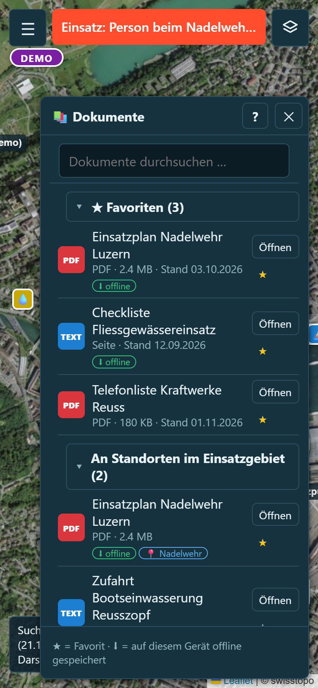
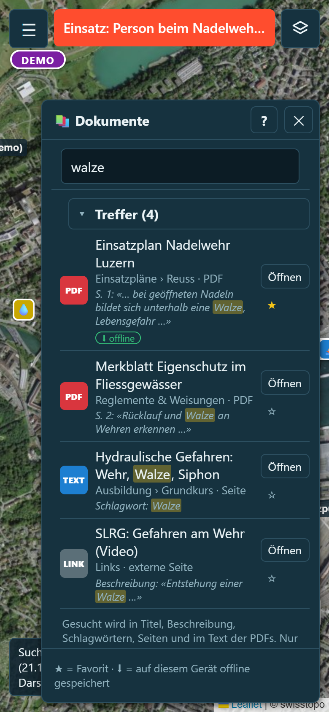
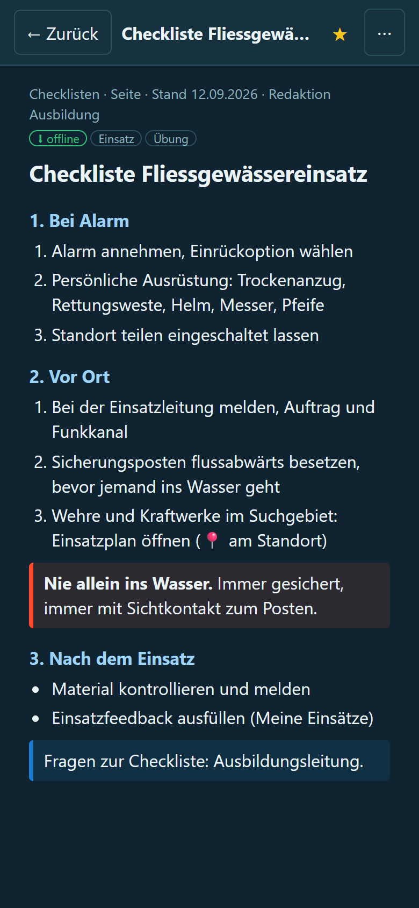
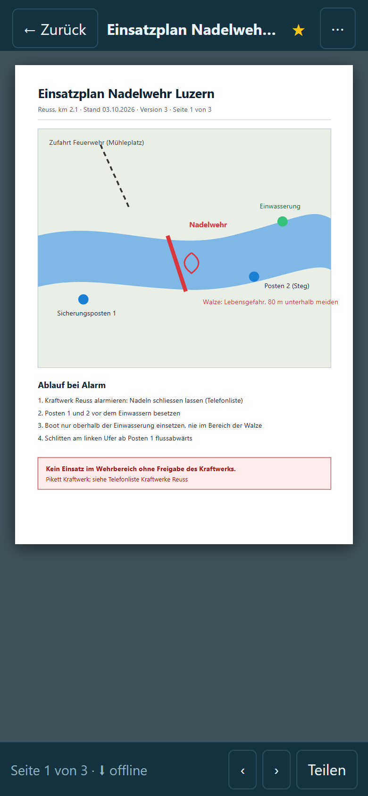
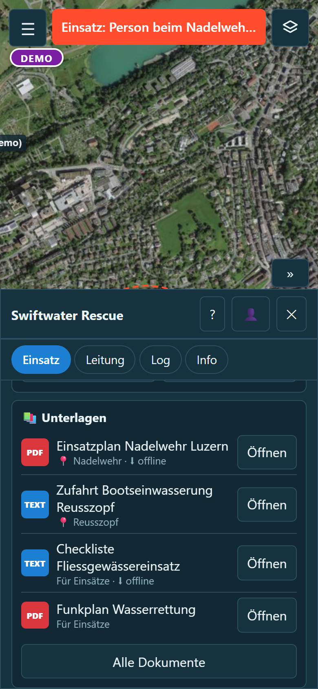
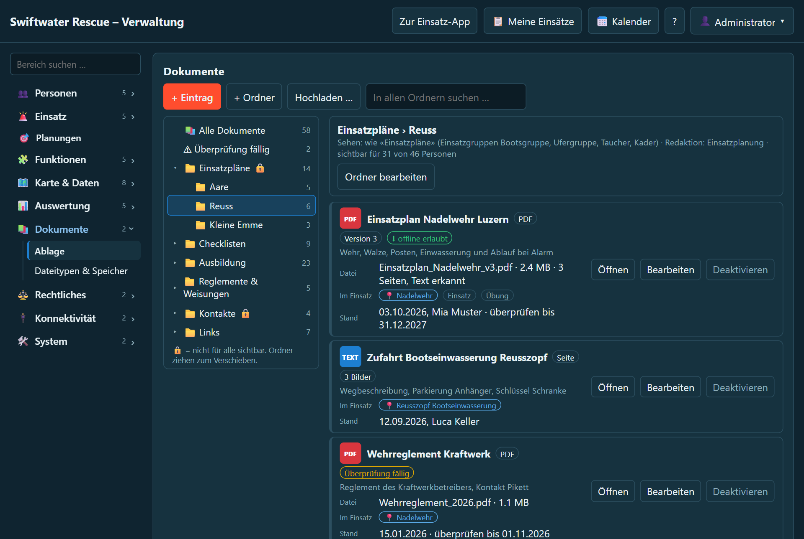
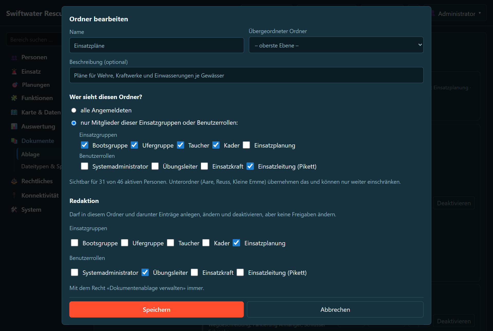
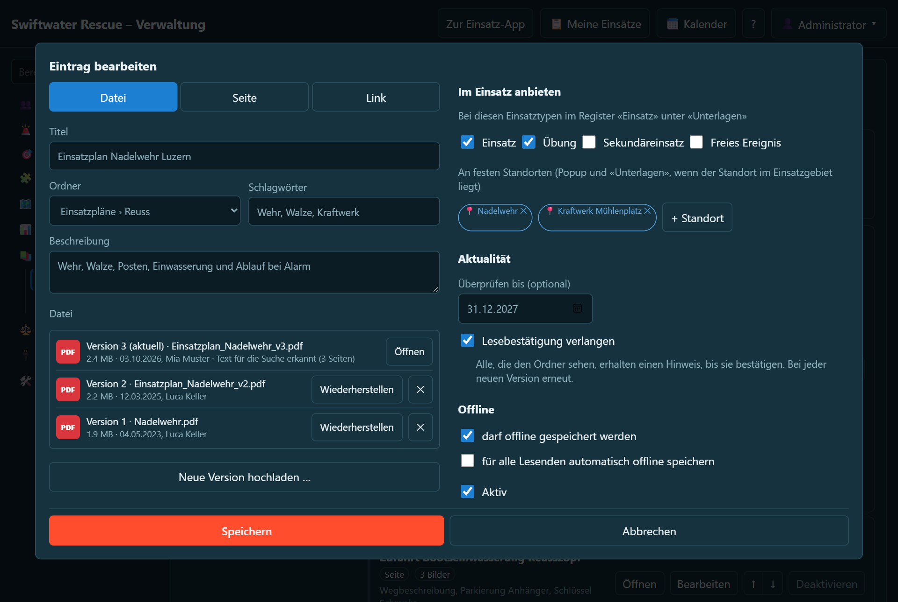
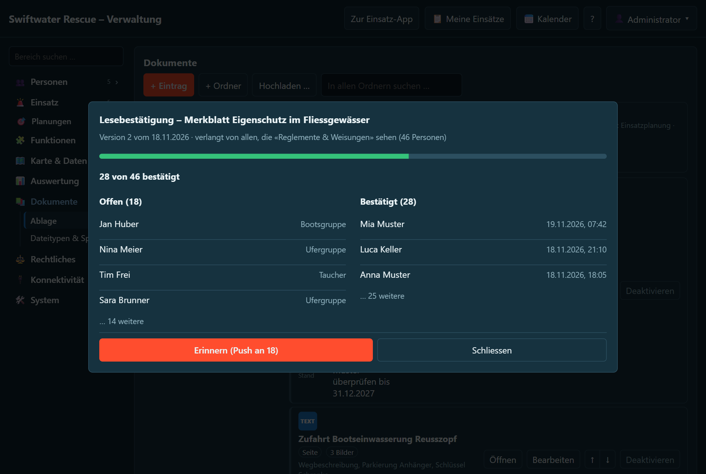

# Konzept: Dokumentenablage / Wissensdatenbank (Issue #229)

Version 2 vom 21.11.2026. Grundlage: Issue #229 und die Antworten des Auftraggebers auf Version 1.
Das ist ein Konzept, noch kein Code. Die Bilder sind Mockups: die echte App (Demo-Modus bzw. Verwaltung mit Beispieldaten), die neuen Teile eingesetzt.

**Entscheide des Auftraggebers**
- «Berechtigungsgruppe» = **Benutzerrolle** (`uroles`). Freigaben also über Einsatzgruppen und Benutzerrollen, keine dritte Art von Gruppen.
- **Redaktion je Ordner**.
- **Dateitypen vorgegeben und einstellbar**, dazu **freie Endungen** erlaubt.
- **Keine Stufen**: alles wird in einem Schritt umgesetzt (Ablage, Freigaben, Standorte, Einsatztypen, Offline, Suche im PDF-Text, Versionen, Überprüfung, Lesebestätigung, Web und nativ).

## Ziel
Eine **Ablage je Organisation** (= je Server) für Unterlagen, die man im Einsatz, in der Übung und in der Ausbildung schnell braucht: Einsatzpläne für Wehre und Kraftwerke, Checklisten, Merkblätter, Ausbildungsunterlagen, Kontaktlisten, Reglemente. Erreichbar aus **allen Systemen**: Einsatz-App (Web/PWA), native App (Android/iOS), Verwaltung. Was jemand sieht, wird je **Einsatzgruppe** und je **Benutzerrolle** freigegeben.

## Begriffe
- **Ordner**: Baum mit beliebiger Tiefe (z. B. «Einsatzpläne › Reuss»). Freigaben und Redaktion hängen am Ordner.
- **Eintrag**, drei Arten:
  - **Datei** mit Versionen (PDF, Bilder, Office, Text, Karten … gemäss Einstellung).
  - **Seite**: Text direkt in der App, Markdown mit dem Renderer der Bedienungsanleitung (`md()` aus `hilfe.html`, Bilder eingebettet). Für Checklisten, die man am Handy lesen muss, ohne ein PDF zu öffnen.
  - **Link** auf eine externe Seite.
- Jeder Eintrag: Titel, Beschreibung, Schlagwörter, Stand, optional «überprüfen bis», Einsatztypen, feste Standorte, Lesebestätigung, Offline.

## Einsatz-App (Web und nativ)

### Fenster «Dokumente»
Neuer Kartenknopf **«Dokumente»** (Seitenfenster `panel` `'doc'`, gleicher Aufbau wie «Markierungen», Gruppen einklappbar). Zuoberst die Suche, darunter:
- **★ Favoriten** (pro Person angeheftet, Stern je Eintrag),
- **An Standorten im Einsatzgebiet**: Einträge an festen Standorten, die im Einsatzgebiet liegen (`areaIn` wie im Fenster «Markierungen»),
- **Für diesen Einsatz**: Einträge, die dem Einsatztyp zugeordnet sind,
- **Ordner** (nur sichtbare, 🔒 = eingeschränkt).

«⬇ offline» zeigt, was auf dem Gerät gespeichert ist. Ohne Einsatz steht der Knopf ebenfalls zur Verfügung (Favoriten und Ordner).

 

Die **Suche** findet Titel, Beschreibung, Schlagwörter, Text der Seiten und **Text der PDFs** (beim Hochladen im Browser mit pdf.js ausgelesen), mit Fundstelle und Seitenzahl. Nur, was die Person sehen darf.

### Feste Standorte
Ein Eintrag kann an feste Standorte gehängt werden (`place_docs`). Im Popup des Standorts erscheinen die Dokumente: Man tippt auf das Wehr und hat den Einsatzplan. Das gilt auch für Standorte einer vorbereiteten Übung (Kopieren übernimmt die Verknüpfung) und nativ im Info-Blatt des Standorts.

Im Bild der Stützpunkt des Demo-Modus mit zwei Dokumenten.

### Ansehen
- **Seiten** direkt gerendert, mit Hinweis- und Warnblöcken wie in der Bedienungsanleitung. Bei verlangter Lesebestätigung unten «Gelesen und verstanden».
- **PDF und Bilder** in einer Vollbild-Ansicht in der App (Web: pdf.js, nativ: eigener Viewer), blättern, zoomen, «Teilen» bzw. «Herunterladen». Funktioniert offline, wenn gespeichert.
- **Übrige Dateien** (Office, freie Endungen) werden heruntergeladen bzw. über das System geöffnet/geteilt (`saveBlob`, nativ share_plus).

 

### Menü
- **Im Einsatz**: Karte **«📚 Unterlagen»** im Register «Einsatz» mit den Einträgen an Standorten im Einsatzgebiet und für den Einsatztyp, «Alle Dokumente» öffnet das Fenster.
- **Ohne Einsatz**: Karte **«📚 Dokumente»** mit Suche, offenen **Lesebestätigungen** und Favoriten.

 

### Offline
Favoriten lassen sich **offline speichern** (je Eintrag erlaubt oder von der Redaktion für alle vorgegeben). Web/PWA: eigener Zwischenspeicher `docs` im Service Worker (`sw.js`), nach Version; nativ: Kopie im App-Speicher je Konto, nachgeführt beim Start und nach `pollAll`, wenn sich die Version ändert. Höchstgrösse je Gerät einstellbar. Entzieht man die Freigabe oder deaktiviert den Eintrag, löscht das Gerät die Kopie bei der nächsten Verbindung.

## Verwaltung

### Ablage
Neue Kategorie **«Dokumente»** in `NAV` mit den Bereichen **«Ablage»** (`#dokumente`) und **«Dateitypen & Speicher»** (`#dokumente-einstellungen`). Links der Ordnerbaum (mit «Alle Dokumente», «Überprüfung fällig», Ordner ziehen zum Verschieben), rechts Angaben zum Ordner (wer sieht ihn, wer pflegt ihn) und die Einträge als Karten `ent()` mit Chips (Art, Version, offline, Überprüfung fällig, Standorte, Lesebestätigung), Deaktivierte in `offGrp`. Hochladen per Knopf oder Ziehen, mehrere Dateien auf einmal.

Sichtbar mit dem Recht **`docs`** «Dokumentenablage verwalten» oder als **Redaktion** mindestens eines Ordners (dann nur diese Ordner).

### Ordner und Freigaben
- **Lesen** je Ordner: «alle Angemeldeten» oder Einsatzgruppen **oder** Benutzerrollen (es genügt eine davon). Ein Unterordner übernimmt die Freigabe und kann **nur weiter einschränken**: sichtbar ist ein Ordner, wenn die Person die Freigaben aller übergeordneten Ordner erfüllt. Der Dialog zeigt, wie viele aktive Personen ihn sehen.
- **Redaktion** je Ordner (Einsatzgruppen/Benutzerrollen): Einträge anlegen, ändern, neue Versionen, deaktivieren, in diesem Ordner und darunter. Keine Freigaben ändern, keine Ordner anlegen oder verschieben.
- Mit dem Recht `docs`: alles. Schutz vor Ausweitung wie bei den Rollen: nur Gruppen/Rollen wählbar, die man selbst vergeben darf.

### Eintrag
Art (Datei/Seite/Link), Titel, Ordner, Schlagwörter, Beschreibung; bei Dateien die **Versionen** (wiederherstellen, entfernen, «Text für die Suche erkannt»). Rechts: **Einsatztypen** («Für diesen Einsatz»), **feste Standorte**, **«Überprüfen bis»**, **Lesebestätigung**, **Offline**, Aktiv. Seiten werden im selben Dialog mit Vorschau bearbeitet (Bilder einfügen wie im AAR).

### Lesebestätigung
Ein Eintrag kann eine Lesebestätigung verlangen (z. B. neues Merkblatt). Alle, die ihn sehen, erhalten einen Hinweis im Menü (und einmal einen Push, Stufe normal), bis sie bestätigen; jede neue Version verlangt sie neu. Die Verwaltung sieht, wer bestätigt hat, kann erinnern (Push an die Offenen) und als CSV exportieren.

### Dateitypen und Speicher
- **Katalog** fester Typen, je ein-/ausschaltbar (Vorgabe: PDF, Bilder, Word, Excel, PowerPoint, Text, Karten/Routen an; Audio, Video, Archive aus). PDF, Bilder und Text werden in der App angezeigt, Audio/Video abgespielt, der Rest heruntergeladen.
- **Freie Endungen** (Feld, mit Komma getrennt, z. B. `dwg, ifc`): erlaubt, aber **nie in der App angezeigt**, immer nur als Download (`Content-Disposition: attachment`, `X-Content-Type-Options: nosniff`, Typ `application/octet-stream`).
- **Nie erlaubt**, auch nicht als freie Endung: ausführbare und aktive Dateien (`.exe .bat .cmd .com .msi .ps1 .sh .js .mjs .html .htm .xhtml .svg .php .phtml .jar .apk .app .dmg .vbs .scr .lnk .hta` …). Liste fest im Server.
- Der Server prüft den **Inhalt** (Signatur, `finfo`), nicht nur die Endung; eine PDF muss eine PDF sein. Office-Dateien mit Makros (`.docm`, `.xlsm`) nur, wenn ausdrücklich als freie Endung eingetragen.
- **Höchstgrösse je Datei** (Standard 25 MB), **Speicher insgesamt** (Standard 5 GB, mit Belegung), **frühere Versionen behalten** (Standard 5), **offline je Gerät** (Standard 300 MB).

## Server (`api/index.php`)

**Tabellen**
- `doc_folders`: `parent_id`, `name`, `descr`, `sort`, `active`, `read_grp`/`read_role` (JSON, NULL = alle Angemeldeten), `edit_grp`/`edit_role`.
- `docs`: `folder_id`, `kind` file|page|link, `title`, `descr`, `tags`, `body` (Markdown), `url`, `kinds` (JSON Einsatztypen), `review_at`, `ack` (Lesebestätigung), `ack_ver`, `offline` (0 nein, 1 erlaubt, 2 automatisch), `search` (Text für die Suche, inkl. PDF-Text), `sort`, `active`, `created_*`, `updated_*`.
- `doc_files`: `doc_id`, `ver`, `name`, `ext`, `mime`, `bytes`, `pages`, `sha256`, `file`, `at`, `by`.
- `doc_imgs`: Bilder in Seiten (wie `aar_img`).
- `doc_user`: `user_id`, `doc_id`, `fav`, `ack_at`, `ack_ver`.
- `place_docs`: `place_id`, `doc_id`.

**Dateien** in `api/data/docs/<Eintrag>/<Version>.<ext>` (über `.htaccess` gesperrt, nie direkt ausgeliefert). Abruf nur über `doc/get` mit Rechteprüfung, `ETag` = sha256, `Range` für grosse PDFs. Hochladen in Stücken wie `aar/arch/put` (je Stück unter dem PHP-Limit von cyon), Abschluss mit sha256- und Inhaltsprüfung, Prüfung von Höchstgrösse und Speicher vor dem ersten Stück.

**Rechteprüfung** `docSee($folder)`: Systemadministrator und `docs` immer; sonst alle Ordner bis zur Wurzel erfüllt (`userGrps`, `userRoles`). `docEdit($folder)`: `docs` oder Redaktion dieses oder eines übergeordneten Ordners.

**Routen**: `docs` (sichtbarer Baum mit Einträgen; `q` Suche, `folder`), `doc` (ein Eintrag mit Versionen), `doc/get` (Datei, kein JSON), `doc/save`, `doc/move`, `doc/remove`, `doc/upload/put|done`, `doc/ver/remove|restore`, `doc/img/add|remove`, `doc/folder/save|move|remove`, `doc/fav`, `doc/ack`, `doc/acks` (Stand der Bestätigungen), `doc/remind`, `docs/cfg`, `docs/cfg/save`.

`incident/state` liefert `docs_inc` (für den Einsatztyp, sichtbar) und je festem Standort `docs` (Kurzangaben); `me` liefert `docs` (`on`, Favoriten, offene Lesebestätigungen, Offline-Liste mit Version) und `docs_cfg` (Typen, Höchstgrössen).

**Funktion** `docs` in `FEATURES` (je Einsatztyp): betrifft nur Kartenknopf, Karte «Unterlagen» und Popups im Einsatz; die Ablage selbst bleibt erreichbar.

**Einstellung** `docs` (Recht `docs`): `types` (Katalog an/aus), `free` (Endungen), `max_mb`, `quota_mb`, `keep`, `off_mb`.

## Zu beachten (Projektregeln)
- `PERMS`/`ADMIN_PERMS`: Recht `docs`; `NAV`/`NAV_PERM` (Liste mit Redaktion), `SETTING_PERMS`.
- `DSAR_TABLES` (neue Tabellen), `dsarUser` (Favoriten, Bestätigungen, erstellte Einträge), `dsar/file` mit `kind` `doc` für den Export der Organisation.
- `PURGE_KINDS`: Eintrag und Ordner endgültig löschen (mit Dateien); `user/delete` löscht `doc_user`.
- `APPLOG_ROUTES` (Hochladen, Entfernen, Freigaben geändert; ohne Inhalte), abgelehnte Dateien als Warnung.
- `legal.html`: gespeicherte Dokumente, pdf.js als Bibliothek, Lesebestätigungen als Personendaten.
- Demo: zwei feste Beispieldokumente (eine Seite, ein Link), Routen in `demo.js` und `demo.dart`.
- Bedienungsanleitung: `karte/dokumente`, `verwaltung/dokumente`, `verwaltung/dokumente-einstellungen`; `docs/REQUIREMENTS.md` neuer Bereich **DO**.
- `sw.js`: Zwischenspeicher `docs`, nie für `doc/get` ohne Offline-Wahl.
- Öffentliche Ansicht, Gastseite Funk und Replay: keine Dokumente.

## Offene Fragen
1. Ist die **Verknüpfung mit festen Standorten** (Einsatzplan am Wehr) der wichtigste Anwendungsfall? Dann teste ich diesen Ablauf zuerst und am gründlichsten.
2. Soll die **Lesebestätigung** mit der Ausbildungskontrolle (#117) zusammenhängen (z. B. Bestätigung = Eintrag einer Fähigkeit)?
3. **Externe** (Gastlinks wie beim Funk) sehen keine Dokumente – richtig?
4. Sollen Personen ohne Redaktion selbst etwas **vorschlagen/hochladen** können (Eingang, den die Redaktion freigibt)?
