# Konzept: Fliessgeschwindigkeit an den Stationen vorhersagen (Issue #254)

Version 3 vom 22.11.2026. Grundlage: Issue #254, Daten der BAFU-Datenplattform und von hydrodaten.admin.ch (abgefragt am 22.11.2026) und die Antworten des Auftraggebers auf Version 1.
Das ist ein Konzept, noch kein Code. Die Bilder sind Mockups: die echte App (Demo-Modus bzw. Verwaltung) mit den neuen Teilen eingesetzt. Neues ist im Bild gelb gestrichelt umrandet oder mit «Entwurf Issue #254» markiert. Diagramme, Querprofil und Kennlinien von Brugg und Murgenthal sind aus echten Daten gerechnet; die Werte der Abschnitte, der Wigger und der übrigen Stationen im Fenster «Messstationen» sind Beispielwerte.

**Entscheide des Auftraggebers**
- **Kantonale Stationen** kommen dazu (zuerst Hydrometrie Aargau für die Zuflüsse).
- Die Vorhersage wird **angezeigt** und **meldet relevante Veränderungen**. Sie ändert weder die Fliessgeschwindigkeit noch das Suchgebiet selbst.

## Ziel
Für die Station Brugg und für jeden Punkt am Fluss (PLS, Abschnitt dazwischen) zeigt die App:
1. die **aktuelle Fliessgeschwindigkeit**: mittlere Geschwindigkeit, Oberfläche, Spanne für die Drift,
2. die **Vorhersage** für die nächsten Stunden bis Tage,
3. **Unterschiede je Abschnitt**: Stau, Schwellen, Engstelle, frei, Kanal, Restwasser.

## Datenquellen
- **BAFU-Datenplattform** `https://data.bafu.admin.ch/api` (GraphQL):
  - Zugang ohne Schlüssel, CORS erlaubt, höchstens 10 000 Zeilen je Abfrage, 500 Anfragen je 5 min und IP. Lizenz «Freie Nutzung. Quellenangabe ist Pflicht.»
  - `water.observations`: Stationen, Messreihen (10 min bis Jahr, `Q`, `W`, `WT`, `releaseState`), `data_live`.
  - `water.river_profile` (Flussvermessung): Querprofile, Längenprofil, Wehre/Schwellen/Brücken, Versicherungspunkte; Pflichtfilter `gwlNo` (Aare `CH0000370000`), Ort `gewissAddress` ≈ Meter ab Mündung.
  - Die Testumgebung (`api.data-platform-stg…`) verlangt einen API-Schlüssel.
- **BAFU-Vorhersage** (hydrodaten.admin.ch, `/plots/q_forecast/<Station>_q_forecast_de.json`): Ensemble mit Median, 25.–75. Perzentil und Min./Max., stündlich, ca. 5 Tage, für 54 Stationen (`web-hydro-maps/hydro_sensor_pq_forecast.geojson`). Kein zugesichertes Format, deshalb mit Rückfall.
- **Kanton Aargau, Hydrometrie**: Zuflüsse unterhalb der Bundesstationen (Suhre, Wyna, Bünz, Aabach …). Format und Zugang noch zu klären.
- **Eigene Daten**: `sw_waterways`/`sw_features` für Distanzen, Kanäle und Kraftwerke.

## Aare – Brugg in Zahlen
- **Stationskette**:
  - Murgenthal (2063, GEWISS 67 885) liegt rund 49 km oberhalb.
  - Dazu die Zuflüsse Murg (2471), Wigger (2450) und Dünnern (2434).
  - Ziel ist Brugg (2016, GEWISS 19 116).
  - Mittel 2025–26: Brugg 241 m³/s, Murgenthal 223 m³/s. Die Bundesstationen der Zuflüsse decken etwa die Hälfte der Differenz.
- **Geschwindigkeit an der Station** (Querprofile GEWISS 19116 und 19240, Mai 2023, und 16 580 Stundenwerte):
  - Formel: v̄ = 0.137 · Q^0.41.
  - Beispiele: 150 m³/s → 1.06 m/s, 500 m³/s → 1.72 m/s, 800 m³/s → 2.08 m/s.
  - Drift = 0.8–1.0 × v̄ / 0.85.
- **Murgenthal**: Querprofil GEWISS 67 885 (Aug. 2019, 2 m von der Station), v̄ = 0.063 · Q^0.55.
- **Laufzeit der Welle** Murgenthal → Brugg 3 h, bei 350–600 m³/s 4 h.
- **Güte**: Bei Ereignissen halbiert die Station oberhalb den Fehler. Nach 3 h liegt er bei 14 statt 27 m³/s.
- **Abschnitte** aus der Flussvermessung: Blockrampen/Schwellen bei GEWISS 24 330, 22 820 und 19 560 (450 m oberhalb der Station), Engstelle bei Brugg (Sohlenbreite um 50 m statt 70–120 m).

## Einbau in die Einsatz-App

### Menü, Karte «Fliessgeschwindigkeit & Suchgebiet»
Die bestehende Karte im Register «Einsatz» erhält unter dem Eingabefeld drei Teile:

1. **Hinweis bei relevanter Veränderung** (gelb), solange eine Meldung offen ist.
2. **Vorschlag**:
   - Spanne jetzt in m/s und km/h, mit Abfluss.
   - Knopf **«Übernehmen»**: setzt die Mitte der Spanne wie `incident/flow`; der Log-Eintrag nennt die Herkunft.
   - Diagramm: gemessen −12 h, Vorhersage bis +4 Tage, Band Min.–Max., eingestellter Wert gestrichelt.
   - Kurztabelle in 3 h / 12 h / 1 Tag / 2 Tagen; gelb, wenn die Schwelle überschritten ist.
   - Quelle und Stand.
3. **Abschnitte bis Ende Suchgebiet**: je Abschnitt Art, Länge, Treibzeit und Geschwindigkeit.

Nur sichtbar mit Recht «Fliessgeschwindigkeit setzen» (`can_flow`) und Funktion `hydro`.

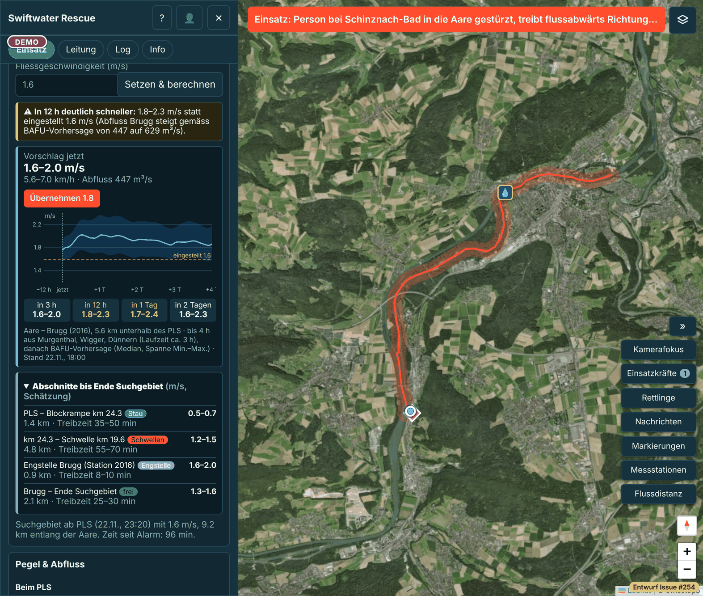

### Karte
- **Abschnitte** auf dem Gewässer, farbig nach Art mit Geschwindigkeit: neue Kategorie `flow` in `VIEW`, im Fenster «Ansicht» ein- und ausblendbar, Standard aus.
- **Messstation** 💧 wie bisher.
- Die **Meldung** einer relevanten Veränderung erscheint wie eine Nachricht (`notify`, Stufe `msg_lvl` des Einsatztyps, Schlüssel `h:<Einsatz>:<Art>`). Antippen öffnet das Menü bei der Karte «Fliessgeschwindigkeit».

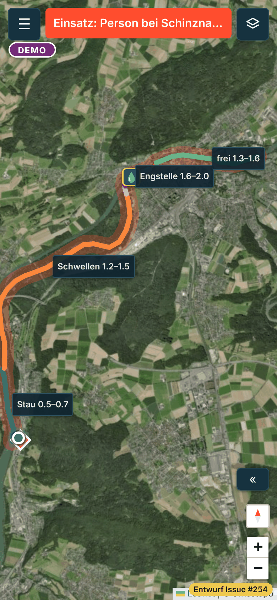 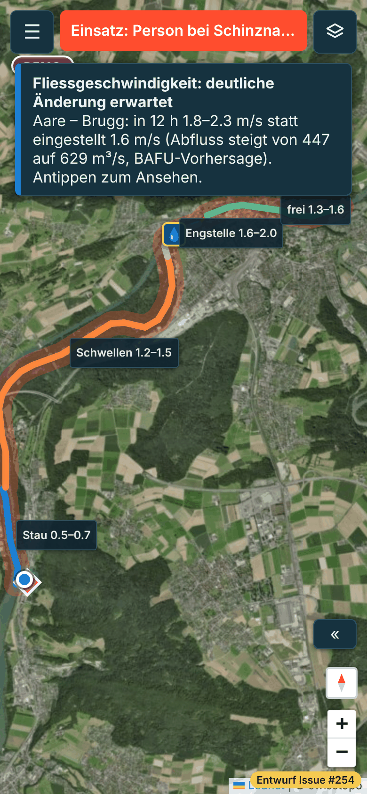

### Popup der Messstation und Fenster «Messstationen»
- **Popup** (`hyPop`):
  - Fliessgeschwindigkeit an der Station (Spanne) mit Mittelwert und Herkunft (Querprofil, Jahr).
  - Diagramm mit Vorhersage.
  - «Als Fliessgeschwindigkeit übernehmen»: nur mit `can_flow`, nur für Stationen am Gewässer des PLS.
- **Seitenfenster «Messstationen»** (`hyList`): je Station eine Zeile 🌊 mit Spanne und Trend. Bei Stationen oberhalb steht, wann die Welle die nächste Station erreicht. Ohne Querprofil gibt es keine Geschwindigkeit.

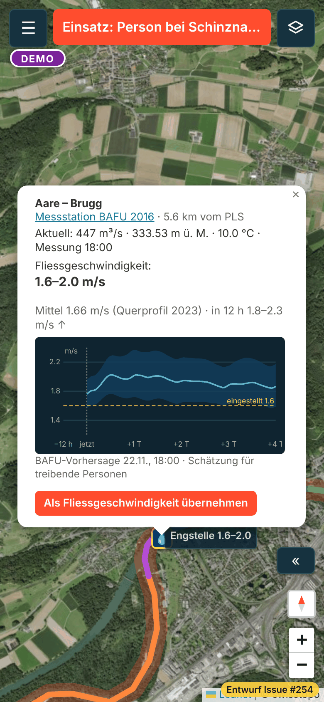 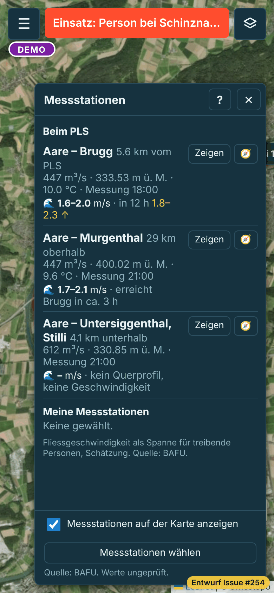

### Einsatzlog und Flussdistanz
- **Log**: Eintrag `hydro` ohne Person bei jeder Meldung (Vorhersage, Station, Werte, eingestellter Wert). Er erscheint auch im Replay und im After Action Review.
- **Flussdistanz** (`rdBox`): Neben der Treibzeit mit einer Geschwindigkeit zeigt das Werkzeug die **Treibzeit nach Abschnitten** (Spanne aus der Vorhersage) und die Aufteilung je Abschnitt; dazu wie bisher «Weg passiert».

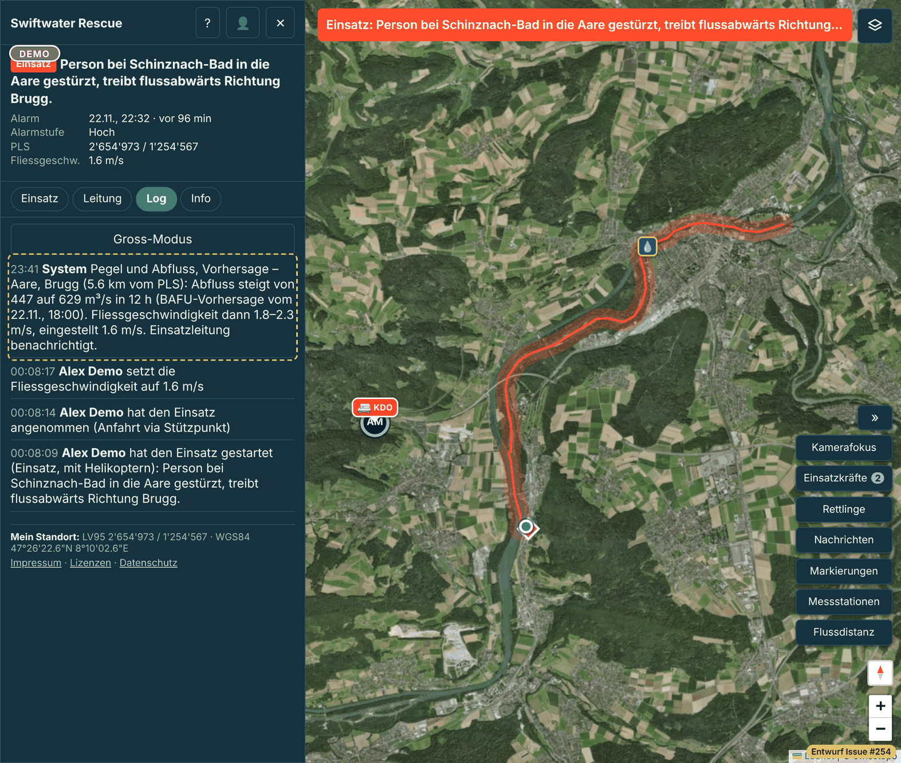

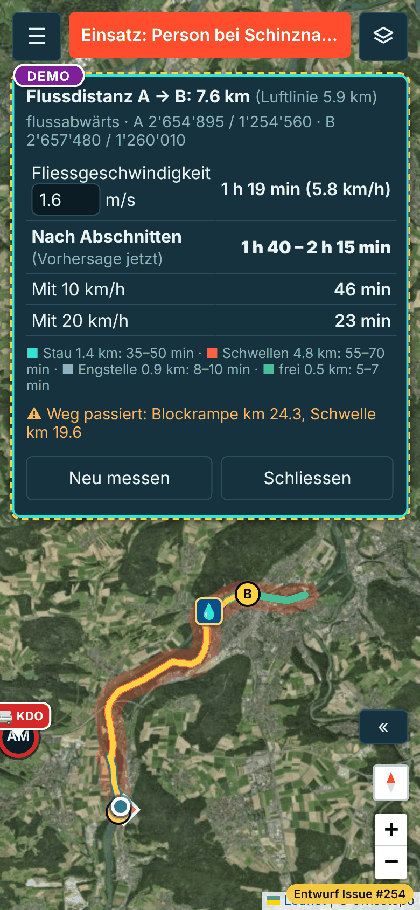

### Native App
- Gleiche Teile in Flutter: Karte im Menü `inc/menu.dart`, Popup und Fenster in `inc/hydro.dart`, Abschnitte als `PolylineLayer` in `inc/map_page.dart`, Flussdistanz `inc/rd.dart`.
- Meldung über `showNote` (Schlüssel `h:`), Überwachung `monitor.dart` wie Nachrichten.
- Demo: feste Werte in `demo.js`/`demo.dart`.

## Einbau in die Verwaltung (Karte & Daten → «Pegel & Abfluss»)
- **Datenquellen** 3–5 neu, gleich aufgebaut wie die bisherigen (Schalter, Lizenz, Hinweis, Stand, «Testen»): BAFU-Datenplattform, BAFU-Hochwasservorhersage, Kanton Aargau.

  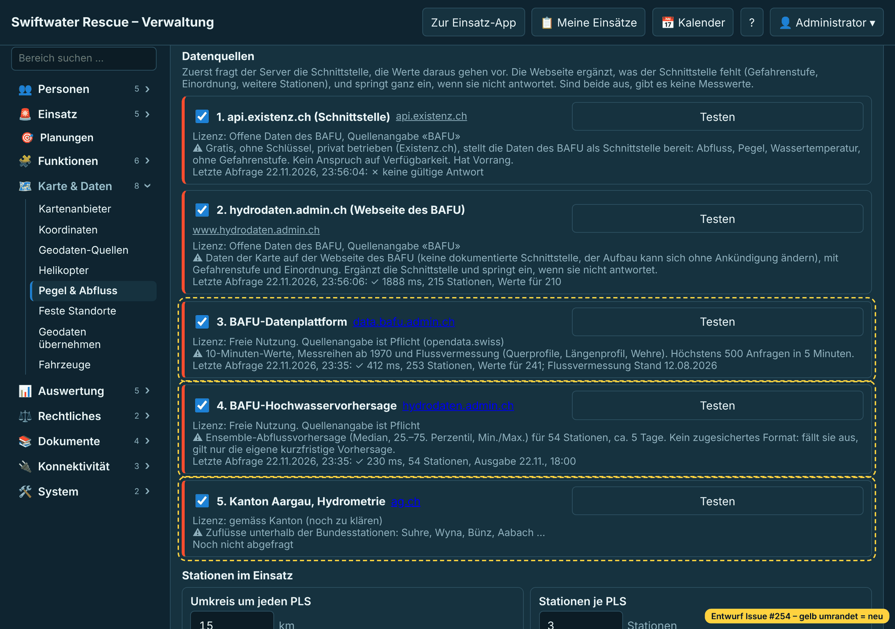
- **Fliessgeschwindigkeit an den Stationen**:
  - Liste mit `ent()`: Station, Herkunft (Querprofil bzw. Schätzung), Kennlinie, jetzt, Drift, Stationen oberhalb mit Laufzeit, Güte.
  - «Kennlinie» öffnet den Dialog mit Querprofil, Wasserspiegeln, Punkten und Formel; die Kennlinie lässt sich von Hand festlegen.

  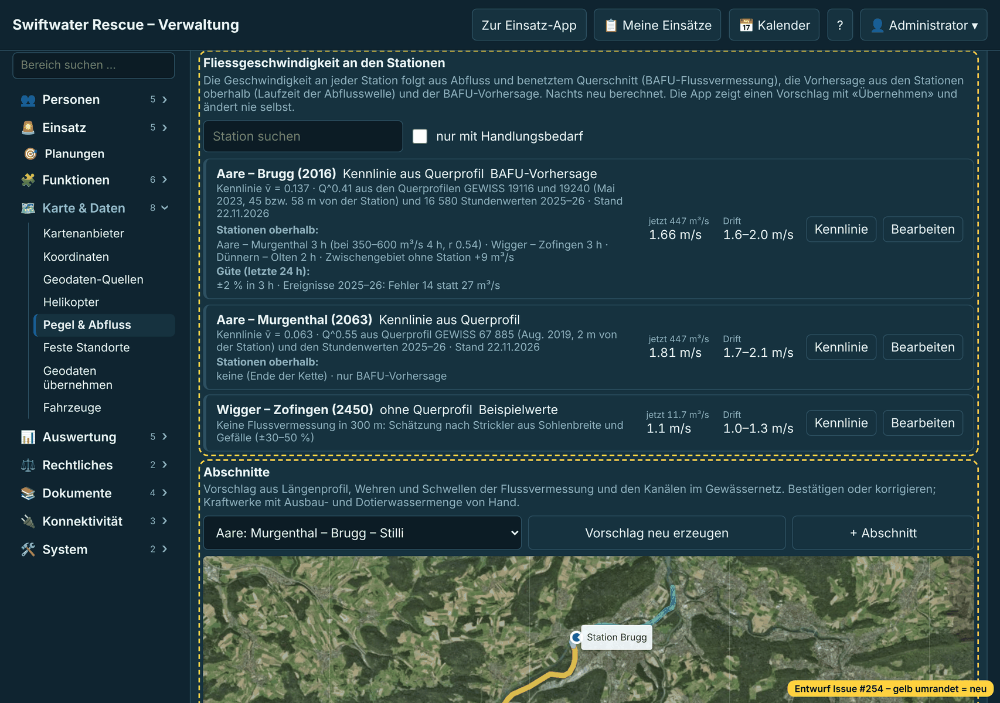
  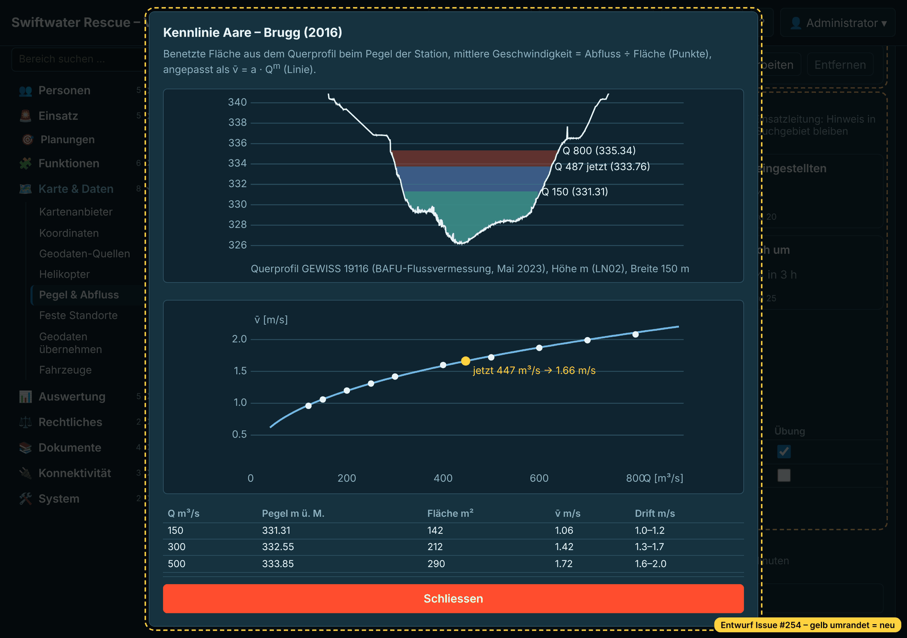
- **Abschnitte**:
  - Vorschlag aus Längenprofil, Wehren/Schwellen und Kanälen.
  - Karte der Abschnitte, Liste mit Art, Länge, Breite, Gefälle, Berechnung und Herkunft.
  - Bearbeiten (Kraftwerk mit Ausbau- und Dotierwassermenge) und Entfernen.

  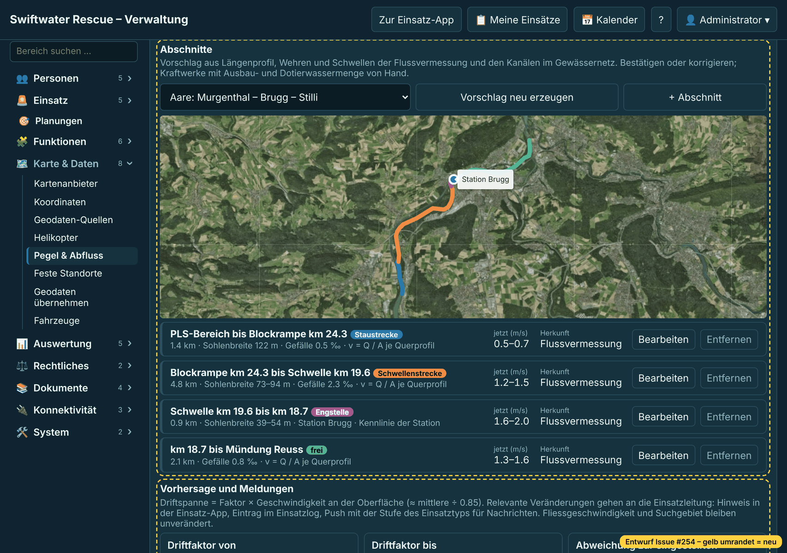
- **Vorhersage und Meldungen**:
  - Driftfaktoren.
  - Schwellen der Meldung: Abweichung %, mindestens km/h, Horizont, Änderung des Abflusses.
  - Gefahrenstufe und neue BAFU-Vorhersage.
  - Auch Teilnehmenden ohne Leitungsrechte melden.
  - Je Einsatztyp «Vorhersage anzeigen» und «Relevante Veränderungen melden».
  - Gespeichert in der Einstellung `hydro` (Recht `cfg_map`), je Typ in `kinds`.

  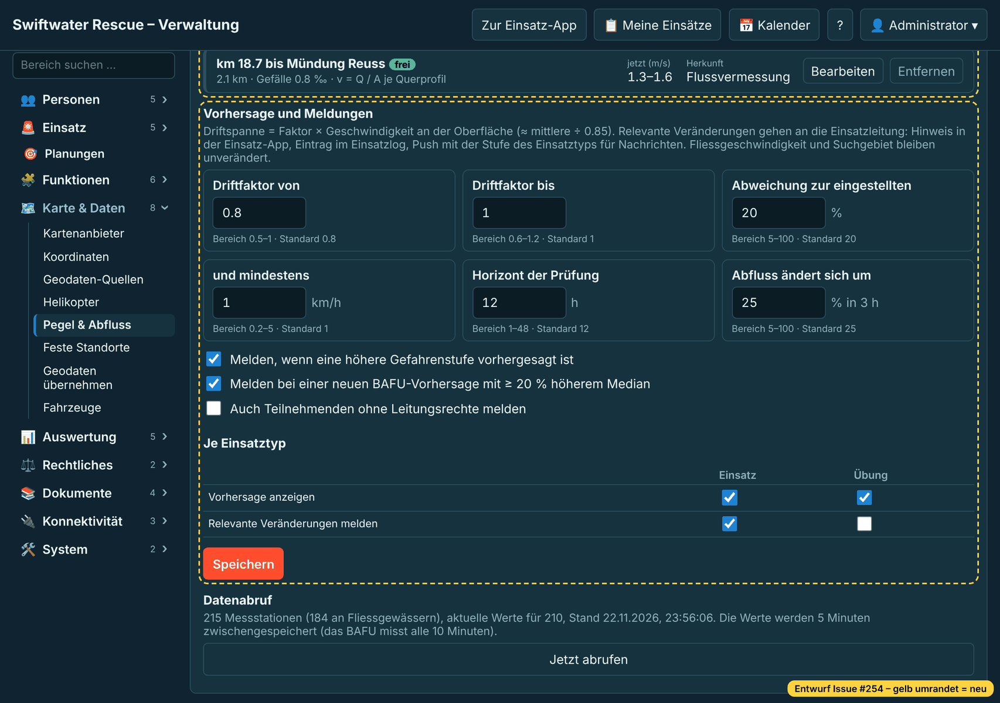

## Server
- **Neue Quellen** in `HYDRO_SOURCES`:
  - `bafu`: GraphQL, Stationen und 10-min-Werte, nachts Stundenreihen und Flussvermessung.
  - `fc`: BAFU-Vorhersage.
  - `kt_ag`: Kanton Aargau.
- **Tabellen**:
  - `hydro_curve`: Station, Profil-IDs, `a`, `m`, Güte, Stand, `manual`.
  - `hydro_lag`: Station oben → unten, Abflussklasse, Laufzeit, Güte.
  - `hydro_reach`: Abschnitt mit `gwl`, `from`/`to`, Weg-IDs, `kind`, `len_m`, `width`, `slope`, Parameter, `q_design`/`q_rest`, `src`, Stand.
  - `hydro_note`: gemeldete Veränderungen je Einsatz und Art, Sperre eine Stunde.
- **Routen**:
  - `hydro/predict` (Funktion `hydro`): Vorschlag, Vorhersage und Abschnitte zu einem Punkt.
  - `hydro/curves`, `hydro/curve/save|calc`.
  - `hydro/reaches`, `hydro/reach/save|remove|propose` (Recht `cfg_map`).
  - `incident/state` liefert `flow_pred` je PLS.
- **Meldungen** im Nachlauf von `incident/state` (wie `hydroLog`), höchstens alle 5 min je Einsatz: Push an `canManage` (bzw. alle Teilnehmenden, falls eingestellt) und Log `hydro`.
- **Übernehmen** über das bestehende `incident/flow` mit `src` (`pred` + Station), Log «übernimmt den Vorschlag …».
- **Nachführen**:
  - `FEATURES` bleibt (`hydro`).
  - Weiter: `DSAR_TABLES` (neue Tabellen), `PURGE_INC_TABLES` (`hydro_note`), `legal` (Quellen), Applikationslog (Quellen ohne Antwort), Hilfe (`einsatz`, `verwaltung/pegel`), `REQUIREMENTS.md`, i18n.

## Grenzen
- Die Geschwindigkeit des Wassers ist nicht die Drift einer Person. Deshalb gibt es immer eine Spanne mit dem Hinweis «Schätzung».
- Schwall und Sunk der Kraftwerke sind nicht vorhersehbar. Die Güte wird laufend gemessen und angezeigt.
- Das JSON der BAFU-Vorhersage ist kein zugesichertes Format. Rückfall: nur kurzfristig aus den Stationen oberhalb.
- Höhen: Profil LN02, Pegel m ü. M. Der Versatz ist vor der Umsetzung zu prüfen.
- Kanäle fehlen in der Flussvermessung. Sie kommen aus dem Gewässernetz, ihre Querschnitte von Hand.

## Offene Punkte
- Kanton Aargau: Zugang und Format der Echtzeitdaten.
- Ausbau- und Dotierwassermengen der Kraftwerke zwischen Murgenthal und Brugg.
