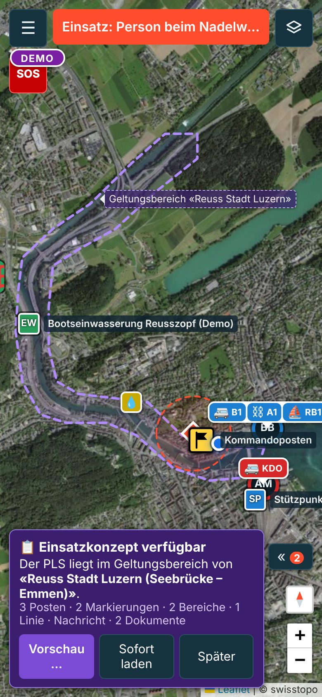
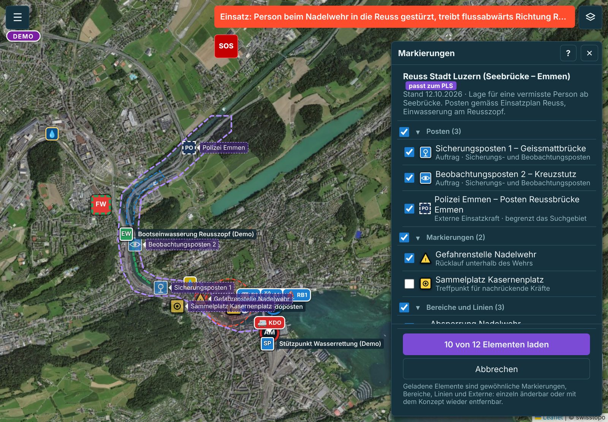
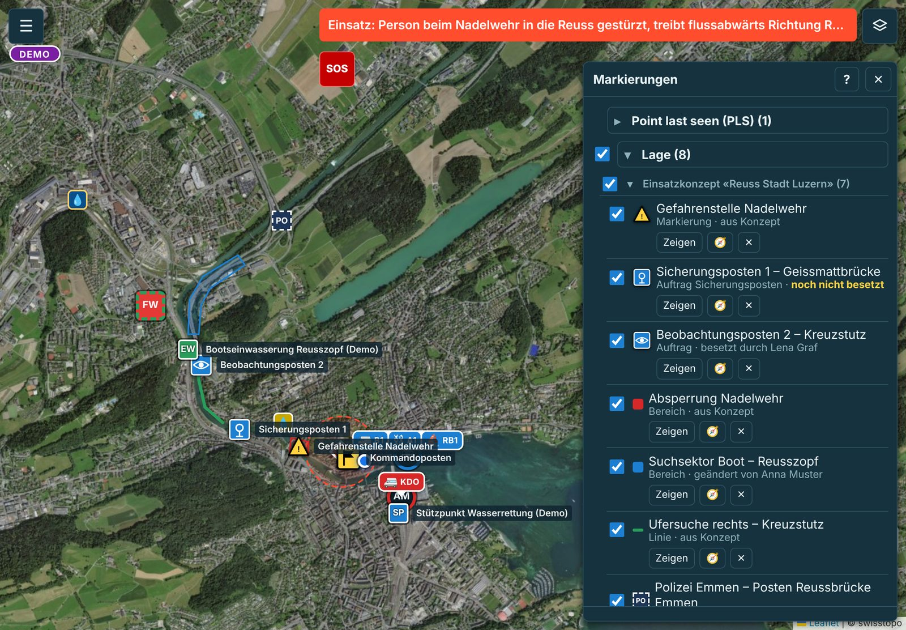

# Konzept: Vordefinierte Einsatzkonzepte (Issue #260)

Version 1 vom 27.11.2026. Grundlage: Issue #260 («Vordefinierte Einsatzkonzepte sollen geladen werden können. Manuelles Laden oder automatisch abhängig vom PLS»).
Das ist ein Konzept, noch kein Code. Die Bilder sind Mockups: die echte App (Demo-Modus, Szenario Reuss Luzern) bzw. die Verwaltung, die neuen Teile eingesetzt. Offene Fragen an den Auftraggeber stehen am Schluss.

## Ziel
Für bekannte Gewässerabschnitte gibt es heute Einsatzpläne auf Papier: Wo stehen die Sicherungsposten, wo wird eingewassert, welche Gefahrenstellen gibt es, welche Partner sperren welche Brücke. Im Einsatz zeichnet die Einsatzleitung das alles von Hand in die Karte. Ein **Einsatzkonzept** hält diese Lage vorbereitet fest. Die Einsatzleitung lädt es mit zwei Klicks, oder die App schlägt es vor bzw. lädt es selbst, sobald ein PLS im Abschnitt liegt.

## Begriffe
- **Einsatzkonzept**: vorbereitete Lage mit Bezeichnung, Beschreibung, Geltungsbereich, Einsatztypen und Elementen.
- **Geltungsbereich**, drei Arten:
  - **Bereich auf der Karte**: Polygon (wie feste Bereiche, 3–200 Eckpunkte).
  - **Entlang Gewässer**: von Punkt A bis Punkt B auf dem Gewässernetz. Der Browser rechnet beim Speichern daraus einen Korridor (Gewässer plus Ufer wie `BANK_M`, dazu einstellbarer Puffer) und speichert ihn als Polygon. So prüft der Server immer nur «Punkt im Polygon» und braucht kein Gewässernetz.
  - **Überall**: allgemeines Konzept ohne Ort; seine Elemente liegen **relativ zum PLS** (z. B. Beobachtungsposten 1 km und 3 km flussabwärts, Sammelplatz am PLS). Wird nur von Hand geladen.
- **Elemente**:
  - **Posten**: Markierung mit Symbol (z. B. Sicherungsposten) und einer Spezialrolle als Auftrag. In der Lage steht «noch nicht besetzt» bzw. «besetzt durch …», sobald eine Person mit dieser Rolle in der Nähe ist. Das Suchgebiet begrenzt wie heute erst die Person (Rolle mit `is_post`), nicht die leere Markierung.
  - **Markierung** (mit Einsatzsymbol), **Bereich**, **Linie**: wie in der Einsatz-App.
  - **Externe Einsatzkraft**: wie heute, optional aus einer Vorlage (`ext_templates`); begrenzt das Suchgebiet gemäss ihrer Spezialrolle.
  - **Nachricht**: wird beim Laden als Nachricht der ladenden Person an alle gesendet (z. B. «Posten gemäss Konzept beziehen»).
  - **Dokumente** aus der Ablage (#229): erscheinen im Fenster «Dokumente» unter «Für diesen Einsatz».
  - Je Element «beim Laden vorausgewählt» ja/nein.

## Einsatz-App (Web und nativ)

### Vorschlag beim PLS
Sobald ein PLS gesetzt oder verschoben wird (PLS des Einsatzes, PLS eines Rettlings, Start mit PLS, E-Mail-Alarm mit PLS, Freigabe eines PLS-Elements einer Übung), prüft der Server alle aktiven Konzepte des Einsatztyps. Liegt ein PLS im Geltungsbereich, gilt die Einstellung:
- **Aus**: nichts.
- **Nur von Hand**: das Konzept steht in der Karte «Einsatzkonzepte» zuoberst als «passt zum PLS», ohne Hinweis.
- **Vorschlagen**: die Einsatzleitung (`canManage`) sieht auf der Karte einen Hinweis mit «Vorschau …», «Sofort laden» und «Später»; der Geltungsbereich ist gestrichelt eingezeichnet. «Später» blendet den Hinweis für diesen Einsatz auf dem Gerät aus.
- **Automatisch laden**: der Server lädt alle vorausgewählten Elemente gleich mit (Log «System lädt das Einsatzkonzept …»). Die Einsatzleitung erhält einen Hinweis mit «Rückgängig».

Jedes Konzept wird je Einsatz höchstens einmal vorgeschlagen bzw. automatisch geladen. Mehrere passende (z. B. zwei Rettlinge in verschiedenen Abschnitten) erscheinen nebeneinander.

### Vorschau und Laden
«Vorschau …» zeigt die Elemente gestrichelt auf der Karte und daneben die Liste mit Häkchen, gruppiert nach Posten, Markierungen, Bereiche und Linien, Weiteres. Was schon im Einsatz steht (z. B. eine Flusssperre eines festen Standorts), ist ausgegraut. «N von M Elementen laden» übernimmt die angehakten.

Geladene Elemente sind **gewöhnliche** Markierungen, Bereiche, Linien und Externe des Einsatzes: alle sehen sie sofort, die Einsatzleitung ändert oder entfernt sie einzeln, sie stehen in Log, Replay und öffentlicher Ansicht wie von Hand gesetzte. Sie merken sich, aus welchem Konzept sie stammen. Im Fenster «Markierungen» stehen sie in der Lage als eigene Untergruppe «Einsatzkonzept «Name»» (ein-/ausblendbar und einklappbar wie die übrigen), mit «aus Konzept», «geändert von …» bzw. beim Posten «noch nicht besetzt» / «besetzt durch …».

### Register «Leitung»
Neue Karte **«Einsatzkonzepte»** zuoberst im Register «Leitung»:
- geladene Konzepte mit Zeitpunkt, Person bzw. «automatisch», Anzahl Elemente und Änderungen; «Zeigen», «Elemente …» (fehlende nachladen, z. B. den abgewählten Sammelplatz), «Entfernen» (entfernt die unveränderten Elemente; geänderte nur nach Rückfrage),
- **Anschlusskonzepte**: erreicht das berechnete Suchgebiet den Geltungsbereich eines weiteren Konzepts flussabwärts (oder nach Fliessgeschwindigkeit in Kürze), steht es hier mit «Vorschau …»; nie automatisch,
- «Anderes Konzept laden …»: Liste aller Konzepte des Einsatztyps, passende zuerst, mit Suche; allgemeine Konzepte («Überall») werden am PLS ausgerichtet.

### Ablauf auf dem Gerät
- Allgemeine Konzepte und Anschlusskonzepte brauchen das Gewässernetz. Das rechnet wie das Suchgebiet der Browser bzw. die App der ladenden Person (`riverFollow`) und schickt die fertigen Koordinaten. Ohne Gewässernetz: Luftlinie flussabwärts ist nicht bestimmbar, deshalb Hinweis und Punktwahl auf der Karte für jedes relative Element.
- Kein Element wird doppelt geladen: lädt man ein Konzept erneut, kommen nur fehlende bzw. entfernte Elemente dazu.

## Verwaltung
Neuer Bereich **Einsatz → «Einsatzkonzepte»** (`NAV` `konzepte`, Recht siehe unten):
- Karte **«Verhalten je Einsatztyp»**: je Typ, was bei einem PLS im Geltungsbereich geschieht (Aus, Nur von Hand, Vorschlagen, Automatisch laden) und ob Anschlusskonzepte vorgeschlagen werden. Ein Konzept kann es übersteuern.
- Liste mit `ent()`: Geltung, Elemente, Einsatztypen, wie oft und wann zuletzt geladen; «Karte», «Kopieren», «Bearbeiten», ↑/↓, «Deaktivieren»; Deaktivierte in `offGrp`.
- **«Aus Einsatz übernehmen …»**: Markierungen, Bereiche, Linien und Externe eines laufenden oder beendeten Einsatzes (bzw. einer vorbereiteten Übung) als neues Konzept, Geltungsbereich vorgeschlagen um alle Elemente. So entsteht ein Konzept aus einer gut gelungenen Übung.

**Bearbeiten** als breiter Dialog mit Karte (wie `placeDlg`, `addBases`): Bezeichnung, Beschreibung, Art des Geltungsbereichs, Verhalten, Einsatztypen, Anschlusskonzept, Elemente mit ↑/↓, «Bearbeiten», ✕ und «+ Posten / Markierung / Bereich / Linie / Externe / Nachricht / Dokument». Die Elemente setzt und verschiebt man auf der Karte, Eckpunkte des Geltungsbereichs ebenso. Feste Standorte stehen grau zur Orientierung auf der Karte.

## Server (`api/index.php`, eigene Datei `api/concepts.php` wie `docs.php`)
**Tabellen**
- `concepts`: `name`, `descr`, `scope` area|river|any, `area` (JSON-Polygon, bei `river` berechnet), `river` (JSON {a, b, buf}), `mode` NULL = wie Einsatztyp | hand | suggest | auto, `kinds` (JSON, NULL = alle), `next_id` (Anschlusskonzept), `sort`, `active`, `created_*`, `updated_*`.
- `concept_items`: `concept_id`, `kind` post|point|area|line|ext|msg|doc, `name`, `descr`, `color`, `sym`, `abbr`, `role_id`, `tpl_id`, `lat`/`lon`, `pts`, `rel` (JSON, nur bei `any`: Distanz entlang Gewässer in km, Seite, Versatz), `text`, `doc_ids`, `def_on`, `sort`.
- `inc_concepts`: `incident_id`, `concept_id`, `state` suggest|loaded|dismissed|removed, `auto`, `at`, `by`, `snap` (Stand des Konzepts beim Laden), `removed_at`/`removed_by`.
- Neue Spalten `pois.cc_id`/`cc_item`, `externals.cc_id`/`cc_item`, `messages.cc_id`; `inc_kinds.cc_mode`, `inc_kinds.cc_next`.

**Routen**: Verwaltung `concepts`, `concept/save|copy|move|remove`, `concept/from_incident`; Einsatz `incident/concepts` (passende und alle des Typs mit Elementen), `incident/concept/load` (`id`, `items`, bei relativen Elementen die berechneten Koordinaten), `incident/concept/remove` (`id`, `keep_changed`), `incident/concept/dismiss`. Geprüft wird in `conceptCheck($inc)` nach jeder Änderung eines PLS (`incident/pls`, `incident/rescuee/save` mit `pls`, `incident/start`, `mailStart`, `exRelease`), Punkt im Polygon für jede Quelle aus `plsSources()`. `incident/state` liefert `concepts` (geladene und vorgeschlagene, Vorschläge nur für `canManage`). Log-Einträge `cc` («lädt das Einsatzkonzept … (N Elemente)», «entfernt …»).

**Funktion und Recht**
- Funktion `cc` «Einsatzkonzepte» in `FEATURES` (je Einsatztyp), Routen in `FEATURE_ROUTES`. Elemente ausgeschalteter Funktionen (z. B. Externe) werden übersprungen und in der Vorschau ausgegraut.
- Laden, Entfernen, Vorschläge: Einsatzleitung (`canManage`), auch die Übungsleitung.
- Pflegen: neues Recht `concepts` «Einsatzkonzepte verwalten» (in `PERMS`, `ADMIN_PERMS`, `NAV_PERM`).

## Zu beachten (Projektregeln)
- Vorbereitete Übungen: optional ein Konzept, das beim Start geladen wird (Auswahl im Dialog der Übung); der AI-Assistent der Übungsvorbereitung kennt die Elemente als Bezugspunkte.
- Replay, öffentliche Ansicht, Einsatzlog: keine Änderung nötig, die Elemente sind gewöhnliche Markierungen usw.
- Demo (`demo.js`, `demo.dart`): ein Beispielkonzept «Reuss Stadt Luzern», im Modus «ohne Daten» die Konzepte der Organisation über die Vorgaben; Vorschlag beim PLS wie im Bild.
- Native App: Hinweis auf der Karte (`inc/map_page.dart`), Vorschau als Seitenfenster (`panel` `'cc'`), Karte im Register «Leitung» (`inc/menu.dart`), Untergruppe in `pois.dart`.
- `DSAR_TABLES` (neue Tabellen), `PURGE_INC_TABLES` (`inc_concepts`), endgültig Löschen eines Konzepts (`PURGE_KINDS`), Applikationslog über `APPLOG_ROUTES`.
- Bedienungsanleitung `verwaltung/konzepte`, `leitung/konzepte`; `docs/REQUIREMENTS.md` neuer Bereich **KZ**; Übersetzungen.

## Offene Fragen an den Auftraggeber
1. **Geltungsbereich**: Reicht ein Bereich auf der Karte, oder soll es auch «entlang Gewässer von A bis B» geben?
2. **Allgemeine Konzepte** ohne Ort, deren Elemente relativ zum PLS stehen (z. B. Posten 1 km und 3 km flussabwärts): gewünscht?
3. **Automatisch laden** auch bei scharfen Einsätzen, oder dort nur vorschlagen? Vorschlag: Einsatz «Vorschlagen», Übung «Nur von Hand».
4. **Posten**: Genügt eine Markierung mit Auftrag (Spezialrolle), oder sollen Posten direkt Personen bzw. Einsatzgruppen zugeteilt werden, mit Meldung an die Person («Du bist Sicherungsposten 1»)?
5. **Anschlusskonzepte** flussabwärts vorschlagen, wenn das Suchgebiet weiterwandert: gewünscht?
6. Wer pflegt die Konzepte: eigenes Recht `concepts` oder das bestehende `cfg_inc`?
7. Sollen weitere Dinge zum Konzept gehören, z. B. Flusssperren fester Standorte ein-/ausschalten, Funkkanäle, Nachbieten bestimmter Einsatzgruppen oder Fahrzeuge?
