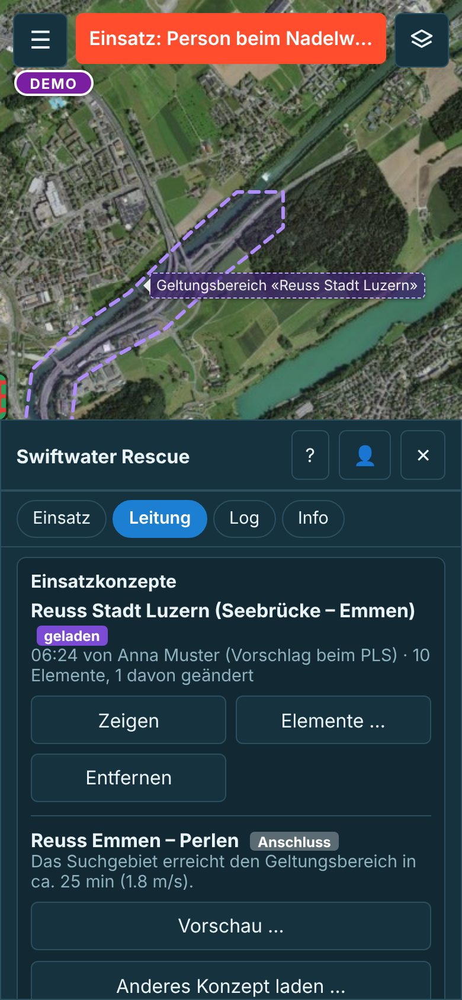
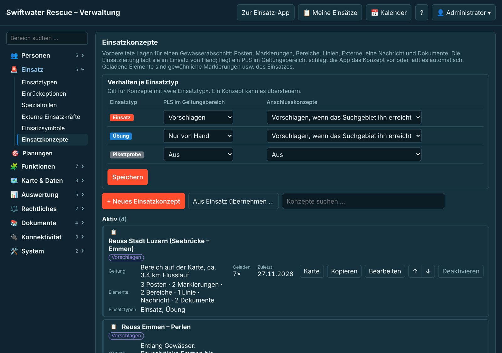
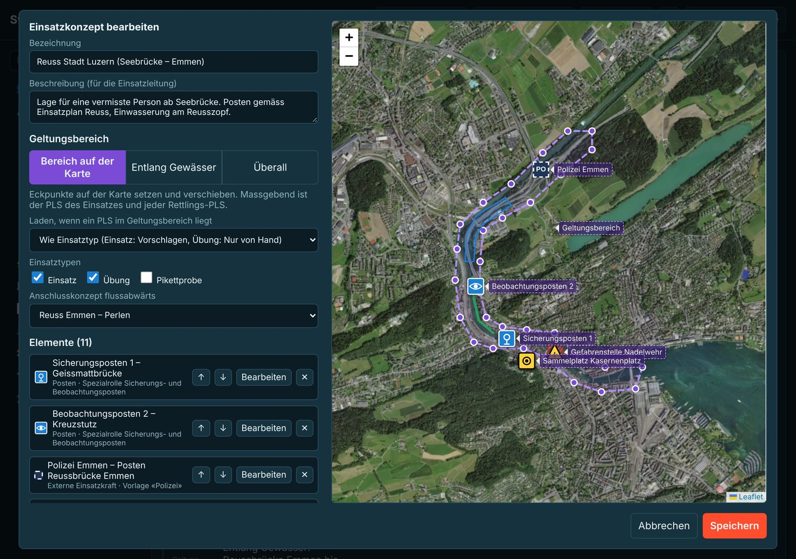

# Konzept: Vordefinierte Einsatzkonzepte (Issue #260)

Version 2 vom 27.11.2026, umgesetzt. Grundlage: Issue #260 («Vordefinierte Einsatzkonzepte sollen geladen werden können. Manuelles Laden oder automatisch abhängig vom PLS») und die Antworten des Auftraggebers auf Version 1.
Die Bilder 1 bis 6 sind die Mockups von Version 1; die Bilder der umgesetzten Fassung stehen in der Bedienungsanleitung (`web/hilfe/img/konzept-*.jpg`, `admin-konzept*.jpg`).

**Entscheide des Auftraggebers**
1. Geltungsbereich: **beides**, Bereich auf der Karte und «entlang Gewässer von A bis B».
2. Allgemeine Konzepte ohne Ort (Elemente relativ zum PLS): **nein**, entfällt.
3. Automatisch laden: **Vorschlag ist gut** (Standard: Einsatz «Vorschlagen», Typen mit vorbereiteten Übungen «Nur von Hand»; «Automatisch laden» bleibt wählbar).
4. Posten: **beides**, Markierung mit Auftrag (Spezialrolle) und direkte Zuteilung an Personen bzw. Einsatzgruppen mit Meldung.
5. Anschlusskonzepte flussabwärts: **ja**.
6. Recht: **eigenes** Recht `concepts` «Einsatzkonzepte verwalten».
7. Weitere Bestandteile: **alles, was in einem Einsatz eingesetzt werden kann**, soll planbar sein: Posten, Markierungen, Bereiche, Linien, Externe, Nachricht, Dokumente, Flusssperren, Funkkanäle, Nachbieten von Einsatzgruppen, Helikopter, Aufzeichnung (Fahrzeuge als Angabe im Auftrag eines Postens; ihr Standort kommt von den Beacons und lässt sich nicht planen).

**Abweichungen von Version 1**
- «Überall» (relativ zum PLS) entfällt (Entscheid 2).
- Kein festes Anschlusskonzept je Konzept: Die App schlägt jedes Konzept vor, dessen Geltungsbereich das berechnete Suchgebiet erreicht (je Einsatztyp abschaltbar).
- Nachrichten, Zuteilungen und Nachbieten löst immer eine Person aus; beim automatischen Laden bleiben sie offen («Jetzt auslösen» bzw. «Verwerfen» im Register «Leitung»).
- «Geändert» bei Elementen entfällt (Markierungen lassen sich im Einsatz nicht bearbeiten, nur entfernen).

## Ziel
Für bekannte Gewässerabschnitte gibt es heute Einsatzpläne auf Papier: Wo stehen die Sicherungsposten, wo wird eingewassert, welche Gefahrenstellen gibt es, welche Partner sperren welche Brücke. Im Einsatz zeichnet die Einsatzleitung das alles von Hand in die Karte. Ein **Einsatzkonzept** hält diese Lage vorbereitet fest. Die Einsatzleitung lädt es mit zwei Klicks, oder die App schlägt es vor bzw. lädt es selbst, sobald ein PLS im Abschnitt liegt.

## Begriffe
- **Einsatzkonzept**: vorbereitete Lage mit Bezeichnung, Beschreibung, Geltungsbereich, Einsatztypen und Elementen.
- **Geltungsbereich**, zwei Arten:
  - **Bereich auf der Karte**: Polygon (wie feste Bereiche, 3–200 Eckpunkte).
  - **Entlang Gewässer**: von Punkt A bis Punkt B auf dem Gewässernetz. Der Browser der Verwaltung berechnet beim Speichern den Weg entlang des Gewässers und speichert ihn mit einem Puffer in Metern. Der Server prüft nur den Abstand eines PLS zu diesen Linien und braucht kein Gewässernetz.
- **Elemente**:
  - **Posten**: Markierung mit Symbol (z. B. Sicherungsposten) und einer Spezialrolle als Auftrag, optional zugeteilt an Personen und Einsatzgruppen (sie erhalten den Auftrag als Nachricht mit Markierung, auf Wunsch mit Spezialrolle) und mit einem Fahrzeug als Angabe. In der Lage steht «noch nicht besetzt» bzw. «besetzt durch …», sobald eine Person mit dieser Rolle in der Nähe ist. Das Suchgebiet begrenzt wie heute erst die Person (Rolle mit `is_post`), nicht die leere Markierung.
  - **Markierung** (mit Einsatzsymbol), **Bereich**, **Linie**: wie in der Einsatz-App.
  - **Externe Einsatzkraft**: wie heute, optional aus einer Vorlage (`ext_templates`); begrenzt das Suchgebiet gemäss ihrer Spezialrolle.
  - **Nachricht**: wird beim Laden als Nachricht der ladenden Person an alle gesendet (z. B. «Posten gemäss Konzept beziehen»).
  - **Dokumente** aus der Ablage (#229): erscheinen im Fenster «Dokumente» unter «Für diesen Einsatz».
  - **Flusssperre** eines festen Standorts ausnehmen bzw. berücksichtigen, **Funkkanäle** des Einsatzes, **Nachbieten** von Einsatzgruppen, **Helikopter** einschalten, **Aufzeichnung** starten.
  - Je Element «beim Laden vorausgewählt» ja/nein.

## Einsatz-App (Web und nativ)

### Vorschlag beim PLS
Sobald ein PLS gesetzt oder verschoben wird (PLS des Einsatzes, PLS eines Rettlings, Start mit PLS, E-Mail-Alarm mit PLS, Freigabe eines PLS-Elements einer Übung), prüft der Server alle aktiven Konzepte des Einsatztyps. Liegt ein PLS im Geltungsbereich, gilt die Einstellung:
- **Aus**: nichts.
- **Nur von Hand**: das Konzept steht in der Karte «Einsatzkonzepte» zuoberst als «passt zum PLS», ohne Hinweis.
- **Vorschlagen**: die Einsatzleitung (`canManage`) sieht auf der Karte einen Hinweis mit «Vorschau …», «Sofort laden» und «Später»; der Geltungsbereich ist gestrichelt eingezeichnet. «Später» blendet den Hinweis für diesen Einsatz auf dem Gerät aus.
- **Automatisch laden**: der Server lädt alle vorausgewählten Elemente gleich mit (Log «System lädt das Einsatzkonzept …»). Die Einsatzleitung erhält einen Hinweis mit «Rückgängig».

Jedes Konzept wird je Einsatz höchstens einmal vorgeschlagen bzw. automatisch geladen. Mehrere passende (z. B. zwei Rettlinge in verschiedenen Abschnitten) erscheinen nebeneinander.

### Vorschau und Laden
«Vorschau …» zeigt die Elemente gestrichelt auf der Karte und daneben die Liste mit Häkchen, gruppiert nach Posten, Markierungen, Bereiche und Linien, Weiteres. Was schon im Einsatz steht (z. B. eine Flusssperre eines festen Standorts), ist ausgegraut. «N von M Elementen laden» übernimmt die angehakten.

Geladene Elemente sind **gewöhnliche** Markierungen, Bereiche, Linien und Externe des Einsatzes: alle sehen sie sofort, die Einsatzleitung ändert oder entfernt sie einzeln, sie stehen in Log, Replay und öffentlicher Ansicht wie von Hand gesetzte. Sie merken sich, aus welchem Konzept sie stammen. Im Fenster «Markierungen» stehen sie in der Lage als eigene Untergruppe «Einsatzkonzept «Name»» (ein-/ausblendbar und einklappbar wie die übrigen), mit «aus Konzept», «geändert von …» bzw. beim Posten «noch nicht besetzt» / «besetzt durch …».

### Register «Leitung»
Neue Karte **«Einsatzkonzepte»** zuoberst im Register «Leitung»:
- geladene Konzepte mit Zeitpunkt, Person bzw. «automatisch», Anzahl Elemente und Änderungen; «Zeigen», «Elemente …» (fehlende nachladen, z. B. den abgewählten Sammelplatz), «Entfernen» (entfernt die unveränderten Elemente; geänderte nur nach Rückfrage),
- **Anschlusskonzepte**: erreicht das berechnete Suchgebiet den Geltungsbereich eines weiteren Konzepts flussabwärts (oder nach Fliessgeschwindigkeit in Kürze), steht es hier mit «Vorschau …»; nie automatisch,
- «Anderes Konzept laden …»: Liste aller Konzepte des Einsatztyps, passende zuerst, mit Suche.

### Ablauf auf dem Gerät
- Anschlusskonzepte prüft das Gerät der Einsatzleitung mit dem berechneten Suchgebiet (Linien entlang des Gewässers bzw. Kreis). Den Abschnitt «entlang Gewässer» berechnet der Browser der Verwaltung beim Speichern über das Gewässernetz (wie die Flussdistanz).
- Kein Element wird doppelt geladen: lädt man ein Konzept erneut, kommen nur fehlende bzw. entfernte Elemente dazu.

## Verwaltung
Neuer Bereich **Einsatz → «Einsatzkonzepte»** (`NAV` `konzepte`, Recht siehe unten):
- Karte **«Verhalten je Einsatztyp»**: je Typ, was bei einem PLS im Geltungsbereich geschieht (Aus, Nur von Hand, Vorschlagen, Automatisch laden) und ob Anschlusskonzepte vorgeschlagen werden. Ein Konzept kann es übersteuern.
- Liste mit `ent()`: Geltung, Elemente, Einsatztypen, wie oft und wann zuletzt geladen; «Karte», «Kopieren», «Bearbeiten», ↑/↓, «Deaktivieren»; Deaktivierte in `offGrp`.
- **«Aus Einsatz übernehmen …»**: Markierungen, Bereiche, Linien und Externe eines laufenden oder beendeten Einsatzes (bzw. einer vorbereiteten Übung) als neues Konzept, Geltungsbereich vorgeschlagen um alle Elemente. So entsteht ein Konzept aus einer gut gelungenen Übung.

**Bearbeiten** als breiter Dialog mit Karte (wie `placeDlg`, `addBases`): Bezeichnung, Beschreibung, Art des Geltungsbereichs, Verhalten, Einsatztypen, Anschlusskonzept, Elemente mit ↑/↓, «Bearbeiten», ✕ und «+ Posten / Markierung / Bereich / Linie / Externe / Nachricht / Dokument». Die Elemente setzt und verschiebt man auf der Karte, Eckpunkte des Geltungsbereichs ebenso. Feste Standorte stehen grau zur Orientierung auf der Karte.

## Server (`api/concepts.php`)
- Tabellen `concepts` (Geltungsbereich `scope` area|river mit `area` bzw. `river` {a, b, buf, lines, km}, `mode`, `kinds`), `concept_items` (`kind` post|point|area|line|ext|msg|doc|stop|voice|invite|opt, `refs` JSON je Art, `def_on`), `inc_concepts` (je Einsatz und Konzept: Zustand, geladene Elemente, offene Aktionen). Herkunft an `pois` und `externals` (`cc_id`, `cc_item`; Posten mit `cc_role`, `cc_users`).
- Verhalten je Einsatztyp in der Einstellung `cc_kinds`. Geprüft wird im Polling, sobald sich die PLS ändern (`ccCheck`, Punkt im Polygon bzw. Abstand zum Abschnitt).
- Routen der Verwaltung `concepts`, `concept/save|move|active|remove|copy`, `concepts/cfg/save`, `concept/sources`, `concept/from`; im Einsatz `incident/concepts`, `incident/concept/load|run|drop|remove|dismiss`.
- Funktion `cc` je Einsatztyp, Recht `concepts`; Laden, Auslösen und Entfernen durch die Einsatzleitung bzw. Übungsleitung.

## Zu beachten (Projektregeln)
- Vorbereitete Übungen: optional ein Konzept, das beim Start geladen wird (Auswahl im Dialog der Übung); der AI-Assistent der Übungsvorbereitung kennt die Elemente als Bezugspunkte.
- Replay, öffentliche Ansicht, Einsatzlog: keine Änderung nötig, die Elemente sind gewöhnliche Markierungen usw.
- Demo (`demo.js`, `demo.dart`): ein Beispielkonzept «Reuss Stadt Luzern», im Modus «ohne Daten» die Konzepte der Organisation über die Vorgaben; Vorschlag beim PLS wie im Bild.
- Native App: Hinweis auf der Karte (`inc/map_page.dart`), Vorschau als Seitenfenster (`panel` `'cc'`), Karte im Register «Leitung» (`inc/menu.dart`), Untergruppe in `pois.dart`.
- `DSAR_TABLES` (neue Tabellen), `PURGE_INC_TABLES` (`inc_concepts`), endgültig Löschen eines Konzepts (`PURGE_KINDS`), Applikationslog über `APPLOG_ROUTES`.
- Bedienungsanleitung `verwaltung/konzepte`, `leitung/konzepte`; `docs/REQUIREMENTS.md` neuer Bereich **KZ**; Übersetzungen.

## Umsetzung (Version 2)
Technische Einzelheiten stehen in `CLAUDE.md` (Abschnitt «Einsatzkonzepte»), die Anforderungen in `docs/REQUIREMENTS.md` (KZ-01 bis KZ-11), die Bedienung in der Anleitung (`leitung/konzepte`, `verwaltung/konzepte`).
- Server `api/concepts.php`, Prüfung des PLS im Polling (`ccCheck`), Laden/Auslösen/Entfernen, Zuteilung beim Annehmen (`ccJoin`).
- Web `cc.js` (Hinweis, Vorschau, Register «Leitung», Gruppe im Fenster «Markierungen»), Verwaltung Einsatz → «Einsatzkonzepte».
- Native App `lib/inc/cc.dart`, Demo im Web und in der App mit einem fiktiven Konzept an der Reuss.
