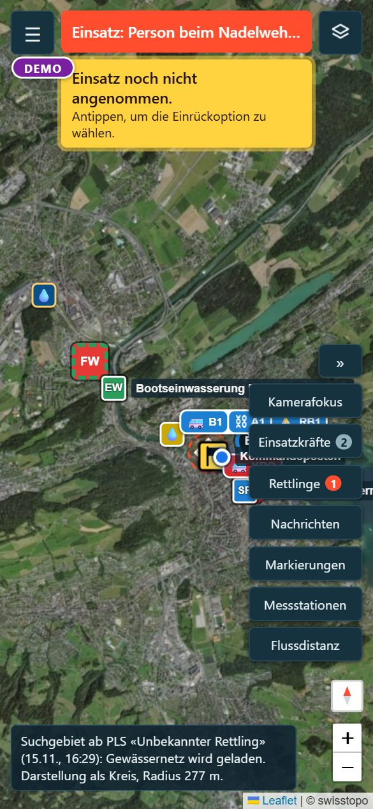
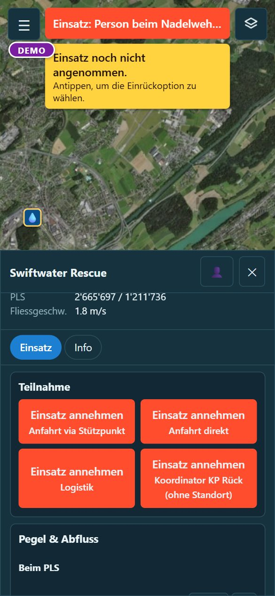
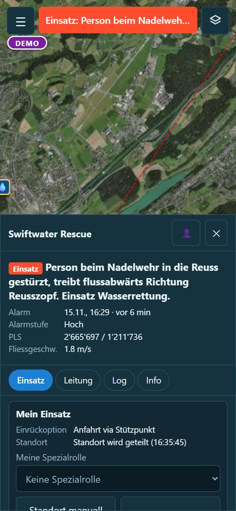

# Alarm und Teilnahme

## Der Alarm {#alarm}

Startet jemand einen Einsatz oder eine Übung, alarmiert die App alle aufgebotenen Personen. Wie laut der Alarm ist, legt der Einsatztyp fest (Alarmstufe):

| Alarmstufe | Was passiert |
|---|---|
| Kritisch | Rote Meldung mit dreifachem Ton, Push bleibt stehen. In der nativen App Vollbild und Dauerton, auch bei «Nicht stören». |
| Hoch | Rote Meldung mit Ton, Push bleibt stehen. In der nativen App Vollbild. |
| Normal | Hinweis mit kurzem Ton. |
| Niedrig | Stiller Hinweis. |
| Keine | Keine Meldung, der Einsatz erscheint nur in der App. |

Ist die App offen, erscheint die Meldung oben rechts, bis du sie antippst. Bei geschlossener App kommt sie als Push-Benachrichtigung. Antippen öffnet die App und zeigt das Einsatzgebiet.

Mit dem **Übungsmodus** im [Profil](#profil/alarmierung) lässt du dich auch bei Übungen kritisch alarmieren, sofern der Einsatztyp das vorsieht. Bist du [abwesend gemeldet](#profil/abwesenheit), wirst du nicht alarmiert, siehst den Einsatz aber und kannst freiwillig teilnehmen.

## Einsatz annehmen {#annehmen}

Solange du nicht teilnimmst, zeigt die Karte unter dem Einsatz-Chip die gelbe Leiste **Einsatz noch nicht angenommen**. Antippen öffnet das Menü bei der Karte «Teilnahme».

Wähle dort, wie du einrückst, zum Beispiel «Anfahrt via Stützpunkt» oder «Anfahrt direkt». Damit nimmst du am Einsatz teil: Die Einsatzleitung sieht dich in der Liste, du siehst alle Nachrichten und kannst mitarbeiten. Nach dem Annehmen zeigt die Karte das Suchgebiet.

Einen Einsatz ablehnen musst du nicht: Wer nicht annimmt, nimmt nicht teil.

## Einrückoptionen {#einrueckoption}

Die Einrückoptionen legt die Verwaltung fest. Sie bestimmen:

- ob die App deinen **Standort teilt** (Optionen mit «ohne Standort» teilen nichts),
- ob du **Rechte der Einsatzleitung** erhältst (zum Beispiel «Koordinator KP Rück»; dann ohne Spezialrolle),
- ob du im Zähler der Einsatzkräfte mitzählst.

## Mein Einsatz {#mein-einsatz}

Nach dem Annehmen zeigt das Menü im Register «Einsatz» die Karte **Mein Einsatz**: Einrückoption, Stand der Standortfreigabe und deine **Spezialrolle** (zum Beispiel Rettungsschwimmer, Bootsführer, Sicherungsposten). Die Spezialrolle wählst du selbst; die Einsatzleitung kann sie ändern.

## Standort teilen {#standort}

Bei Einrückoptionen mit Standort teilt die App deinen Standort, solange du teilnimmst und die App offen ist. Der Browser fragt beim ersten Mal nach der Erlaubnis. Die Einsatzleitung sieht dich dann auf der Karte, und Fahrten erscheinen im Einsatzlog.

- Am Handy teilt die Web-App den Standort nur, solange sie im Vordergrund ist. Für das Teilen bei gesperrtem Bildschirm brauchst du die [native App](#app/standort).
- **Standort manuell setzen (Test)** setzt deinen Standort auf einen Punkt der Karte, zum Beispiel für Übungen am Schreibtisch. «GPS-Standort verwenden» schaltet zurück.
- Positionen auf dem Wasser (Boot) zählen nicht als Fahrt.

## Einsatz verlassen {#verlassen}

**Einsatz verlassen** in der Karte «Mein Einsatz» beendet deine Teilnahme, zum Beispiel wenn du abgelöst wirst. Du kannst später wieder einsteigen. Hat dich die Einsatzleitung aus dem Einsatz entfernt, erhältst du eine Meldung; auch dann ist ein Wiedereinstieg möglich.

## Mehrere Einsätze gleichzeitig {#parallel}

Laufen mehrere Einsätze, zeigt das Menü über den Registern die Karte **Laufende Einsätze**. Dort wechselst du den angezeigten Einsatz. Du nimmst immer nur an einem teil: Nimmst du einen anderen an, verlässt du den bisherigen. Die übrigen Einsätze erscheinen blass auf der Karte; im Fenster [Ansicht](#karte/ansicht) blendest du sie unter «Weitere Einsätze» ein und aus.

## Alarm einer anderen Organisation {#organisation}

Gehörst du mehreren Organisationen an oder bietet dich eine andere Organisation über eine Vereinbarung auf, meldet die App auch deren Alarme. Im Menü steht dann die Karte **🔔 «Organisation»: …** mit dem Knopf **Zu «Organisation» wechseln**; dort nimmst du wie gewohnt an. Wie bei mehreren Einsätzen entscheidest du selbst, wo du teilnimmst. In der nativen App öffnet das Antippen der Meldung das Konto der Organisation (es wird bei Bedarf angelegt).

> Im Demo-Modus gibt es keine anderen Organisationen.

## Einsatzende {#ende}

Beendet die Einsatzleitung den Einsatz, erhältst du eine Meldung, und die Benachrichtigungen zum Einsatz verschwinden. Log und Replay findest du danach unter [Meine Einsätze](#auswertung/meine).
