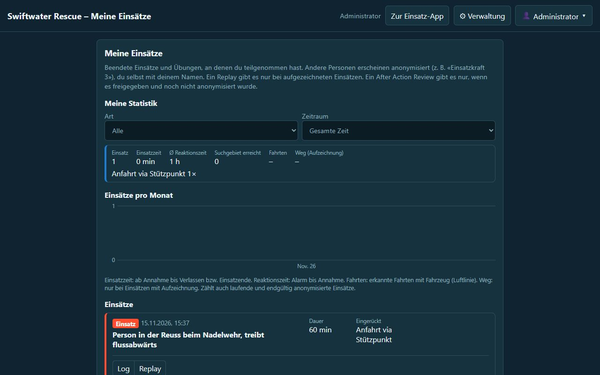
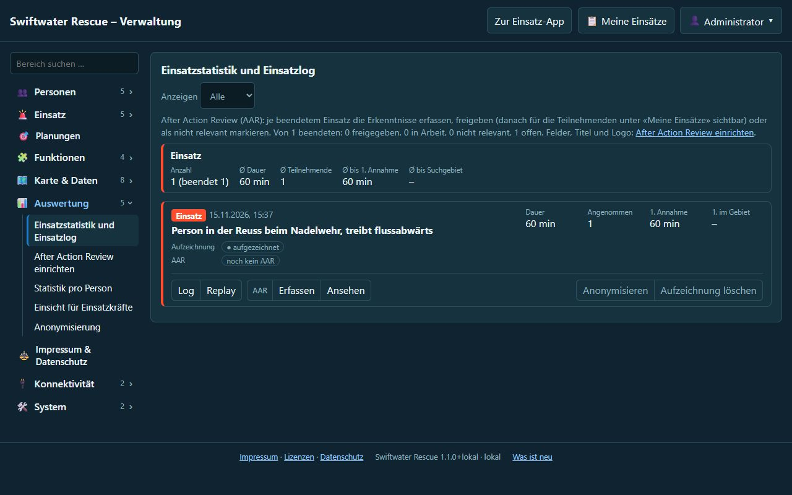

# Auswertung

## Meine Einsätze {#meine}

Der Knopf 📋 in der Kopfzeile des Menüs öffnet **Meine Einsätze**: alle beendeten Einsätze und Übungen, an denen du teilgenommen hast. Oben steht deine persönliche Statistik (Einsätze, Einsatzzeit, Reaktionszeit, Fahrten) mit Filter nach Art und Zeitraum.

Je Einsatz gibt es, soweit die Verwaltung es erlaubt:

- **Log**: das Einsatzlog,
- **Replay**: die Aufzeichnung auf der Karte,
- **AAR**: das freigegebene After Action Review, als Ansicht, Word oder PDF.

Andere Personen erscheinen je nach Einstellung anonym («Einsatzkraft 3»), du selbst immer mit Namen. Nach einer Anonymisierung sind Log und Replay ganz anonym.

## Einsatzlog {#log}

Das Log zeigt den Ablauf mit Zeit und Person. **Gross-Modus** zeigt es bildschirmfüllend und nach Zeit sortiert. In der Verwaltung blendet der Knopf **Anonym** die Namen aus. Mit dem AI-Assistenten gibt es eine Zusammenfassung des Logs.

## Replay {#replay}

Das Replay spielt einen aufgezeichneten Einsatz auf der Karte ab:

- **Zeitregler** und **Abspielen** mit 1- bis 120-facher Geschwindigkeit; Leertaste startet und stoppt, Escape schliesst.
- Der Balken unter dem Regler zeigt die aufgezeichneten Zeiträume; in Pausen sind keine Personen sichtbar.
- **Spurlänge**: ganzer Verlauf, die letzten Minuten oder keine.
- Daneben Lage, Einsatzkräfte (mit Zentrieren und Folgen) und das Log bis zum gewählten Zeitpunkt; ein Klick auf einen Log-Eintrag springt dorthin.
- Das Fenster **Ansicht** blendet Kategorien aus und ändert die Grösse der Positionen; **Auto-Übersicht** hält alle Positionen im Bild.

## After Action Review {#aar}

Ein After Action Review (AAR) hält die Erkenntnisse aus einem beendeten Einsatz fest. Mit dem Recht «After Action Reviews erstellen» öffnest du es in der Verwaltung unter **Einsatzstatistik und Einsatzlog** mit **Erfassen**:

- Links das Formular mit den Feldern der Organisation (Text, Datum, Auswahl, Bilder …), rechts Einsatzdaten, Feedback und Log zum Nachschlagen.
- **Speichern** lässt den Arbeitsplatz offen; ✨ schlägt mit dem AI-Assistenten Texte für leere Felder vor.
- **Speichern und freigeben** (Recht «freigeben») schliesst das Review ab. Freigegebene Reviews sehen die Teilnehmenden unter «Meine Einsätze».
- **Nicht relevant** markiert Einsätze ohne Review.

Word und PDF entstehen im Browser. Vor einer Anonymisierung sichert die App freigegebene Reviews als PDF.

## Einsatzfeedback {#feedback}

Nach dem Einsatzende kann die Leitung die Teilnehmenden um ein kurzes **Feedback** bitten (auf Wunsch automatisch). Offene Anfragen erscheinen als Hinweis im Menü und zuoberst in «Meine Einsätze». Die Antworten fliessen ins After Action Review ein; auf Wunsch anonym.

## Statistik {#statistik}

In der Verwaltung unter **Auswertung** gibt es mit dem Recht «Statistik»:

- **Einsatzstatistik und Einsatzlog**: Kennzahlen je Einsatztyp, Liste aller Einsätze mit Log, Replay und AAR.
- **Statistik pro Person**: Einsätze, Einsatzzeit, Reaktionszeit, Fahrten und Weg je Person, mit Diagrammen und Export als CSV.

