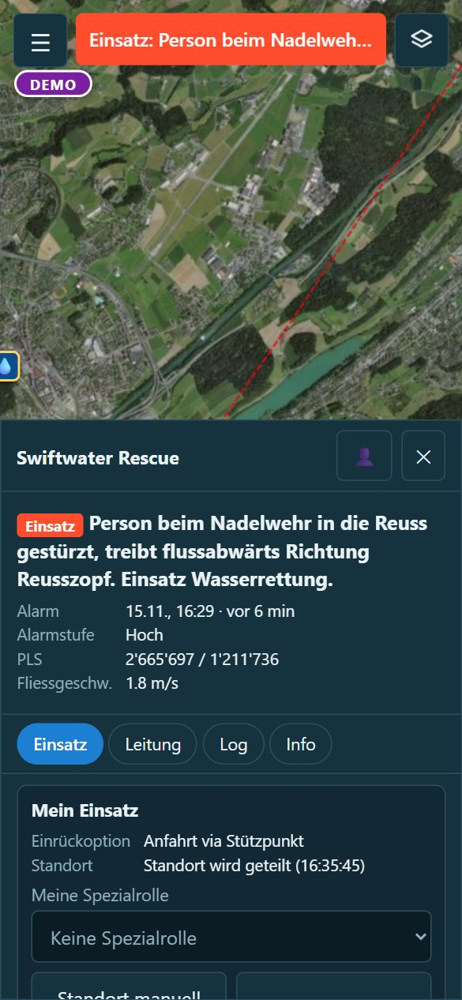
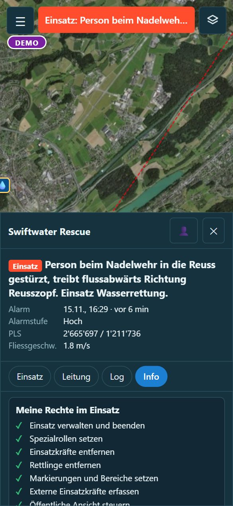
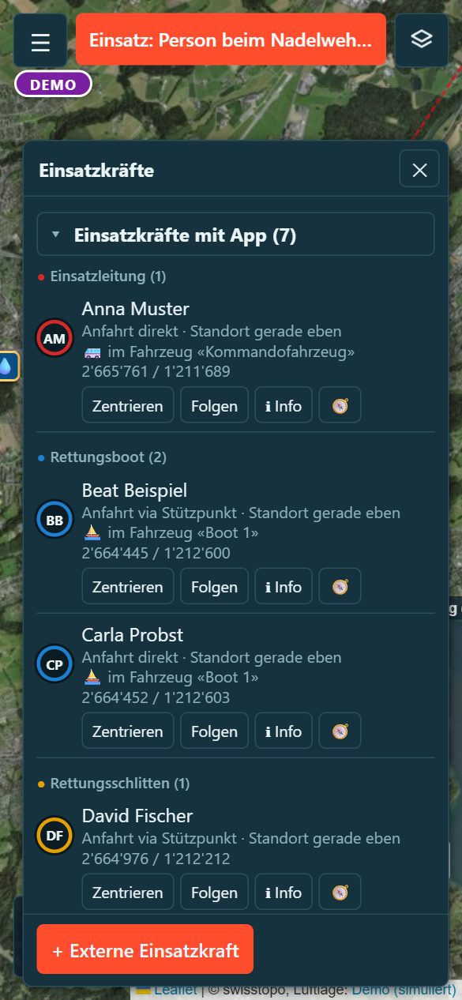
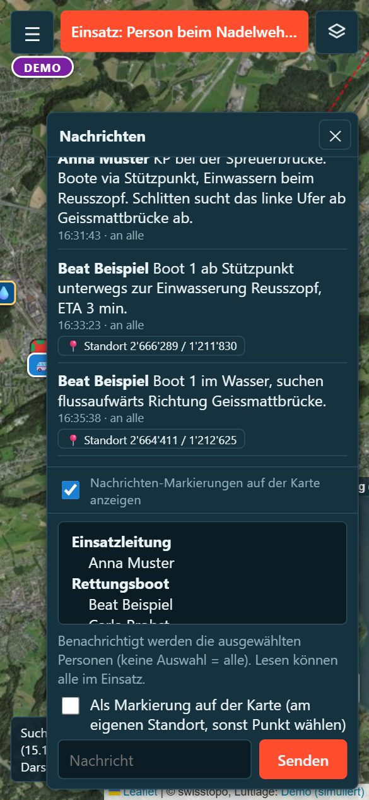
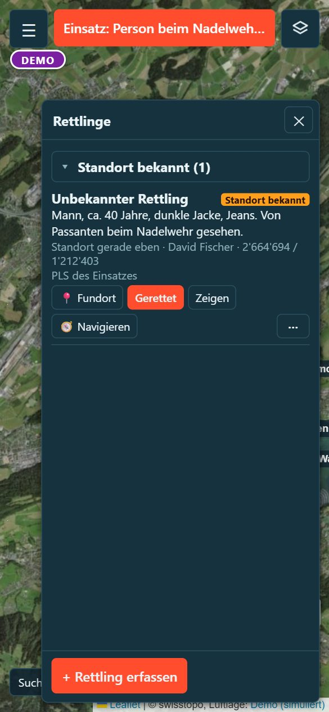
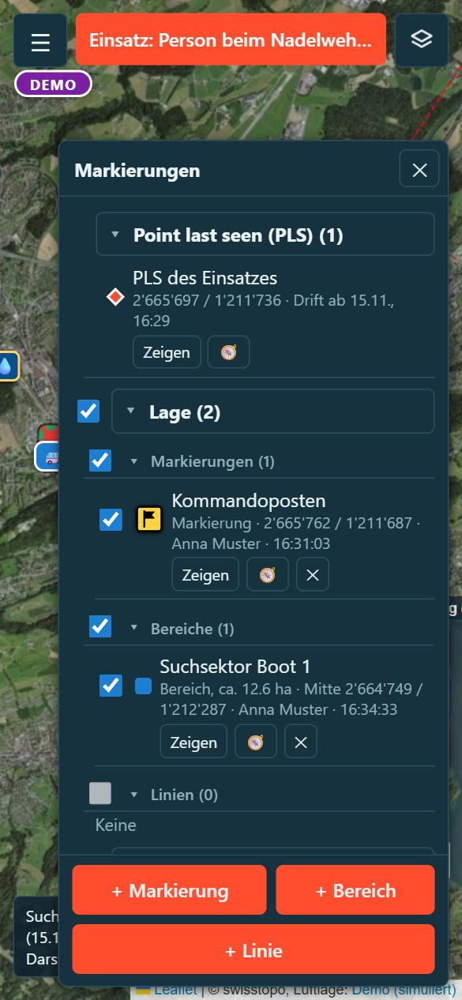
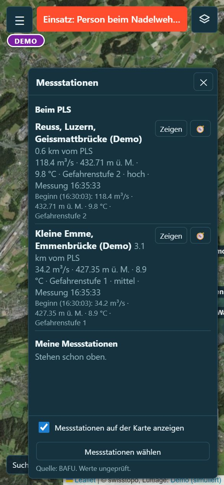
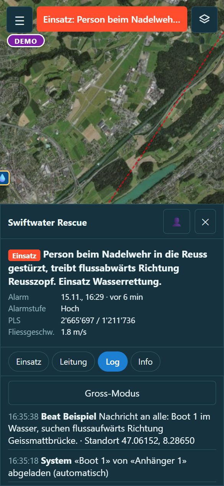

# Im Einsatz

## Das Menü {#menu}

Das Menü ☰ zeigt oben den Einsatz: Meldung, Alarmzeit, Alarmstufe, PLS, Fliessgeschwindigkeit und ob der Einsatz aufgezeichnet wird oder öffentlich sichtbar ist. Darunter liegen Register:

| Register | Inhalt |
|---|---|
| Einsatz | Teilnahme, Mein Einsatz, Fliessgeschwindigkeit, Pegel & Abfluss, Werkzeuge, AI-Assistent |
| Leitung | nur für die Einsatzleitung, siehe [Einsatzleitung](#leitung) |
| Übung | nur für die Übungsleitung, siehe [Übungen](#planung/freigabe) |
| Log | Einsatzlog live |
| Info | deine Rechte in diesem Einsatz, Person, Server, Version |

Beim Öffnen steht das Menü immer auf «Einsatz» (für die Übungsleitung auf «Übung»).

## Einsatzkräfte {#einsatzkraefte}

Der Kartenknopf **Einsatzkräfte** öffnet die Liste aller Teilnehmenden, gruppiert nach Spezialrolle, darunter die externen Einsatzkräfte und die Fahrzeuge. Je Person siehst du Einrückoption, Alter des Standorts und Koordinaten.

- **Zentrieren** schiebt die Karte zur Person, **Folgen** hält sie im Bild.
- **ℹ Info** zeigt Profilbild, Spezialrolle, Einrückoption und Einsatzgruppen. Dasselbe Fenster öffnet sich beim Antippen einer Einsatzkraft auf der Karte.
- 🧭 übergibt den Standort an deine [Navigations-App](#einsatz/navigation).
- Die Gruppen lassen sich auf- und zuklappen; das Gerät merkt es sich.

Die Einsatzleitung kann hier Spezialrollen ändern, Personen aus dem Einsatz entfernen und [externe Einsatzkräfte](#leitung/externe) erfassen.

## Nachrichten {#nachrichten}

Der Kartenknopf **Nachrichten** öffnet den Verlauf. Alle, die den Einsatz angenommen haben, sehen alle Nachrichten. Die Empfänger bestimmen nur, wer benachrichtigt wird; an dich gerichtete Nachrichten sind markiert. Die rote Zahl am Knopf zeigt Ungelesenes.

1. Text eingeben.
2. Optional Empfänger wählen (nach Spezialrolle gruppiert). Ohne Auswahl werden alle benachrichtigt.
3. Optional **Als Markierung auf der Karte**: am eigenen Standort oder an einem Punkt, den du danach auf der Karte antippst.
4. **Senden**.

Nachrichten speichern deinen Standort, sofern du ihn teilst. Markierungen von Nachrichten erscheinen als eigene Kategorie auf der Karte; entfernen kann sie die sendende Person oder die Einsatzleitung. Wer senden darf, legt die Verwaltung je Spezialrolle fest.

## Rettlinge {#rettlinge}

Der Kartenknopf **Rettlinge** zeigt die gesuchten Personen in drei Gruppen: **Vermisst** (ohne Standort), **Standort bekannt** und **Gerettet**. Die rote Zahl zählt die nicht geretteten.

- **+ Rettling erfassen**: Name und Beschreibung. Ohne Namen heisst er «Unbekannter Rettling».
- **📍 Fundort**: am eigenen Standort oder auf der Karte gewählt. Es gilt der zuletzt gemeldete Fundort.
- **Gerettet** bzw. **Zurücknehmen**.
- **Suchgebiet** (bei vermissten): Kamerafokus auf sein Teilgebiet.
- **⋯** klappt weitere Knöpfe auf: Fundort zurücksetzen, **PLS setzen** (eigener PLS für diesen Rettling), Bearbeiten und, für die Einsatzleitung, Entfernen.

Erfassen, Fundort melden und «gerettet» melden dürfen alle, die den Einsatz angenommen haben.

## Markierungen {#markierungen}

Der Kartenknopf **Markierungen** zeigt drei Gruppen:

- **Point last seen (PLS)**: der PLS des Einsatzes und die PLS der Rettlinge. Blasse PLS zählen nicht mehr fürs Suchgebiet (Rettling gefunden).
- **Lage**: Markierungen, Bereiche und Linien der Einsatzleitung.
- **Feste Standorte**: Orte der Organisation wie Bootseinwasserungen oder Magazine, mit Suchgebiet aufgeteilt in «Im Einsatzgebiet» und «Ausserhalb».

Mit den Häkchen blendest du einzelne Einträge oder ganze Gruppen auf der Karte aus; **Zeigen** schiebt die Karte hin. Neue Markierungen, Bereiche und Linien setzt die Einsatzleitung (siehe [Lage zeichnen](#leitung/lage)).

## Fliessgeschwindigkeit {#fliessgeschwindigkeit}

Im Register «Einsatz» setzen alle Teilnehmenden die **Fliessgeschwindigkeit** in m/s. Daraus berechnet die App die Länge des Suchgebiets. Die Messstationen beim PLS (siehe unten) helfen bei der Einschätzung.

## Wasserzeit {#wasserzeit}

Die **Wasserzeit** überwacht, wie lange jemand im Wasser ist (Swimmer, Bootsbesatzung im Wasser), ähnlich der Atemschutzüberwachung. So bleibt niemand unbemerkt zu lange im kalten Wasser.

1. Im Register «Einsatz», Karte **Wasserzeit**, deinen **Kälteschutz** prüfen (ohne, Neoprenanzug, Trockenanzug). Vorgewählt ist deine Vorgabe aus dem Profil (Karte «Wasserzeit»), sonst die zuletzt verwendete, sonst die der Organisation. Ändern kannst du ihn jederzeit, auch an Land.
2. **🌊 Ich gehe ins Wasser** antippen. Die Zeit läuft, oben auf der Karte steht sie mit dem Knopf **An Land**.
3. Zurück an Land: **Zurück an Land** antippen.

Der **Richtwert** hängt vom Kälteschutz und von der Wassertemperatur ab. Die Temperatur kommt von der nächsten Messstation des BAFU; die Einsatzleitung kann sie von Hand setzen. Ohne Temperatur gilt der Richtwert der kältesten Stufe.

Die Zeit steht bei der Person im Fenster «Einsatzkräfte», in der Personeninfo und als Chip unter ihrem Marker auf der Karte: **blau** läuft, **gelb** ab der Vorwarnung (Standard 75 %), **rot** ab dem Richtwert. Bei der Vorwarnung und beim Erreichen des Richtwerts erhalten du und die Einsatzleitung eine Meldung; beides steht im Einsatzlog.

> Je nach Einstellung erkennt die App den Aufenthalt im Wasser auch selbst: Ist dein Standort eine Weile sehr nahe an der Gewässerachse (nicht in einem Fahrzeug und nicht in Fahrt), beginnt die Wasserzeit, und du erhältst einen Hinweis. Stimmt das nicht, tippst du **Zurück an Land**. Das braucht das Gewässernetz (Funktion «Suchgebiet»).

Die Einsatzleitung startet und beendet die Wasserzeit auch für andere (Knöpfe **🌊 Ins Wasser** und **An Land** im Fenster «Einsatzkräfte» und in der Personeninfo) und setzt die Wassertemperatur in der Karte «Wasserzeit». Dort stellt sie unter **Kälteschutz der Einsatzkräfte** auch den Kälteschutz jeder Person ein, bevor sie ins Wasser geht; läuft die Wasserzeit schon, gilt der neue Richtwert sofort.

> Liegt keine BAFU-Station mit Wassertemperatur in der Nähe des PLS oder der Einsatzkräfte, steht die Temperatur auf «unbekannt». Die App sucht dann jede Minute erneut, sobald Standorte gemeldet werden.

## Flussdistanz {#flussdistanz}

Das Werkzeug **Flussdistanz** misst die Distanz zwischen zwei Punkten entlang des Gewässers. Du findest es als Kartenknopf und im Menü unter «Werkzeuge», auch ohne Einsatz.

1. Kartenknopf **Flussdistanz** antippen.
2. Startpunkt A auf der Karte antippen.
3. Zielpunkt B antippen.

Die App setzt beide Punkte aufs nächste Gewässer und zeigt die Distanz entlang des Gewässers und in Luftlinie, die Fliessrichtung, die Treibzeit mit der Fliessgeschwindigkeit des Einsatzes (ohne Einsatz gibst du sie ein) und die Dauer für einige Vergleichsgeschwindigkeiten. Passiert der Weg ein Wehr oder eine andere Gefahrenstelle, steht das ebenfalls dabei. Höchstens 50 km Luftlinie.

## Navigation {#navigation}

Der Knopf 🧭 bei Einsatzkräften, Rettlingen, PLS, Markierungen, festen Standorten und Messstationen übergibt das Ziel an deine Navigations-App (Google Maps, Apple Karten, Waze oder eine andere App). Welche App, wählst du im [Profil](#profil/anzeige). Hat ein fester Standort mehrere Navigationspunkte (zum Beispiel Zufahrten), wählst du einen aus.

Marker ohne Popup (Einsatzkräfte, PLS) fragen beim Antippen kurz nach, damit sich die Navigations-App nicht aus Versehen öffnet.

## Messstationen {#messstationen}

Der Kartenknopf **Messstationen** zeigt Pegel, Abfluss und Wassertemperatur der BAFU-Messstationen:

- **Beim PLS**: die nächsten Stationen, mit den Werten bei Einsatzbeginn und den aktuellen.
- **Meine Messstationen**: deine eigene Auswahl, auch ohne Einsatz (im [Profil](#profil/messstationen)).

Die Marker auf der Karte sind nach der Gefahrenstufe eingefärbt. Die Werte zu Beginn und am Ende eines Einsatzes stehen im Einsatzlog.

## Funk {#funk}

Ist der Funk eingerichtet, öffnet der Kartenknopf **Funk** zwei Register:

- **Live-Konferenz**: Sprechfunk in Echtzeit in einem Kanal. **Beitreten** und **Verlassen** gibt es auch direkt auf der Karte links unten. Mit der Live-Taste sprichst du, solange du sie hältst; «Mikro offen» lässt das Mikrofon offen.
- **Durchsagen**: Sprachnachrichten. Taste gedrückt halten, sprechen, loslassen. Andere hören die Durchsage sofort oder später; sie steht mit ▶ im Log und, falls eingerichtet, auch als Text.

Welche Kanäle du hörst und wo du sprechen darfst, hängt von deiner Spezialrolle und der Einsatzleitung ab. Die Einsatzleitung kann Personen stummschalten. Im Profil stellst du ein, ob Durchsagen automatisch abgespielt werden («Mithören»).

## Fahrzeuge {#fahrzeuge}

Fahrzeuge mit einem Bluetooth-Beacon erscheinen auf der Karte, sobald die native App eines Teilnehmenden sie sieht. Die Liste steht im Fenster «Einsatzkräfte» unter «Fahrzeuge»: wer darin sitzt, was verladen ist (Boot auf dem Anhänger) und wo es zuletzt gesehen wurde. Verladen und abladen geht über das Popup des Fahrzeugs.

## Dokumente {#dokumente}

Der Kartenknopf **📚 Dokumente** öffnet die Unterlagen deiner Organisation, auch ohne Einsatz. Zuoberst steht die Suche: Sie findet Titel, Beschreibung, Schlagwörter, den Text von Seiten und den Text von PDFs, mit Seitenzahl. Darunter stehen die Abschnitte, die die Verwaltung eingerichtet hat, zum Beispiel offene Lesebestätigungen, ★ Favoriten, Dokumente an Standorten im Einsatzgebiet, Dokumente für diesen Einsatztyp und die Ordner. Ist es erlaubt, ordnest du die Abschnitte mit **Abschnitte anordnen** für dich.

Jede Zeile zeigt links die Art (PDF, TEXT, LINK …), daneben Titel, Art, Grösse und Stand sowie Chips wie «⬇ offline» oder den Standort (📍). Rechts stehen **Öffnen** und der Stern für Favoriten. Bei Suchtreffern steht statt dessen der Ordner und darunter die Fundstelle, zum Beispiel «S. 3: «… Walze …»» oder «Schlagwort: Walze»; die gesuchten Wörter sind hervorgehoben.

- **Ansehen**: Seiten, Bilder und PDFs zeigt die App direkt an, andere Dateien lädst du herunter bzw. öffnest sie in einer passenden App. Links öffnen im Browser.
- **★** (bzw. ☆) heftet einen Eintrag an. Favoriten und von der Redaktion bestimmte Einträge speichert das Gerät auch **offline**.
- **Lesebestätigung**: Verlangt die Organisation, dass du ein Dokument liest, steht es mit Frist im Menü (Karte «📚 Unterlagen») und mit einem Zähler am Kartenknopf. Unten bzw. oben im Dokument bestätigst du mit **Gelesen und verstanden**.
- **Vorschlagen**: Fehlt etwas oder ist etwas falsch, schickst du der Redaktion einen Vorschlag, bei einem Eintrag oder in einem Ordner. Im Browser kannst du auch eine Datei mitschicken.
- **Feste Standorte**: Hängt ein Dokument an einem Standort (z. B. dem Einsatzplan eines Wehrs), steht es im Popup des Standorts (in der App im Info-Blatt) unter «Dokumente zu diesem Standort»: je Dokument die Art (PDF, TEXT …), der Titel, «offline», wenn es auf dem Gerät gespeichert ist, und der Stand. Antippen öffnet es.

Die Einsatzleitung kann im Register «Leitung» unter **Dokumente für Externe** einzelne Dokumente an Externe ohne App weitergeben: auf der Gastseite des Funks oder über einen eigenen Link. Die Freigabe endet mit dem Einsatz.

## Einsatzlog {#log}

Das Register **Log** zeigt den Ablauf des Einsatzes: Beitritte, Spezialrollen, Fahrten («fährt von A nach B»), Nachrichten im Volltext, Markierungen, Rettlinge, Messwerte und mehr. **Gross-Modus** zeigt das Log bildschirmfüllend, zum Beispiel auf einem Bildschirm im Kommandoposten.

## AI-Assistent {#ai}

Hat deine Organisation den AI-Assistenten eingerichtet, findest du im Register «Einsatz» **✨ Lagezusammenfassung** und **✨ Frage stellen**. Der Assistent macht nur Vorschläge; übernommen wird nichts automatisch. Ob er auf Abruf oder begleitend arbeitet, stellst du im [Profil](#profil/ai) ein.

## Werkzeuge {#werkzeuge}

Unter «Werkzeuge» im Menü stehen die [Flussdistanz](#einsatz/flussdistanz) und, je nach Rechten, weitere Hilfsmittel. Sie funktionieren auch ohne laufenden Einsatz.
