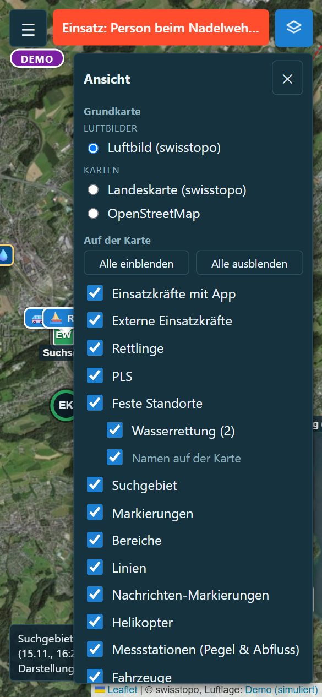
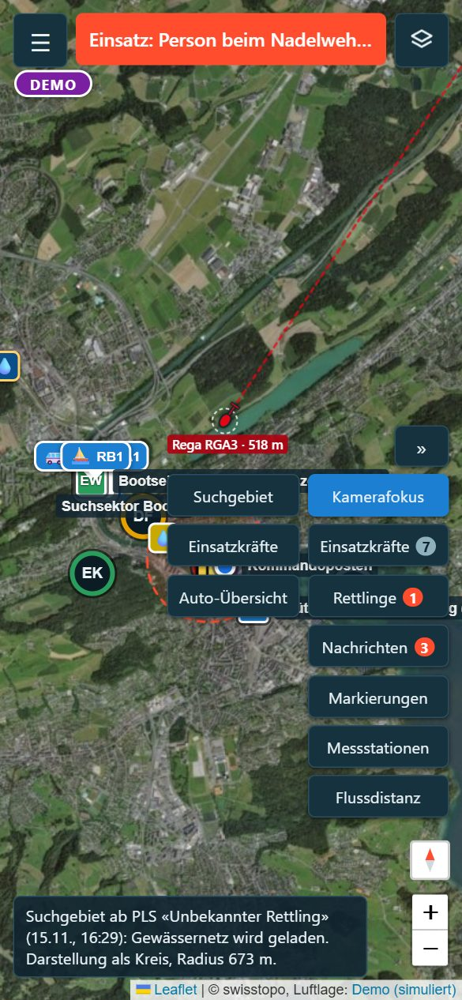

# Die Karte

Die Karte zeigt standardmässig das Luftbild von swisstopo. Verschieben und zoomen wie gewohnt: ziehen, zwei Finger oder Mausrad.

## Kartenknöpfe {#knoepfe}

Rechts unten liegen die Kartenknöpfe. Rote Zahlen zeigen Ungelesenes oder Offenes (nicht gerettete Rettlinge, ungelesene Nachrichten), die neutrale Zahl bei «Einsatzkräfte» die Zahl der Teilnehmenden.

| Knopf | Öffnet |
|---|---|
| Kamerafokus | Auswahl, was die Karte zeigen soll (siehe unten) |
| Einsatzkräfte | Liste aller Einsatzkräfte, nach Spezialrolle gruppiert ([mehr](#einsatz/einsatzkraefte)) |
| Rettlinge | Vermisste und gefundene Personen ([mehr](#einsatz/rettlinge)) |
| Nachrichten | Nachrichten des Einsatzes ([mehr](#einsatz/nachrichten)) |
| Funk | Durchsagen und Live-Konferenz ([mehr](#einsatz/funk)) |
| Markierungen | PLS, Markierungen, Bereiche, Linien und feste Standorte ([mehr](#einsatz/markierungen)) |
| Messstationen | Pegel und Abfluss ([mehr](#einsatz/messstationen)) |
| Flussdistanz | Distanz zwischen zwei Punkten entlang des Gewässers ([mehr](#einsatz/flussdistanz)) |

Der Knopf **»** über den Kartenknöpfen klappt sie ein, damit am Handy mehr Karte sichtbar ist. Eingeklappt zeigt er die Summe der roten Zahlen. Am Handy decken die Seitenfenster die Kartenknöpfe ab; sie schliessen über ✕.

## Ansicht {#ansicht}

Der Knopf oben rechts (Ebenen-Symbol) öffnet das Fenster **Ansicht**:

- **Grundkarte**: Luftbilder und Karten, die deine Organisation eingeschaltet hat. Die Wahl gilt bis zum Ende des Einsatzes.
- **Auf der Karte**: je ein Häkchen pro Kategorie, zum Beispiel Einsatzkräfte, Externe, Rettlinge, PLS, Suchgebiet, Markierungen, Bereiche, Linien, Helikopter, Messstationen, Fahrzeuge und die Geodaten-Ebene. «Alle einblenden» und «Alle ausblenden» schalten alle auf einmal.
- **Feste Standorte** mit ihren Kategorien und «Namen auf der Karte».

Die Auswahl gilt nur für die Karte auf diesem Gerät; die Listen in den Seitenfenstern bleiben vollständig. Ausgeblendete Sicherungsposten begrenzen das Suchgebiet weiterhin.

## Kamerafokus {#kamerafokus}

**Kamerafokus** richtet die Karte aus:

- **Suchgebiet**: das ganze Suchgebiet, bei mehreren PLS zusätzlich je Teilgebiet.
- **Einsatzkräfte**: alle Einsatzkräfte mit Standort.
- **Auto-Übersicht**: Die Karte hält bei jeder Aktualisierung alle sichtbaren Positionen im Bild. Sie endet, sobald du die Karte von Hand verschiebst oder zoomst.

In der Liste der Einsatzkräfte kannst du einer Person **folgen**: Die Karte bleibt dann auf ihr. Folgen endet über ✕ im Hinweis oben, beim Verschieben der Karte oder wenn die Person den Einsatz verlässt.

## Karte drehen {#drehen}

Am Handy drehst du die Karte mit zwei Fingern, am Computer mit Shift + Mausrad oder durch Ziehen am Kompass über den Zoomknöpfen. Die Kompassnadel zeigt immer nach Norden; ein Klick auf den Kompass richtet die Karte wieder nach Norden aus.

## Eigener Standort {#eigener-standort}

Der blaue Punkt mit dem Genauigkeitskreis ist dein eigener Standort, auch ohne Einsatz. Er dient nur der Anzeige. Gesendet wird dein Standort nur, wenn du an einem Einsatz [teilnimmst](#alarm/standort). Nimmst du mit einer Einrückoption ohne Standort teil, ist der Punkt ausgeblendet.

Ohne Einsatz zeigt die Karte beim Öffnen deinen Standort und die festen Standorte deiner Organisation.

## Suchgebiet {#suchgebiet}

Das Suchgebiet folgt dem Flusslauf ab dem **PLS** (Point last seen, letzter bekannter Ort der vermissten Person). Seine Länge ergibt sich aus der Fliessgeschwindigkeit und der Zeit seit dem PLS. Es umfasst das Gewässer und einen Uferstreifen von 30 m auf jeder Seite und folgt bei Verzweigungen allen Armen.

- Ein **Sicherungs- oder Beobachtungsposten** auf dem Gewässer beendet das Suchgebiet auf seinem Arm, ebenso **Flusssperren** wie Wehre (siehe [Flusssperren](#leitung/flusssperren)).
- Hat jeder Rettling einen eigenen PLS, ist das Suchgebiet die Vereinigung der Teilgebiete.
- Der Hinweis unten links fasst das Suchgebiet zusammen; ein Klick klappt die Angaben je PLS auf.
- Ist das Gewässernetz nicht verfügbar, zeichnet die App einen Kreis um den PLS.

Die Fliessgeschwindigkeit setzen alle Teilnehmenden im Menü (Karte «Fliessgeschwindigkeit & Suchgebiet»).
