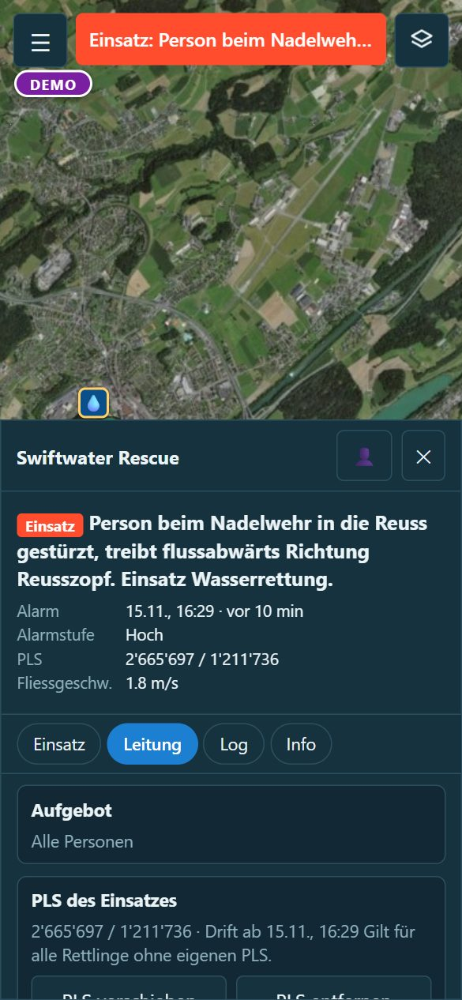
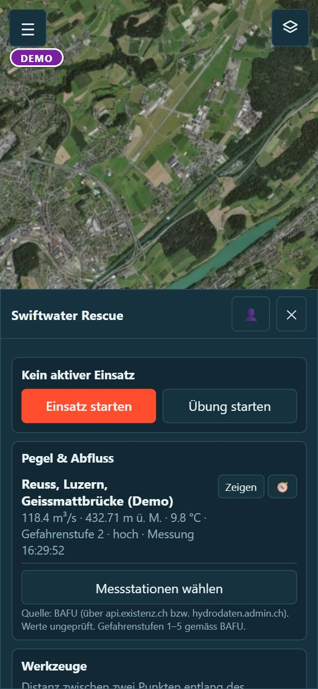
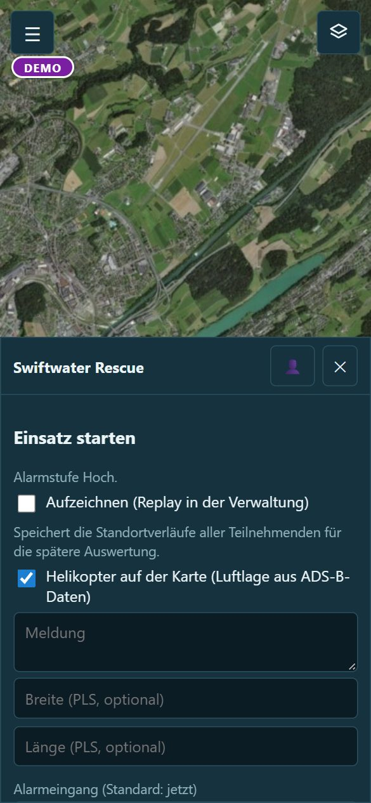

# Einsatzleitung

## Wer leitet? {#rechte}

Die Rechte der Einsatzleitung haben alle, die den Einsatz angenommen haben und

- die Spezialrolle **Einsatzleitung** tragen,
- mit einer Einrückoption mit Leitungsrechten teilnehmen (zum Beispiel «Koordinator KP Rück»),
- das Recht «Jeden Einsatz leiten» haben oder
- den Einsatz gestartet haben.

Ohne Teilnahme gibt es keine Rechte der Einsatzleitung (Ausnahme: die Übungsleitung). Welche Rechte du gerade hast, zeigt das Register **Info** im Menü. Die Einsatzleitung sieht im Menü zusätzlich das Register **Leitung**.

## Einsatz starten {#starten}

Ohne laufenden Einsatz zeigt das Menü je Einsatztyp, den du starten darfst, einen Knopf, zum Beispiel **Einsatz starten** oder **Übung starten**.

Im Formular:

- **Meldung** (Pflicht): was passiert ist. Sie erscheint im Alarm.
- **PLS** (optional): Koordinaten eingeben oder auf der Karte wählen. Ohne PLS gibt es erst ein Suchgebiet, wenn ein Rettling einen PLS hat.
- **Alarmeingang**: leer = jetzt; sonst der tatsächliche Zeitpunkt (höchstens 7 Tage zurück).
- **Aufgebot**: Einsatzgruppen, bei manchen Typen auch Einzelpersonen, oder alle aufbietbaren Personen.
- **Aufzeichnen** (für das Replay) und **Helikopter auf der Karte**, vorausgewählt je Einsatztyp.

Bei einem Folgeeinsatz (Sekundäreinsatz) wählst du den Einsatz, auf den er sich bezieht, und übernimmst auf Wunsch PLS, Fliessgeschwindigkeit und vermisste Rettlinge.

Läuft schon ein Einsatz, findest du im Register «Einsatz» die Karte **Weiteren Einsatz starten**.

## PLS setzen {#pls}

Im Register «Leitung» setzt, verschiebst oder entfernst du den **PLS des Einsatzes** samt Zeitpunkt (Beginn der Drift). Er gilt für alle Rettlinge ohne eigenen PLS. Einen eigenen PLS je Rettling setzen alle Teilnehmenden im Fenster [Rettlinge](#einsatz/rettlinge).

## Aufgebot und Nachbieten {#aufgebot}

Die Karte **Aufgebot** zeigt, wer aufgeboten ist. **Nachbieten** alarmiert weitere Einsatzgruppen, Einzelpersonen oder alle; alarmiert werden nur die neu Aufgebotenen. **Allen den Beitritt erlauben** lässt auch Nicht-Aufgebotene teilnehmen, ohne sie zu alarmieren.

Hat deine Organisation eine **Vereinbarung** mit einer anderen (eingerichtet in der Plattformverwaltung) und darfst du alle Einsatzgruppen aufbieten, ist das Aufgebot beim Start und beim Nachbieten in zwei Bereiche geteilt: **Eigene Organisation** und **Partnerorganisationen** mit deren Einsatzgruppen. Die Vereinbarung gilt je Einsatztyp. Wählst du nur Gruppen von Partnern, wird in der eigenen Organisation niemand alarmiert, auch wenn sie keine Einsatzgruppen hat. Die andere Organisation erhält einen eigenen, **verknüpften Einsatz** mit ihren eigenen Einstellungen, Rollen und Einrückoptionen; ihre Leute werden dort alarmiert und nehmen in ihrer Organisation teil. Im Menü erscheint die Karte **Gemeinsamer Einsatz** mit den beteiligten Organisationen, dem gemeinsamen Kanal und, falls eingerichtet, der gemeinsamen Konferenz. Die Lage der Partner (Einsatzkräfte, Markierungen, Rettlinge, feste Standorte, Fahrzeuge) steht blass auf der Karte und lässt sich im Fenster «Ansicht» unter «Weitere Einsätze» je Organisation ausblenden. Beendet die auslösende Organisation den Einsatz, enden auch die verknüpften.

## Externe Einsatzkräfte {#externe}

Externe Einsatzkräfte haben kein App-Konto, zum Beispiel Sicherungsposten der Feuerwehr. Im Fenster «Einsatzkräfte» erfasst du sie mit **+ Externe Einsatzkraft**:

1. Vorlage wählen (sie bringt Name, Spezialrolle, Kürzel und Farbe mit) oder «Neu ohne Vorlage».
2. Standort auf der Karte antippen. Vorlagen mit Standort werden direkt dort gesetzt.

Externe erscheinen eckig und gestrichelt auf der Karte. Mit der Spezialrolle eines Postens begrenzen sie das Suchgebiet wie eine Person. Bearbeiten (✎) und Entfernen (✕) in der Liste.

## Lage zeichnen {#lage}

Im Fenster «Markierungen» setzt die Einsatzleitung:

- **+ Markierung**: ein Punkt mit Bezeichnung, Farbe und optional einem taktischen Symbol.
- **+ Bereich**: eine Fläche. Eckpunkte antippen, dann «Fertig» (Rückgängig und Abbrechen in der Leiste oben).
- **+ Linie**: zum Beispiel eine Sperrlinie oder Rettungsachse, Punkte in Zeichenreihenfolge.

Alle sehen die Lage sofort. Entfernen über ✕ in der Liste. Ein Objekt der Geodaten-Ebene (Wehr, Brücke) lässt sich über sein Popup direkt als Markierung übernehmen.

## Einsatzkräfte führen {#einsatzkraefte}

Im Fenster «Einsatzkräfte» ändert die Einsatzleitung die **Spezialrolle** einer Person und **entfernt** Personen aus dem Einsatz (ein Wiedereinstieg bleibt möglich). Im Register «Leitung» gibt es dafür zusätzlich die Karte «Einsatzkräfte».

## Aufzeichnung {#aufzeichnung}

Die Karte **Aufzeichnung** startet, pausiert, setzt fort und beendet die Aufzeichnung der Standorte für das [Replay](#auswertung/replay). Alle sehen im Menü, ob aufgezeichnet wird («● wird aufgezeichnet»). Ohne Aufzeichnung gibt es Log, aber kein Replay.

## Öffentliche Ansicht {#oeffentlich}

Die Karte **Öffentliche Ansicht (ohne Login)** erzeugt einen Link, über den andere ohne Konto zuschauen können, zum Beispiel die Polizei oder eine Partnerorganisation. Sie sehen Karte, PLS, Suchgebiet, Einsatzkräfte, Markierungen und Rettlinge, auf Wunsch auch das Log.

- **Anonym** (Standard): statt Namen die Spezialrolle, Rettlinge als «Rettling N» ohne Beschreibung.
- **Ausschalten** macht den Link sofort ungültig; beim nächsten Einschalten gibt es einen neuen.
- Nach dem Einsatzende zeigt der Link nur noch «beendet».

## Flusssperren {#flusssperren}

Feste Standorte mit der Eigenschaft «begrenzt Suchgebiet» (zum Beispiel ein Wehr oder eine Treibgutfalle) beenden das Suchgebiet. In der Karte **Flusssperren** schaltest du sie für diesen Einsatz ganz oder einzeln aus, etwa wenn ein Wehr offen ist. Standorte mit einer Warnung (Lebensgefahr, Walze) sind im Suchgebiet hervorgehoben.

## Helikopter {#helikopter}

Ist die Anzeige eingerichtet, zeigt die Karte Helikopter und andere Luftfahrzeuge aus offenen ADS-B-Daten: rot = Rettungshelikopter (zum Beispiel Rega), gelb = übrige Helikopter. In der Karte **Helikopter** schaltest du die Anzeige für den Einsatz ein und aus. Tief fliegende Helikopter in Tälern fehlen oft, weil kein Empfänger sie sieht.

## Funk für Externe {#funk-extern}

Mit der Karte **Funk für Externe (Link)** erstellst du einen Link, über den eine externe Person ohne Konto einen Funkkanal hört und, falls erlaubt, spricht. In **Funk & Konferenz** wählst du die Kanäle des Einsatzes.

## Einsatz beenden {#beenden}

**Einsatz beenden** im Register «Leitung» schliesst den Einsatz für alle. Die Messwerte der Stationen beim PLS kommen ins Log, eine laufende Aufzeichnung endet, und, falls eingerichtet, erhalten die Teilnehmenden eine Anfrage für ein [Einsatzfeedback](#auswertung/feedback).
