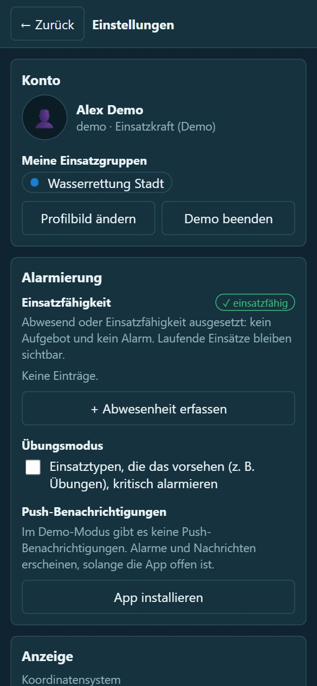

# Profil und Einstellungen

Der Knopf 👤 in der Kopfzeile des Menüs öffnet dein **Profil** mit allen persönlichen Einstellungen. «← Zurück» oder die Zurück-Taste des Geräts schliesst es.

## Konto {#konto}

Name, Benutzername und deine Einsatzgruppen. Hier änderst du dein **Profilbild** und dein **Passwort** und meldest dich **ab**. Abmelden löscht den auf dem Gerät gemerkten Stand. Unter **Angemeldete Apps** siehst du die Geräte, auf denen die native App mit deinem Konto angemeldet ist, und kannst sie abmelden.

## Alarmierung {#alarmierung}

- **Einsatzfähigkeit**: ob du zurzeit alarmiert wirst (siehe unten).
- **Übungsmodus**: Bei Einsatztypen, die das vorsehen (zum Beispiel Übungen), wirst du wie bei einem kritischen Alarm alarmiert.
- **Push-Benachrichtigungen** ein- oder ausschalten und eine Probe senden.
- **App installieren**, falls der Browser das anbietet.
- **Testalarm**: Stufe wählen (Kritisch, Hoch, Normal, Leise) und «Testalarm in 30 s» antippen. Nach 30 Sekunden kommt ein Alarm dieser Stufe nur an dich, ohne Einsatz. Schliesse in der Zwischenzeit die App oder sperre den Bildschirm, dann siehst du, ob Ton, «Nicht stören» und Push wie gewünscht wirken. «Abbrechen» stoppt den Test vorher.

> Ohne Push auf dem Gerät kommt der Testalarm nur, solange die App offen ist. Genau das zeigt der Test.

## Abwesenheit {#abwesenheit}

Mit **+ Abwesenheit erfassen** meldest du dich für einen Zeitraum ab (Ferien, Krankheit) oder setzt deine Einsatzfähigkeit aus. «Bis» leer bedeutet bis auf Weiteres. Während einer Abwesenheit:

- wirst du nicht alarmiert (kein Push),
- siehst du Einsätze trotzdem und kannst freiwillig teilnehmen,
- zeigt das Menü den Hinweis ⏸.

Laufende Abwesenheiten beendest du mit **Beenden**, geplante entfernst du. Die Verwaltung kann Abwesenheiten auch für dich erfassen.

## Regelmässige Einsatzzeiten {#einsatzzeiten}

Unter **Alarmierung → Regelmässige Einsatzzeiten** legst du je Wochentag und Uhrzeit fest, wann du alarmiert werden willst. **+ Regel erfassen** bietet zwei Arten:

- **Regelmässig ausgesetzt**: In diesen Zeiten wirst du nicht alarmiert, zum Beispiel Mo–Fr 07:00–17:00 während der Arbeit.
- **Einsatzzeit**: Sobald du mindestens eine Einsatzzeit hast, wirst du nur noch in deinen Einsatzzeiten alarmiert, zum Beispiel Pikett Sa, So 00:00–00:00 (gleiche Zeit = ganzer Tag).

Liegt «Bis» vor «Von», gilt die Regel über Mitternacht; die Stunden nach Mitternacht zählen zum gewählten Tag (Fr 20:00–02:00 = Freitagabend bis Samstag 02:00). Die Regeln wirken wie eine Abwesenheit: kein Aufgebot-Alarm, laufende Einsätze bleiben sichtbar und du kannst freiwillig beitreten. Oben bei der Einsatzfähigkeit siehst du, ob du gerade «regelmässig ausgesetzt» oder «ausserhalb Einsatzzeit» bist und ab wann du wieder alarmiert wirst. Höchstens 20 Regeln je Person; die Verwaltung kann sie auch für dich erfassen.

## Kalender {#kalender}

Der Kalender (Karte **Kalender** im Menü ohne Einsatz, über dem Übungsplan, im Profil bei den Einsatzzeiten oder in der Kopfzeile der Verwaltung) zeigt alles mit Datum an einem Ort:

- deine Abwesenheiten und regelmässigen Einsatzzeiten,
- Einsätze, an denen du teilgenommen hast (mit dem Recht «Statistik» alle),
- geplante Übungen und Einsätze aus dem Übungsplan; ist die Anmeldung offen, meldest du dich direkt dort an oder ab (**Ich nehme teil**, **Ich nehme nicht teil**, **Zurückziehen**). Übungsleiter sehen alle Planungen mit Datum und öffnen sie mit **Öffnen** in der Verwaltung,
- Ausbildungen, die ablaufen.

Oben wechselst du den Monat (‹ Heute ›), zwischen **Monat** und **Liste** und blendest Kategorien ein und aus. Ein Tag antippen zeigt seine Einträge. Mit dem Recht «Abwesenheiten verwalten» wählst du «Alle Personen» und siehst die Abwesenheiten und Einsatzzeiten aller. Deine Wahl merkt sich das Gerät.

## Anzeige {#anzeige}

- **Sprache**: Deutsch, Englisch, Französisch oder Italienisch. «Automatisch» nimmt die Sprache des Geräts, sonst die Vorgabe der Organisation. Die Wahl gilt für dein Konto (auch in der Verwaltung und für Push-Meldungen); die Seite lädt danach neu. In der Verwaltung wählst du sie im Konto-Menü oben rechts, bei der Anmeldung unter dem Knopf «Anmelden».
- **Koordinatensystem**: LV95 (Standard), LV03, WGS84 dezimal oder in Grad/Minuten/Sekunden, oder Koordinaten ausblenden.
- **Navigations-App** für den Knopf 🧭: Google Maps, Apple Karten, Waze oder eine andere App.

## Messstationen {#messstationen}

In der Karte **Pegel & Abfluss** stellst du deine eigenen Messstationen zusammen (bis 20). Suche nach Gewässer oder Ort, ↑ verschiebt, ✕ entfernt. Sie erscheinen im Fenster [Messstationen](#einsatz/messstationen), auch ohne Einsatz.

## Funk {#funk}

- **Mithören**: neue Durchsagen sofort abspielen, solange die App offen ist.
- Bedienung der Sprechtaste: halten oder antippen zum Starten und Stoppen.

## AI-Assistent {#ai}

Je Funktion des AI-Assistenten wählst du, wie weit er dich unterstützt: aus, **auf Abruf** (Knopf ✨) oder **begleitend** (der Vorschlag liegt beim Öffnen bereit). Mehr als die Verwaltung erlaubt, ist nicht möglich.

## Fahrzeuge {#fahrzeuge}

Werden die Fahrzeuge auch ausserhalb von Einsätzen verfolgt, gibst du hier deine Zustimmung, dass die native App Beacons in deiner Nähe meldet. **Fahrzeuge jetzt scannen** sucht sofort nach Fahrzeugen in deiner Nähe und meldet sie (siehe [Fahrzeuge und Beacons](#app/beacons)). Mit dem nötigen Recht lernst du hier ein neues Beacon ein.

## Dokumente {#dokumente}

Die Karte **Dokumente** zeigt, wie viele Einträge offline auf dem Gerät gespeichert sind und wie viele Lesebestätigungen offen sind. **Jetzt offline speichern** führt den Offline-Stand sofort nach, **Meine Vorschläge** zeigt deine Vorschläge an die Redaktion mit Stand. Offene Vorschläge kannst du zurückziehen. Mehr unter [Dokumente](#einsatz/dokumente).

## Ausbildung {#ausbildung}

Die Karte **Ausbildung** zeigt deine Ausbildungen und Fähigkeiten mit Gültigkeit: gültig, läuft bald ab, abgelaufen oder fehlend (Pflicht). Ist es erlaubt, erfasst du einen Abschluss selbst. Ausstehendes meldet auch ein Hinweis im Menü.

## Version {#version}

Die Karte **Version** zeigt die Version der App und des Servers. **Was ist neu** listet die Änderungen der letzten Versionen. Nach einem Update erscheint diese Liste einmal von selbst.

## Rechtliches {#rechtliches}

Links zur Bedienungsanleitung, zum Impressum, zu den Lizenzen und zur Datenschutzerklärung der Organisation.
