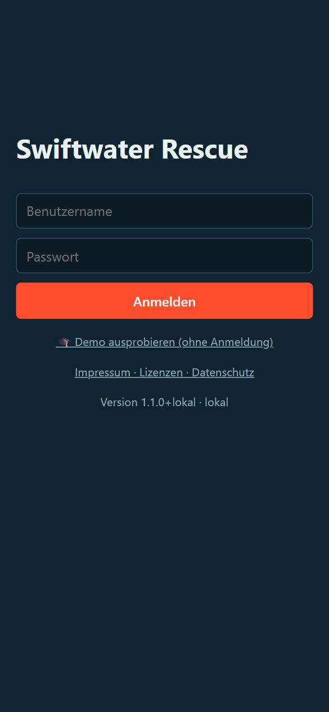
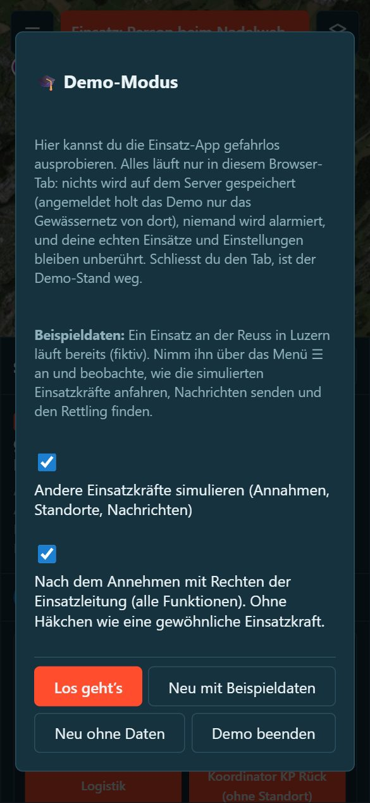
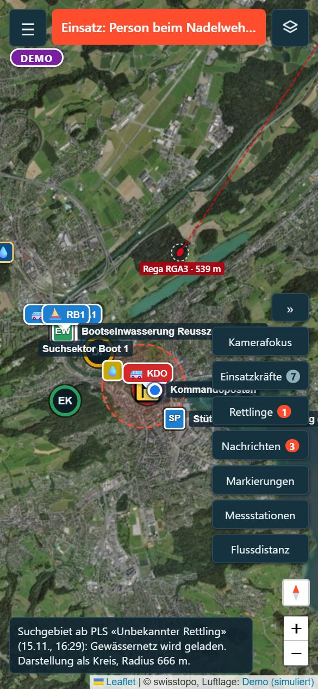

# Erste Schritte

Swiftwater Rescue unterstützt Einsatzgruppen der Wasserrettung bei der Alarmierung, der Koordination und der Lageübersicht, wenn eine Person in einem Fliessgewässer vermisst wird, und bei Übungen. Die App läuft im Browser am Handy und am Computer. Für Android und iOS gibt es zusätzlich eine eigene App (siehe [Native App](#app)).

Diese Anleitung beschreibt alle Funktionen. Welche du tatsächlich siehst, hängt von deinen Rechten und von den Einstellungen deiner Organisation ab: Ausgeschaltete Funktionen fehlen in der App ganz.

> Überall in der App findest du den Knopf **?**. Er öffnet die Anleitung direkt beim passenden Abschnitt.

## Anmelden {#anmelden}

Dein Konto erhältst du von der Verwaltung deiner Organisation: Benutzername und ein erstes Passwort. Bei der ersten Anmeldung musst du ein eigenes Passwort setzen. Danach bleibst du auf dem Gerät angemeldet, bis du dich abmeldest.

Unter dem Knopf «Anmelden» findest du:

- **Demo ausprobieren**: die App ohne Konto kennenlernen (siehe unten),
- **Bedienungsanleitung**: diese Seite,
- **Impressum, Lizenzen, Datenschutz** der Organisation,
- die Wahl der **Sprache** («Automatisch» nimmt die Sprache des Geräts).

Passwort vergessen? Die Verwaltung setzt es zurück. Du erhältst wieder ein erstes Passwort und setzt danach ein eigenes.

## Demo-Modus {#demo}

Im Demo-Modus probierst du die Einsatz-App gefahrlos aus. Alles läuft nur in diesem Browser-Tab: Nichts wird auf dem Server gespeichert, niemand wird alarmiert, und deine echten Einsätze bleiben unberührt. Schliesst du den Tab, ist der Demo-Stand weg.

- **Mit Beispieldaten**: Ein Einsatz an der Reuss in Luzern läuft bereits. Simulierte Einsatzkräfte nehmen den Einsatz an, fahren an, senden Nachrichten und finden den Rettling.
- **Ohne Daten**: leere App, du startest selbst einen Einsatz oder eine Übung.
- Mit dem Häkchen **Rechte der Einsatzleitung** siehst du nach dem Annehmen alle Funktionen der Einsatzleitung.

Das violette Zeichen **DEMO** oben links öffnet diesen Dialog jederzeit wieder, zum Beispiel um neu zu beginnen oder das Demo zu beenden. Die Bilder in dieser Anleitung stammen aus dem Demo-Modus.

## App installieren {#installieren}

Die Web-App lässt sich wie eine App auf dem Startbildschirm ablegen. Sie öffnet sich dann ohne Adressleiste und kann Push-Benachrichtigungen empfangen.

- **Android (Chrome)**: Menü ⋮ → «App installieren» oder «Zum Startbildschirm hinzufügen». Im Profil gibt es dafür auch den Knopf «App installieren».
- **iPhone und iPad (Safari)**: Teilen-Symbol → «Zum Home-Bildschirm». Push funktioniert am iPhone nur so (ab iOS 16.4).
- **Computer**: In Chrome und Edge erscheint in der Adressleiste ein Symbol zum Installieren.

Für zuverlässige Alarme auch bei lautlosem Handy empfehlen wir die [native App](#app).

## Push-Benachrichtigungen {#push}

Damit dich ein Alarm auch bei geschlossener App erreicht, braucht es Push-Benachrichtigungen. Solange Push auf deinem Gerät aus ist, steht zuoberst im Menü ein Hinweis mit **Push einschalten**. Du kannst Push auch im [Profil](#profil/alarmierung) ein- und ausschalten. «Später» blendet den Hinweis für sieben Tage aus.

> ! Die Web-App kann «Nicht stören» und den Lautlos-Modus nicht umgehen. Für kritische Alarme, die auch nachts klingeln, nutze die [native App](#app/kritisch).

## Die Oberfläche {#oberflaeche}

Die Einsatz-App zeigt die Karte im Vollbild. Alle Bedienelemente liegen darüber:

- **☰ Menü** oben links: Einsatz, Teilnahme, Leitung, Log und Werkzeuge (siehe [Das Menü](#einsatz/menu)).
- **Einsatz-Chip** oben in der Mitte: der laufende Einsatz. Antippen öffnet das Menü.
- **Ansicht** oben rechts (Ebenen-Symbol): Grundkarte und was auf der Karte erscheint (siehe [Ansicht](#karte/ansicht)).
- **Kartenknöpfe** rechts unten: Kamerafokus, Einsatzkräfte, Rettlinge, Nachrichten, Markierungen, Messstationen, Funk und Flussdistanz. Sie öffnen je ein Seitenfenster.
- **Hinweis zum Suchgebiet** unten links.

In der Kopfzeile des Menüs findest du:

| Knopf | Bedeutung |
|---|---|
| 👤 | Profil: deine persönlichen Einstellungen |
| 📋 | Meine Einsätze: Log und Replay deiner beendeten Einsätze |
| ⚙ | Verwaltung (nur mit den entsprechenden Rechten) |
| ? | Diese Anleitung |
| ✕ | Menü schliessen |

## Ohne Verbindung {#offline}

Die App merkt sich nach jeder Aktualisierung den letzten Stand. Fällt die Verbindung aus, zeigt sie oben einen Hinweis mit dem Zeitpunkt der letzten Verbindung und arbeitet mit diesem Stand weiter. Aktionen wie Nachrichten senden schlagen dann mit «Keine Verbindung zum Server» fehl. Sobald die Verbindung zurück ist, lädt die App alles neu. Kartenausschnitte, die du schon gesehen hast, bleiben auch offline sichtbar.

Hat jemand eine neue Version eingespielt, erscheint unten «Neue Version verfügbar» mit dem Knopf **Neu laden**.
