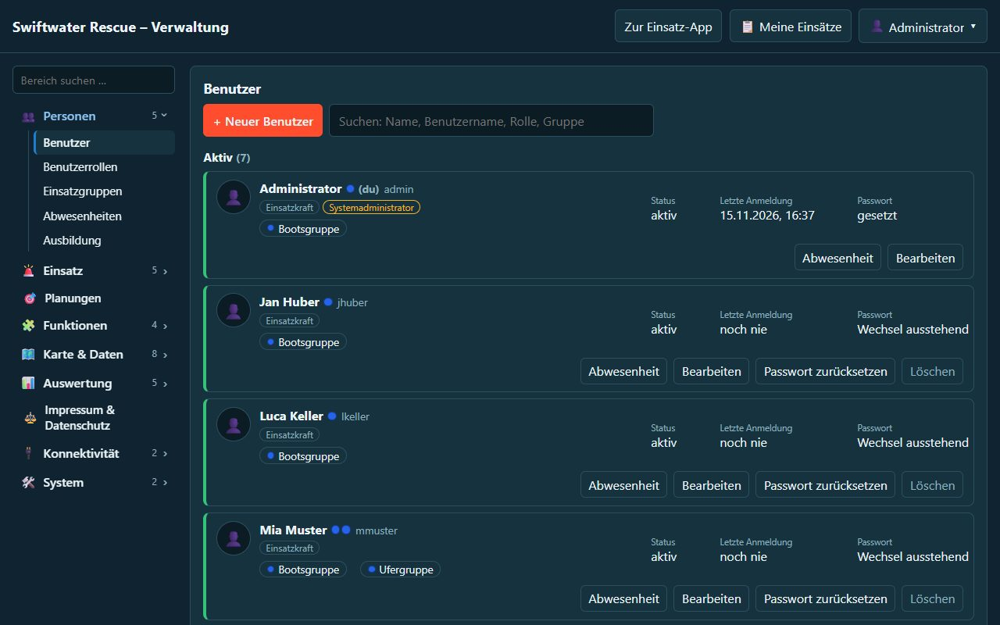
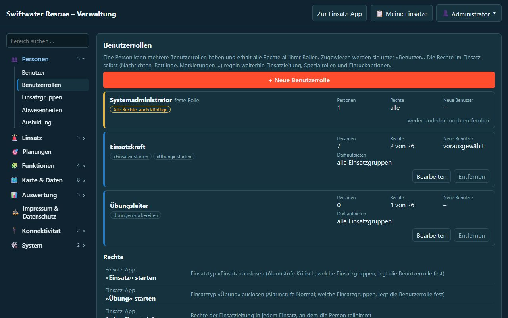
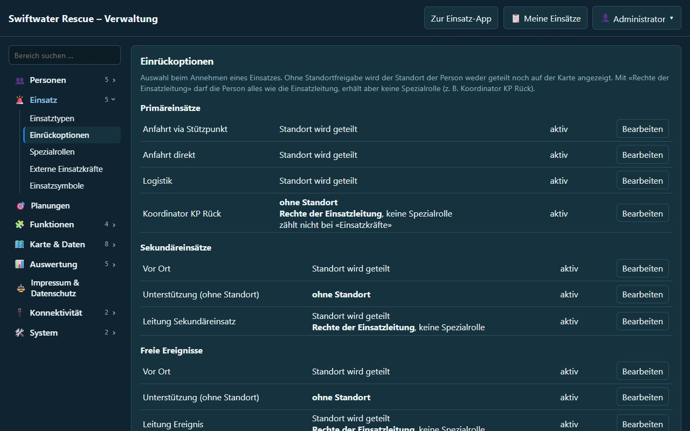
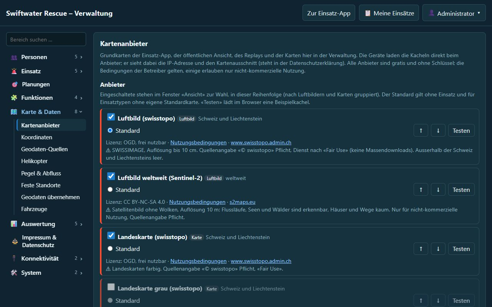
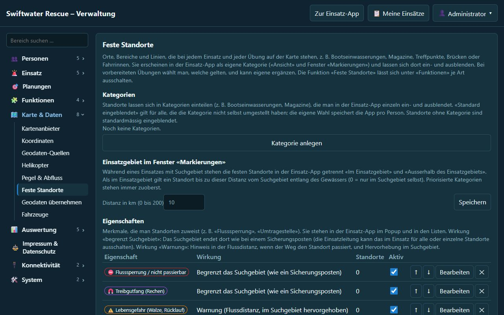
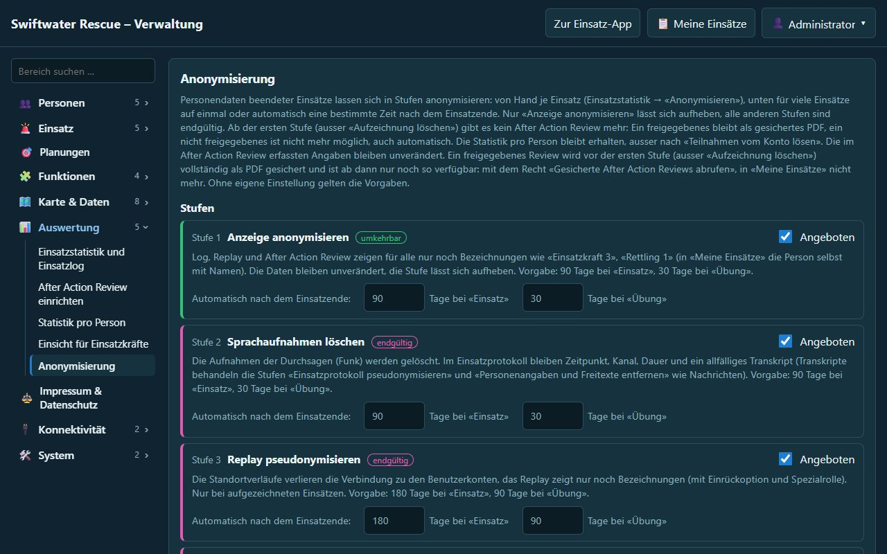
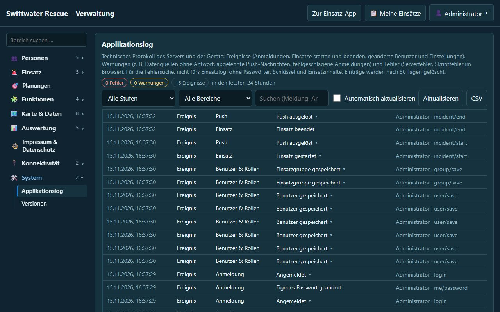

# Verwaltung

Die Verwaltung öffnest du mit ⚙ in der Kopfzeile des Menüs. Sie läuft am besten am Computer. Links stehen die Bereiche nach Kategorien (am Handy als Auswahlliste); du siehst nur die Bereiche, für die du ein Recht hast. Ab neun Bereichen hilft das Suchfeld «Bereich suchen». Der Knopf **?** oben öffnet die Anleitung zum gewählten Bereich.

Oben rechts: **Zur Einsatz-App**, **Meine Einsätze** und das Konto-Menü (Passwort ändern, Abmelden, Impressum, Version).

Alle Bereiche sind gleich aufgebaut:

- Einträge stehen als Karten untereinander, die Knöpfe immer in derselben Reihenfolge: eigene Aktionen, **Bearbeiten**, ↑/↓ für die Reihenfolge und zuletzt **Entfernen** bzw. **Deaktivieren**.
- Oben steht **+ Neu …**, bei längeren Listen daneben eine Suche.
- Deaktivierte Einträge stehen zugeklappt unter **Deaktiviert (N)**.
- In Einstellungen speichert **Speichern** die ganze Karte. Nach einer Änderung steht daneben «Ungespeicherte Änderungen»; wechselst du den Bereich, fragt die Verwaltung nach. Was mit «wird sofort gespeichert» bezeichnet ist (z. B. die Funktionen je Einsatztyp), gilt ohne Speichern.

> Rechte gelten immer auch auf dem Server. Was die Verwaltung ausblendet, kann man auch auf anderem Weg nicht ändern.

## Personen {#personen}

### Benutzer {#benutzer}

Personen anlegen, Name und Benutzerrollen ändern, Passwort zurücksetzen und deaktivieren. Mit einem neuen Konto oder einem zurückgesetzten Passwort muss die Person bei der nächsten Anmeldung ein eigenes Passwort setzen.

- **Deaktivieren** meldet die Person ab und trägt sie aus einem laufenden Einsatz aus. Ihre Daten bleiben, sie lässt sich wieder aktivieren.
- **Löschen** gibt es nur für Konten, die sich noch nie angemeldet haben und in keinem Einsatz vorkommen.
- **Endgültig löschen** gibt es für alle übrigen Konten mit dem Spezialrecht «Endgültig löschen» (siehe [Endgültig löschen](#endgueltig)).
- Du kannst nur Personen bearbeiten, deren Rechte du selbst alle hast.

### Benutzerrollen {#benutzerrollen}

Rollen bündeln Rechte, zum Beispiel «Einsatzkraft», «Übungsleiter» oder «Systemadministrator». Eine Person kann mehrere Rollen haben und erhält alle Rechte davon. Die Rolle Systemadministrator hat immer alle Rechte und lässt sich nicht ändern. Je Rolle legst du auch fest, welche Einsatzgruppen sie aufbieten darf.

### Einsatzgruppen {#einsatzgruppen}

Gruppen wie «Bootsgruppe» oder «Ufergruppe» mit Farbe und Mitgliedern. Beim Start eines Einsatzes bietet man Gruppen auf. Je Einsatztyp legt die Verwaltung fest, welche Gruppen aufbietbar und vorausgewählt sind. «Farbe beim Namen anzeigen» zeigt die Gruppe als Punkt bei den Namen in der Verwaltung.

### Abwesenheiten {#abwesenheiten}

Laufende und geplante Abwesenheiten aller Personen (Recht «Abwesenheiten verwalten»). Abwesende werden nicht alarmiert.

Darunter stehen die Personen, die nach ihren [regelmässigen Einsatzzeiten](#profil/einsatzzeiten) gerade nicht einsatzfähig sind, und alle Regeln. **+ Regel** erfasst eine Regel für eine Person, **Ändern** und **Entfernen** wirken wie im Profil. Alles zusammen im Kalender: **📅 Kalender** in der Kopfzeile ([Kalender](#profil/kalender)).

### Ausbildung {#ausbildung}

Katalog der Fähigkeiten (zum Beispiel «Rettungsschwimmer», «Bootsführer») mit Gültigkeit, Vorwarnung, Pflicht je Einsatzgruppe und ob die Person den Abschluss selbst erfasst. Die Übersicht zeigt alle Personen mit dem Stand je Fähigkeit, filterbar nach Einsatzgruppe und «nur mit Handlungsbedarf», mit Export als CSV.

## Einsatz {#einsatz}

### Einsatztypen {#einsatztypen}

Die Arten von Einsätzen, zum Beispiel «Einsatz», «Übung» oder «Pikettprobe». Für jeden aktiven Typ gibt es in der Einsatz-App einen eigenen Startknopf. Je Typ:

- Name, Farbe, Kategorie (Primär, Sekundär, freies Ereignis),
- **Alarmstufe** (kritisch bis keine), Stufe für Nachrichten und Einsatzende, Ton bei kritischem Alarm,
- aufbietbare und vorausgewählte Einsatzgruppen, Einzelpersonen erlaubt, für Nicht-Aufgebotene sichtbar,
- vorbereitete Übungen erlaubt, Vorauswahl «Aufzeichnen».

**Ton bei kritischem Alarm** (oben in der Liste): Vorgabe der Organisation für alle Typen ohne eigenen Ton, standardmässig das Martinshorn (Zweiklanghorn). Im Dialog eines Typs gilt «Vorgabe der Organisation», bis du einen anderen Ton oder «Ton des Systems» wählst. Jede Person kann in der nativen App im Profil einen eigenen Ton wählen; die Web-App spielt immer ihren eigenen Ton.

Ein neuer Typ übernimmt die Einstellungen eines bestehenden. Gelöschte Typen bleiben bei ihren Einsätzen erhalten.

### Einrückoptionen {#einrueckoptionen}

Die Auswahl beim Annehmen eines Einsatzes. Je Option: teilt den Standort, Rechte der Einsatzleitung, zählt bei den Einsatzkräften. Optionen werden deaktiviert statt gelöscht; mindestens eine bleibt aktiv.

### Spezialrollen {#spezialrollen}

Rollen im Einsatz, zum Beispiel Einsatzleitung, Rettungsschwimmer oder Sicherungsposten. Je Rolle: Reihenfolge, Farbe, **Sicherungsposten** (begrenzt das Suchgebiet), darf Nachrichten senden, darf im Funk sprechen.

### Externe Einsatzkräfte {#externe}

Vorlagen für externe Einsatzkräfte (Name, Beschreibung, Spezialrolle, Kürzel, Farbe, optional fester Standort). Die Einsatzleitung wählt sie beim Erfassen im Einsatz.

### Einsatzsymbole {#symbole}

Welche taktischen Symbole für Markierungen zur Wahl stehen und ob Markierungen ohne Symbol erlaubt sind.

## Planungen {#planungen}

Vorbereitete Übungen, geplante Sekundäreinsätze und freie Ereignisse mit ihren Elementen, Übungsplan und Anmeldungen, Durchführungen mit Log und Replay. Siehe [Übungen und Planungen](#planung/vorbereiten).

## Funktionen {#funktionen-kat}

### Funktionen {#funktionen}

Je Einsatztyp ein- und ausschaltbar: Suchgebiet, Rettlinge, Nachrichten, Markierungen, Externe, Flussdistanz, öffentliche Ansicht, Aufzeichnung, Navigation, feste Standorte, Pegel & Abfluss, Personeninfo, Geodaten-Ebene, Funk, Fahrzeuge. Ausgeschaltete Funktionen verschwinden sofort aus der Einsatz-App, auch im laufenden Einsatz; die bisherigen Daten bleiben erhalten.

### Flussdistanz {#flussdistanz}

Die Vergleichsgeschwindigkeiten, mit denen das Werkzeug Flussdistanz Fahrzeiten berechnet (1 bis 6 Werte).

### Navigation {#navigation}

Welche Navigations-Apps zur Wahl stehen und welche der Standard ist.

### Sprache {#sprache}

Die App gibt es auf Deutsch, Englisch, Französisch und Italienisch. Hier stellst du die **Vorgabe der Organisation** ein. Sie gilt für Personen, die selbst keine Sprache gewählt haben und deren Gerät keine dieser Sprachen nutzt, sowie für Push-Meldungen an Personen, die die App noch nie geöffnet haben.

> Übersetzt werden die Texte der App. Was die Organisation selbst erfasst (Einsatztypen, Rollen, Einrückoptionen, Meldungen, Dokumente) und das Einsatzlog bleiben in der Sprache, in der sie geschrieben wurden.

### AI-Assistent {#ai}

Anbieter (OpenAI-kompatibel oder Anthropic), Modell, Schlüssel, Limits und Datenschutz je Einsatztyp (Namen ersetzen, Koordinaten runden). In der Matrix gibst du je Funktion, Rolle und Einsatztyp frei, ob der Assistent aus, auf Abruf oder begleitend arbeitet.

## Karte & Daten {#karte-daten}

### Kartenanbieter {#karten}

Welche Grundkarten (Luftbilder, Karten) zur Wahl stehen, ihre Reihenfolge und der Standard, global und je Einsatztyp. «Testen» lädt eine Beispielkachel.

### Koordinaten {#koordinaten}

Das Standard-Koordinatensystem. Jede Person kann es im Profil übersteuern.

### Geodaten-Quellen {#geoquellen}

Woher das Gewässernetz für Suchgebiet und Flussdistanz kommt: eigene PostGIS-Datenbank, PostGIS-API und Overpass-Server, in einstellbarer Reihenfolge, mit Zwischenspeicher und Statistik je Server.

### Helikopter {#helikopter}

Quellen der ADS-B-Daten, Filter (Rettungshelikopter, Helikopter, alle), wer die Helikopter sieht, Umkreis mit und ohne Einsatz, Liste der Rettungshelikopter.

### Pegel & Abfluss {#pegel}

Umkreis und Anzahl der Messstationen beim PLS, Seen ja oder nein, Datenquellen mit Test.

**Fliessgeschwindigkeit**: Faktoren der Driftgeschwindigkeit (Unter- und Obergrenze), Schwellen der Meldungen (Abweichung in %, Horizont, Anstieg des Abflusses, Gefahrenstufe, neue Vorhersage) und je Einsatztyp Anzeige und Meldungen ein oder aus.

**Kennlinien**: je Station aus den Querprofilen der BAFU-Flussvermessung bzw. aus den Messreihen berechnen («Berechnen»), prüfen (Diagramm v(Q) mit Messpunkten) oder von Hand übersteuern. Dazu die Stationen oberhalb mit ihrer Laufzeit (für Stunden ohne BAFU-Vorhersage).

**Abschnitte**: für eine Station vorschlagen (km oberhalb und unterhalb), danach Art (Stau, Schwellen, Engstelle, frei) und Faktor je Abschnitt anpassen. Von Hand geänderte Abschnitte bleiben bei einem neuen Vorschlag erhalten.

### Feste Standorte {#standorte}

Orte, Bereiche und Linien, die in jedem Einsatz auf der Karte stehen, zum Beispiel Bootseinwasserungen, Magazine oder Fahrrinnen. Mit Kategorien (Standard ein- oder ausgeblendet, priorisiert), Eigenschaften (zum Beispiel «Flusssperre», die das Suchgebiet begrenzt, oder eine Warnung) und Navigationspunkten (Zufahrten).

### Geodaten übernehmen {#geodaten}

Objekte am Gewässer aus OpenStreetMap (Wehre, Kraftwerke, Brücken, Slipanlagen …) auf einer Karte suchen und als feste Standorte übernehmen. Die App vergleicht übernommene Standorte regelmässig mit der Quelle und meldet Abweichungen.

### Fahrzeuge {#fahrzeuge}

Fahrzeugarten (Boot, Anhänger, Zugfahrzeug) mit Platz und Ladung, Fahrzeuge mit ihrem Beacon (UUID, Major, Minor, optional die MAC-Adresse für den Batteriestand unter iOS; Android-Geräte lernen sie selbst) und dem zuletzt gemeldeten Batteriestand, Standort von Hand setzen und Verbund (welches Fahrzeug was trägt).

## Auswertung {#auswertung-kat}

### Einsatzstatistik und Einsatzlog {#einsatzlog}

Kennzahlen und alle Einsätze mit Log, Replay, After Action Review, Anonymisieren und «Aufzeichnung löschen». Siehe [Auswertung](#auswertung/statistik).

### After Action Review einrichten {#aarcfg}

Titel, Logo, Felder des Reviews, mitgelieferte Abschnitte, erlaubte Dokumente je Zustand und das Einsatzfeedback mit seinen Fragen.

### Statistik pro Person {#personenstatistik}

Auswertung je Person mit Filter, Diagrammen und CSV.

### Einsicht für Einsatzkräfte {#einsicht}

Was Teilnehmende unter «Meine Einsätze» sehen: aus, anonym (Standard) oder vollständig, und welche Knöpfe (Log, Replay, AAR, Word, PDF).

### Anonymisierung {#anonymisierung}

Personendaten beendeter Einsätze in Stufen entfernen: Anzeige anonymisieren, Sprachaufnahmen löschen, Replay, Protokoll, Freitexte, Teilnahmen vom Konto lösen, Aufzeichnung löschen. Je Stufe und Einsatztyp eine Frist für die automatische Ausführung. Ausser der Anzeige sind die Stufen nicht umkehrbar.

## Rechtliches {#rechtliches}

Angaben der Organisation für Impressum und Datenschutzerklärung. Die Seite «Impressum, Lizenzen & Datenschutz» ergänzt sie mit dem aktuellen Stand der Einstellungen.

### Datenschutzauszug {#datenschutzauszug}

Für Auskunftsbegehren nach dem Datenschutzgesetz. Zwei getrennte Rechte, beide in der Gruppe «Datenschutz» der Benutzerrollen; der Systemadministrator hat sie immer.

- **Auszug je Person** (Recht «Datenschutzauszug je Person erstellen»): Person wählen (auch deaktivierte), dann «PDF erstellen» oder «ZIP erstellen». Das PDF enthält Konto und Einstellungen, Rollen und Gruppen, angemeldete Geräte, Abwesenheiten, Einsatzzeiten, Ausbildung, Planungen, Teilnahmen mit letztem Standort, Einträge im Einsatzlog, gesendete und empfangene Nachrichten, Durchsagen, Einsatzfeedback, Erfasstes, Nutzung des AI-Assistenten und das Applikationslog. Das ZIP enthält zusätzlich alle Daten als JSON und CSV, den Standortverlauf als GeoJSON, das Profilbild und die eigenen Sprachaufnahmen.
- **Datenexport der Organisation** (Recht «Datenexport der Organisation erstellen»): «Übersicht als PDF» listet alle Tabellen mit Anzahl Zeilen und alle Personen; «ZIP erstellen» enthält je Tabelle eine JSON- und eine CSV-Datei, auf Wunsch auch die Sprachaufnahmen und die gesicherten After Action Reviews.

> Passwörter, Schlüssel und Zugangstoken sind nie enthalten. Der Auszug entsteht im Browser und wird nirgends gespeichert; jeder erstellte Auszug steht im **Verlauf** (wer, wann, welche Person, welches Format).

> ! Ein Auszug enthält Namen, Standorte und Inhalte. Nur sicher an die berechtigte Person weitergeben.

Einsätze, deren Teilnahmen anonymisiert und vom Konto gelöst wurden, sind der Person nicht mehr zugeordnet und fehlen deshalb im Auszug.

## Dokumente {#dokumente-kat}

Die Dokumentenablage hält Unterlagen bereit, die man im Einsatz, in der Übung und in der Ausbildung braucht: Einsatzpläne, Checklisten, Merkblätter, Reglemente. Alles Nötige sehen Personen mit dem Recht «Dokumentenablage verwalten». Wer zur **Redaktion** eines Ordners gehört, sieht die Ablage und den Eingang nur für seine Ordner. Die Funktion «Dokumente» lässt sich je Einsatztyp unter [Funktionen](#funktionen) ausschalten.

### Ablage {#dokumente}

Links steht der **Ordnerbaum** mit der Zahl der Einträge je Ordner (samt Unterordnern), dazu «Alle Dokumente» und «Überprüfung fällig». 🔒 kennzeichnet Ordner, die nicht alle sehen. Rechts steht oben die Karte des gewählten Ordners mit seinen **Zugriffen** in einer Zeile (wer ihn sieht, Redaktion, Vorschläge, für wie viele Personen er sichtbar ist), darunter seine Einträge als Karten: Art (PDF, TEXT, LINK …), Version, Offline, Bilder, Lesebestätigung, «Überprüfung fällig», Datei bzw. Adresse, wo er im Einsatz erscheint und der Stand.

- **+ Eintrag** öffnet den Dialog mit den Registern Datei, Seite und Link; **Hochladen …** legt mehrere Dateien auf einmal im gewählten Ordner an (Titel = Dateiname); **+ Ordner** legt einen Unterordner des gewählten an.
- **Ziehen**: Einträge in einen anderen Ordner ziehen verschiebt sie; Ordner (mit dem Recht «Dokumentenablage verwalten») lassen sich in einen anderen Ordner oder auf «Alle Dokumente» (oberste Ebene) ziehen. Aufgeklappte Ordner merkt sich das Gerät.
- **Suche** «In allen Ordnern suchen …» findet Titel, Schlagwörter, Beschreibung und den Text der Seiten und PDFs, mit Fundstelle.

Ein Eintrag ist eine **Datei** (mit Versionen), eine **Seite** (Text direkt in der App, Markdown wie in dieser Anleitung, mit Bildern) oder ein **Link**. Je Eintrag: Titel, Beschreibung, Schlagwörter, Einsatztypen («Für diesen Einsatz»), feste Standorte (das Dokument erscheint im Popup des Standorts), «Überprüfen bis», Offline und Lesebestätigung.

- **Ordner** («Ordner bearbeiten»): links Name, übergeordneter Ordner, Beschreibung und wer ihn sieht (alle Angemeldeten oder nur bestimmte Einsatzgruppen bzw. Benutzerrollen, mit der Zahl der Personen); ein Unterordner kann nur weiter einschränken. Rechts die **Redaktion** (darf Einträge anlegen und ändern), wer **vorschlagen** darf und ob der Ordner **mit Externen teilbar** ist.
- **Eintrag** («Bearbeiten»): links Art, Titel, Ordner, Schlagwörter, Beschreibung und der Inhalt (Datei mit Versionen, Text der Seite oder Adresse), rechts «Im Einsatz anbieten» (Einsatztypen und feste Standorte über «+ Standort»), «Überprüfen bis», Lesebestätigung («Einstellen …», «Stand ansehen») und Offline («darf offline gespeichert werden», «für alle Lesenden automatisch offline speichern»). Deaktivieren und Aktivieren direkt an der Karte.
- **Versionen**: Eine neue Datei ersetzt die bisherige. Frühere Fassungen bleiben gemäss [Einstellungen](#dokumente-einstellungen) erhalten und lassen sich wiederherstellen. Der Text von PDFs wird beim Hochladen für die Suche ausgelesen.
- **Lesebestätigung**: von allen, die den Eintrag sehen, nur von bestimmten Einsatzgruppen oder Benutzerrollen oder wie die Pflicht einer Fähigkeit der [Ausbildung](#ausbildung). Später Hinzukommende müssen wahlweise auch bestätigen (mit eigener Frist ab Eintritt) oder nicht. Frist in Tagen mit Erinnerung per Push. Eine neue Version verlangt die Bestätigung erneut, wahlweise nur bei wesentlichen Änderungen. Mit einer Fähigkeit trägt die Bestätigung die Ausbildung bei der Person ein. Die Übersicht zeigt Offene, Bestätigte und Freiwillige, mit «Erinnern» und CSV.

> Wer einen Eintrag sehen darf, regelt der Ordner. Wer ihn bestätigen muss, regelt der Eintrag. Alle übrigen Lesenden können freiwillig bestätigen.

### Eingang {#dokumente-eingang}

Vorschläge von Einsatzkräften: ein neuer Eintrag, eine neue Version oder ein Hinweis («Funkgerät fehlt auf der Checkliste»). Sie sieht nur die Redaktion des Ordners. **Übernehmen** legt den Eintrag bzw. die Version an, **Ablehnen** mit Begründung, Hinweise markiert man als **erledigt**. Die vorschlagende Person wird benachrichtigt (Push) und sieht den Stand im Profil.

### Anzeige {#dokumente-anzeige}

Welche Abschnitte im Fenster «Dokumente» der Einsatz-App erscheinen und in welcher Reihenfolge: Lesebestätigung offen, Favoriten, An Standorten im Einsatzgebiet, Für diesen Einsatz, Zuletzt geöffnet, Neu und geändert, Ordner. Es gibt eine Vorgabe (auch ohne Einsatz) und auf Wunsch eine eigene je Einsatztyp. Dazu die Zahl der Einträge je Abschnitt, die Zahl in der Menükarte «Unterlagen» und ob Personen die Abschnitte für sich anordnen dürfen.

### Einstellungen {#dokumente-einstellungen}

- **Dateitypen**: Katalog fester Typen, je ein- und ausschaltbar, dazu freie Endungen. Freie Endungen zeigt die App nie an, sie werden nur heruntergeladen. Ausführbare und aktive Dateien (z. B. `.exe`, `.js`, `.html`, `.svg`) sind nie erlaubt. Der Server prüft den Inhalt, nicht nur die Endung.
- **Speicher**: Höchstgrösse je Datei, Speicher insgesamt, Anzahl früherer Versionen, offline je Gerät.
- **Externe**: ob die Einsatzleitung Dokumente an Externe freigeben darf, auf der Gastseite des Funks und bzw. oder über einen eigenen Link, ob Externe herunterladen dürfen und wie viele Abrufe je Stunde erlaubt sind.

## Konnektivität {#konnektivitaet}

### E-Mail-Alarm {#emailalarm}

Eine eingehende E-Mail startet einen Einsatz: Postfach (IMAP), Abruf, erlaubte Absender und Schlüsselwörter je Einsatztyp, Aufgebot und PLS aus Koordinaten in der E-Mail. «Beispiel prüfen» testet eine E-Mail, ohne einen Einsatz zu starten.

### Funk & Konferenz {#funk}

Durchsagen und Live-Konferenz (LiveKit-Server), Kanäle mit Hör- und Sprechrechten, Transkription, Aufbewahrung und Links für Externe je Einsatztyp.

### Partnerorganisationen {#partner}

Vereinbarungen mit anderen Organisationen, die eine **eigene Installation** mit eigener Adresse betreiben (Recht «Konnektivität einstellen»). Es gibt keine gemeinsame Datenbank: Jede Organisation behält ihre Personen, Einstellungen und Einsätze auf ihrem Server und entscheidet selbst, was ein Partner darf.

1. Eine Seite trägt den Partner mit **+ Partnerorganisation** ein: Name, Adresse der Installation (z. B. `https://partner.example.ch/swiftwater/`, steht beim Partner oben unter «Diese Installation») und **Neuen Schlüssel erzeugen**. Der Schlüssel erscheint einmal zum Kopieren.
2. Die andere Seite trägt diese Installation ebenso ein und gibt unter «Schlüssel» den **erhaltenen Schlüssel** ein. Den Schlüssel auf einem sicheren Weg weitergeben (nicht per gewöhnlicher E-Mail), er berechtigt zum Aufbieten.
3. **Verbindung testen** auf beiden Seiten; danach kennt jede Seite die Einsatztypen des Partners.
4. Im Dialog des Partners festlegen, **welche Einsatzgruppen** er aufbieten darf (alle oder ausgewählte) und **welcher eigene Einsatztyp** auf einen Einsatztyp des Partners folgt. Einsatztypen ohne Zuordnung lösen bei uns nichts aus.

Die Server sprechen direkt miteinander; jede Anfrage ist mit dem Schlüssel signiert und gilt nur kurz (die Uhren beider Server müssen stimmen). **Deaktivieren** sperrt den Partner sofort, ohne die Vereinbarung zu löschen; **Entfernen** geht nur, solange kein gemeinsamer Einsatz läuft. Ein neuer Schlüssel ersetzt den alten, der Partner muss ihn dann ebenfalls eintragen. Ablauf im Einsatz: siehe [Aufgebot und Nachbieten](#leitung/aufgebot).

> Partner sehen von uns nur, was ein gemeinsamer Einsatz braucht: Name und Spezialrolle der Teilnehmenden mit Standort, die Lage, feste Standorte und Fahrzeuge dieses Einsatzes, gemeinsame Rettlinge und den gemeinsamen Kanal. Telefonnummern nur, wenn der Direktanruf bei uns allen Teilnehmenden offen steht.

## System {#system}

### Applikationslog {#applog}

Technisches Protokoll von Server und Geräten: Ereignisse, Warnungen und Fehler, mit Filter, Suche und Export. Hilft bei der Fehlersuche; es enthält keine Passwörter, Standorte oder Einsatzinhalte.

### Versionen {#versionen}

Version des Servers, Mindestversion der Apps und alle angemeldeten Apps je Plattform und Version.

### Endgültig löschen {#endgueltig}

Manches lässt sich normalerweise nur deaktivieren oder gar nicht löschen, damit Einsatzdaten vollständig bleiben. Wer zusätzlich zum Recht des Bereichs das Spezialrecht **«Endgültig löschen»** hat (Benutzerrollen, Gruppe System), sieht dort den Knopf **«Endgültig löschen»**:

| Was | Wo | Folgen |
|---|---|---|
| Beendeter Einsatz | Einsatzstatistik (Recht «Alle Einsätze auswerten») | Einsatz mit Log, Nachrichten, Aufzeichnung, Rettlingen, Markierungen, Durchsagen, After Action Review (auch gesichertes PDF) und Feedback; eine vorbereitete Übung wird zurückgesetzt |
| Benutzer | Benutzer | Konto und alle persönlichen Angaben; in bisherigen Einsätzen erscheint die Person als «Gelöschte Person», auch in Log und Nachrichten |
| Einrückoption | Einrückoptionen | bisherige Teilnahmen zeigen nur noch das Kürzel; je Kategorie bleibt mindestens eine aktiv |
| Spezialrolle | Spezialrollen | bisherige Einsatzkräfte, Vorlagen, Elemente von Übungen und Funkkanäle verlieren die Rolle |
| Vorlage | Externe Einsatzkräfte | bereits erfasste Externe bleiben |
| Fähigkeit mit Einträgen | Ausbildung | die erfassten Ausbildungen aller Personen |
| Fahrzeugart mit Fahrzeugen, Fahrzeug aus Einsätzen | Fahrzeuge | die Fahrzeuge mit Sichtungen und Verbund, auch im Replay |

Vor dem Löschen zählt eine Rückfrage die Folgen auf. **Das lässt sich nicht rückgängig machen.** Laufende Einsätze und das eigene Konto lassen sich nicht löschen. Jedes endgültige Löschen steht im Applikationslog (ohne Namen).

> ! Für Personendaten in Einsätzen ist meist die [Anonymisierung](#anonymisierung) der bessere Weg: Sie behält Statistik und Einsatzlog.
