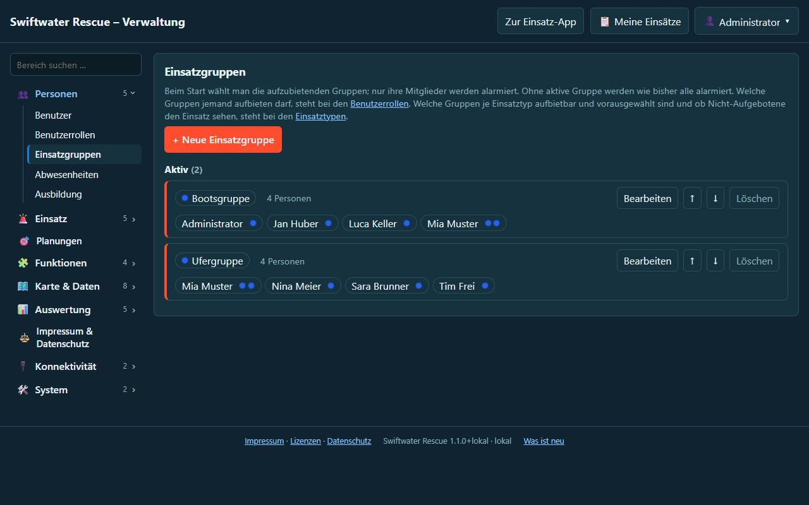
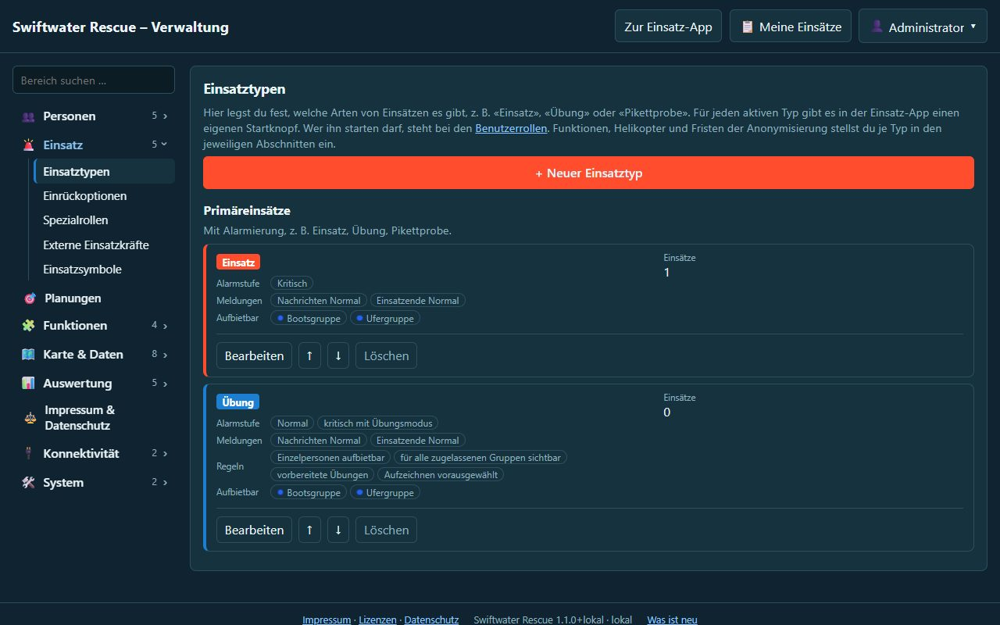
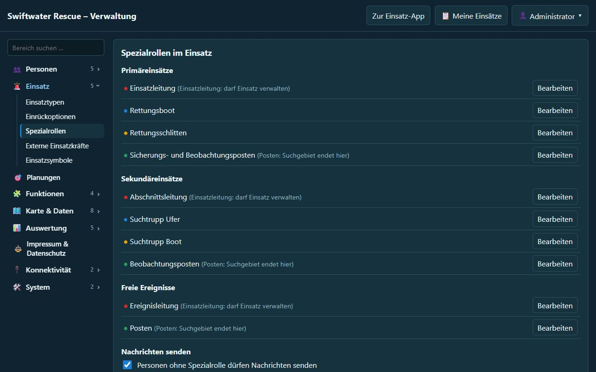
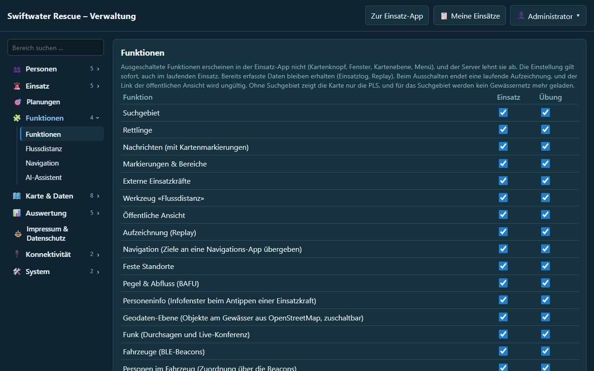

# Verwaltung

Die Verwaltung öffnest du mit ⚙ in der Kopfzeile des Menüs. Sie läuft am besten am Computer. Links stehen die Bereiche nach Kategorien (am Handy als Auswahlliste); du siehst nur die Bereiche, für die du ein Recht hast. Ab neun Bereichen hilft das Suchfeld «Bereich suchen». Der Knopf **?** oben öffnet die Anleitung zum gewählten Bereich.

Oben rechts: **Zur Einsatz-App**, **Meine Einsätze** und das Konto-Menü (Passwort ändern, Abmelden, Impressum, Version).

Alle Bereiche sind gleich aufgebaut:

- Einträge stehen als Karten untereinander, die Knöpfe immer in derselben Reihenfolge: eigene Aktionen, **Bearbeiten**, ↑/↓ für die Reihenfolge und zuletzt **Entfernen** bzw. **Deaktivieren**.
- Oben steht **+ Neu …**, bei längeren Listen daneben eine Suche.
- Deaktivierte Einträge stehen zugeklappt unter **Deaktiviert (N)**.
- In Einstellungen speichert **Speichern** die ganze Karte. Nach einer Änderung steht daneben «Ungespeicherte Änderungen»; wechselst du den Bereich, fragt die Verwaltung nach. Was mit «wird sofort gespeichert» bezeichnet ist (z. B. die Funktionen je Einsatztyp), gilt ohne Speichern.

> Rechte gelten immer auch auf dem Server. Was die Verwaltung ausblendet, kann man auch auf anderem Weg nicht ändern.

## Personen {#personen}

### Benutzer {#benutzer}

Personen anlegen, Name und Benutzerrollen ändern, Passwort zurücksetzen und deaktivieren. Mit einem neuen Konto oder einem zurückgesetzten Passwort muss die Person bei der nächsten Anmeldung ein eigenes Passwort setzen.

- **Deaktivieren** meldet die Person ab und trägt sie aus einem laufenden Einsatz aus. Ihre Daten bleiben, sie lässt sich wieder aktivieren.
- **Löschen** gibt es nur für Konten, die sich noch nie angemeldet haben und in keinem Einsatz vorkommen.
- **Endgültig löschen** gibt es für alle übrigen Konten mit dem Spezialrecht «Endgültig löschen» (siehe [Endgültig löschen](#endgueltig)).
- Du kannst nur Personen bearbeiten, deren Rechte du selbst alle hast.

### Benutzerrollen {#benutzerrollen}

Rollen bündeln Rechte, zum Beispiel «Einsatzkraft», «Übungsleiter» oder «Systemadministrator». Eine Person kann mehrere Rollen haben und erhält alle Rechte davon. Die Rolle Systemadministrator hat immer alle Rechte und lässt sich nicht ändern. Je Rolle legst du auch fest, welche Einsatzgruppen sie aufbieten darf.

### Einsatzgruppen {#einsatzgruppen}

Gruppen wie «Bootsgruppe» oder «Ufergruppe» mit Farbe und Mitgliedern. Beim Start eines Einsatzes bietet man Gruppen auf. Je Einsatztyp legt die Verwaltung fest, welche Gruppen aufbietbar und vorausgewählt sind. «Farbe beim Namen anzeigen» zeigt die Gruppe als Punkt bei den Namen in der Verwaltung.

### Abwesenheiten {#abwesenheiten}

Laufende und geplante Abwesenheiten aller Personen (Recht «Abwesenheiten verwalten»). Abwesende werden nicht alarmiert.

Darunter stehen die Personen, die nach ihren [regelmässigen Einsatzzeiten](#profil/einsatzzeiten) gerade nicht einsatzfähig sind, und alle Regeln. **+ Regel** erfasst eine Regel für eine Person, **Ändern** und **Entfernen** wirken wie im Profil. Alles zusammen im Kalender: **📅 Kalender** in der Kopfzeile ([Kalender](#profil/kalender)).

### Ausbildung {#ausbildung}

Katalog der Fähigkeiten (zum Beispiel «Rettungsschwimmer», «Bootsführer») mit Gültigkeit, Vorwarnung, Pflicht je Einsatzgruppe und ob die Person den Abschluss selbst erfasst. Die Übersicht zeigt alle Personen mit dem Stand je Fähigkeit, filterbar nach Einsatzgruppe und «nur mit Handlungsbedarf», mit Export als CSV.

## Einsatz {#einsatz}

### Einsatztypen {#einsatztypen}

Die Arten von Einsätzen, zum Beispiel «Einsatz», «Übung» oder «Pikettprobe». Für jeden aktiven Typ gibt es in der Einsatz-App einen eigenen Startknopf. Je Typ:

- Name, Farbe, Kategorie (Primär, Sekundär, freies Ereignis),
- **Alarmstufe** (kritisch bis keine), Stufe für Nachrichten und Einsatzende, Ton bei kritischem Alarm,
- aufbietbare und vorausgewählte Einsatzgruppen, Einzelpersonen erlaubt, für Nicht-Aufgebotene sichtbar,
- vorbereitete Übungen erlaubt, Vorauswahl «Aufzeichnen».

Ein neuer Typ übernimmt die Einstellungen eines bestehenden. Gelöschte Typen bleiben bei ihren Einsätzen erhalten.

### Einrückoptionen {#einrueckoptionen}

Die Auswahl beim Annehmen eines Einsatzes. Je Option: teilt den Standort, Rechte der Einsatzleitung, zählt bei den Einsatzkräften. Optionen werden deaktiviert statt gelöscht; mindestens eine bleibt aktiv.

### Spezialrollen {#spezialrollen}

Rollen im Einsatz, zum Beispiel Einsatzleitung, Rettungsschwimmer oder Sicherungsposten. Je Rolle: Reihenfolge, Farbe, **Sicherungsposten** (begrenzt das Suchgebiet), darf Nachrichten senden, darf im Funk sprechen.

### Externe Einsatzkräfte {#externe}

Vorlagen für externe Einsatzkräfte (Name, Beschreibung, Spezialrolle, Kürzel, Farbe, optional fester Standort). Die Einsatzleitung wählt sie beim Erfassen im Einsatz.

### Einsatzsymbole {#symbole}

Welche taktischen Symbole für Markierungen zur Wahl stehen und ob Markierungen ohne Symbol erlaubt sind.

## Planungen {#planungen}

Vorbereitete Übungen, geplante Sekundäreinsätze und freie Ereignisse mit ihren Elementen, Übungsplan und Anmeldungen, Durchführungen mit Log und Replay. Siehe [Übungen und Planungen](#planung/vorbereiten).

## Funktionen {#funktionen-kat}

### Funktionen {#funktionen}

Je Einsatztyp ein- und ausschaltbar: Suchgebiet, Rettlinge, Nachrichten, Markierungen, Externe, Flussdistanz, öffentliche Ansicht, Aufzeichnung, Navigation, feste Standorte, Pegel & Abfluss, Personeninfo, Geodaten-Ebene, Funk, Fahrzeuge. Ausgeschaltete Funktionen verschwinden sofort aus der Einsatz-App, auch im laufenden Einsatz; die bisherigen Daten bleiben erhalten.

### Flussdistanz {#flussdistanz}

Die Vergleichsgeschwindigkeiten, mit denen das Werkzeug Flussdistanz Fahrzeiten berechnet (1 bis 6 Werte).

### Navigation {#navigation}

Welche Navigations-Apps zur Wahl stehen und welche der Standard ist.

### AI-Assistent {#ai}

Anbieter (OpenAI-kompatibel oder Anthropic), Modell, Schlüssel, Limits und Datenschutz je Einsatztyp (Namen ersetzen, Koordinaten runden). In der Matrix gibst du je Funktion, Rolle und Einsatztyp frei, ob der Assistent aus, auf Abruf oder begleitend arbeitet.

## Karte & Daten {#karte-daten}

### Kartenanbieter {#karten}

Welche Grundkarten (Luftbilder, Karten) zur Wahl stehen, ihre Reihenfolge und der Standard, global und je Einsatztyp. «Testen» lädt eine Beispielkachel.

### Koordinaten {#koordinaten}

Das Standard-Koordinatensystem. Jede Person kann es im Profil übersteuern.

### Geodaten-Quellen {#geoquellen}

Woher das Gewässernetz für Suchgebiet und Flussdistanz kommt: eigene PostGIS-Datenbank, PostGIS-API und Overpass-Server, in einstellbarer Reihenfolge, mit Zwischenspeicher und Statistik je Server.

### Helikopter {#helikopter}

Quellen der ADS-B-Daten, Filter (Rettungshelikopter, Helikopter, alle), wer die Helikopter sieht, Umkreis mit und ohne Einsatz, Liste der Rettungshelikopter.

### Pegel & Abfluss {#pegel}

Umkreis und Anzahl der Messstationen beim PLS, Seen ja oder nein, Datenquellen mit Test.

### Feste Standorte {#standorte}

Orte, Bereiche und Linien, die in jedem Einsatz auf der Karte stehen, zum Beispiel Bootseinwasserungen, Magazine oder Fahrrinnen. Mit Kategorien (Standard ein- oder ausgeblendet, priorisiert), Eigenschaften (zum Beispiel «Flusssperre», die das Suchgebiet begrenzt, oder eine Warnung) und Navigationspunkten (Zufahrten).

### Geodaten übernehmen {#geodaten}

Objekte am Gewässer aus OpenStreetMap (Wehre, Kraftwerke, Brücken, Slipanlagen …) auf einer Karte suchen und als feste Standorte übernehmen. Die App vergleicht übernommene Standorte regelmässig mit der Quelle und meldet Abweichungen.

### Fahrzeuge {#fahrzeuge}

Fahrzeugarten (Boot, Anhänger, Zugfahrzeug) mit Platz und Ladung, Fahrzeuge mit ihrem Beacon (UUID, Major, Minor), Standort von Hand setzen und Verbund (welches Fahrzeug was trägt).

## Auswertung {#auswertung-kat}

### Einsatzstatistik und Einsatzlog {#einsatzlog}

Kennzahlen und alle Einsätze mit Log, Replay, After Action Review, Anonymisieren und «Aufzeichnung löschen». Siehe [Auswertung](#auswertung/statistik).

### After Action Review einrichten {#aarcfg}

Titel, Logo, Felder des Reviews, mitgelieferte Abschnitte, erlaubte Dokumente je Zustand und das Einsatzfeedback mit seinen Fragen.

### Statistik pro Person {#personenstatistik}

Auswertung je Person mit Filter, Diagrammen und CSV.

### Einsicht für Einsatzkräfte {#einsicht}

Was Teilnehmende unter «Meine Einsätze» sehen: aus, anonym (Standard) oder vollständig, und welche Knöpfe (Log, Replay, AAR, Word, PDF).

### Anonymisierung {#anonymisierung}

Personendaten beendeter Einsätze in Stufen entfernen: Anzeige anonymisieren, Sprachaufnahmen löschen, Replay, Protokoll, Freitexte, Teilnahmen vom Konto lösen, Aufzeichnung löschen. Je Stufe und Einsatztyp eine Frist für die automatische Ausführung. Ausser der Anzeige sind die Stufen nicht umkehrbar.

## Rechtliches {#rechtliches}

Angaben der Organisation für Impressum und Datenschutzerklärung. Die Seite «Impressum, Lizenzen & Datenschutz» ergänzt sie mit dem aktuellen Stand der Einstellungen.

### Datenschutzauszug {#datenschutzauszug}

Für Auskunftsbegehren nach dem Datenschutzgesetz. Zwei getrennte Rechte, beide in der Gruppe «Datenschutz» der Benutzerrollen; der Systemadministrator hat sie immer.

- **Auszug je Person** (Recht «Datenschutzauszug je Person erstellen»): Person wählen (auch deaktivierte), dann «PDF erstellen» oder «ZIP erstellen». Das PDF enthält Konto und Einstellungen, Rollen und Gruppen, angemeldete Geräte, Abwesenheiten, Einsatzzeiten, Ausbildung, Planungen, Teilnahmen mit letztem Standort, Einträge im Einsatzlog, gesendete und empfangene Nachrichten, Durchsagen, Einsatzfeedback, Erfasstes, Nutzung des AI-Assistenten und das Applikationslog. Das ZIP enthält zusätzlich alle Daten als JSON und CSV, den Standortverlauf als GeoJSON, das Profilbild und die eigenen Sprachaufnahmen.
- **Datenexport der Organisation** (Recht «Datenexport der Organisation erstellen»): «Übersicht als PDF» listet alle Tabellen mit Anzahl Zeilen und alle Personen; «ZIP erstellen» enthält je Tabelle eine JSON- und eine CSV-Datei, auf Wunsch auch die Sprachaufnahmen und die gesicherten After Action Reviews.

> Passwörter, Schlüssel und Zugangstoken sind nie enthalten. Der Auszug entsteht im Browser und wird nirgends gespeichert; jeder erstellte Auszug steht im **Verlauf** (wer, wann, welche Person, welches Format).

> ! Ein Auszug enthält Namen, Standorte und Inhalte. Nur sicher an die berechtigte Person weitergeben.

Einsätze, deren Teilnahmen anonymisiert und vom Konto gelöst wurden, sind der Person nicht mehr zugeordnet und fehlen deshalb im Auszug.

## Konnektivität {#konnektivitaet}

### E-Mail-Alarm {#emailalarm}

Eine eingehende E-Mail startet einen Einsatz: Postfach (IMAP), Abruf, erlaubte Absender und Schlüsselwörter je Einsatztyp, Aufgebot und PLS aus Koordinaten in der E-Mail. «Beispiel prüfen» testet eine E-Mail, ohne einen Einsatz zu starten.

### Funk & Konferenz {#funk}

Durchsagen und Live-Konferenz (LiveKit-Server), Kanäle mit Hör- und Sprechrechten, Transkription, Aufbewahrung und Links für Externe je Einsatztyp.

## System {#system}

### Applikationslog {#applog}

Technisches Protokoll von Server und Geräten: Ereignisse, Warnungen und Fehler, mit Filter, Suche und Export. Hilft bei der Fehlersuche; es enthält keine Passwörter, Standorte oder Einsatzinhalte.

### Versionen {#versionen}

Version des Servers, Mindestversion der Apps und alle angemeldeten Apps je Plattform und Version.

### Endgültig löschen {#endgueltig}

Manches lässt sich normalerweise nur deaktivieren oder gar nicht löschen, damit Einsatzdaten vollständig bleiben. Wer zusätzlich zum Recht des Bereichs das Spezialrecht **«Endgültig löschen»** hat (Benutzerrollen, Gruppe System), sieht dort den Knopf **«Endgültig löschen»**:

| Was | Wo | Folgen |
|---|---|---|
| Beendeter Einsatz | Einsatzstatistik (Recht «Alle Einsätze auswerten») | Einsatz mit Log, Nachrichten, Aufzeichnung, Rettlingen, Markierungen, Durchsagen, After Action Review (auch gesichertes PDF) und Feedback; eine vorbereitete Übung wird zurückgesetzt |
| Benutzer | Benutzer | Konto und alle persönlichen Angaben; in bisherigen Einsätzen erscheint die Person als «Gelöschte Person», auch in Log und Nachrichten |
| Einrückoption | Einrückoptionen | bisherige Teilnahmen zeigen nur noch das Kürzel; je Kategorie bleibt mindestens eine aktiv |
| Spezialrolle | Spezialrollen | bisherige Einsatzkräfte, Vorlagen, Elemente von Übungen und Funkkanäle verlieren die Rolle |
| Vorlage | Externe Einsatzkräfte | bereits erfasste Externe bleiben |
| Fähigkeit mit Einträgen | Ausbildung | die erfassten Ausbildungen aller Personen |
| Fahrzeugart mit Fahrzeugen, Fahrzeug aus Einsätzen | Fahrzeuge | die Fahrzeuge mit Sichtungen und Verbund, auch im Replay |

Vor dem Löschen zählt eine Rückfrage die Folgen auf. **Das lässt sich nicht rückgängig machen.** Laufende Einsätze und das eigene Konto lassen sich nicht löschen. Jedes endgültige Löschen steht im Applikationslog (ohne Namen).

> ! Für Personendaten in Einsätzen ist meist die [Anonymisierung](#anonymisierung) der bessere Weg: Sie behält Statistik und Einsatzlog.

## Plattformverwaltung {#plattform}

Eine Installation kann mehrere **Organisationen** (Mandanten) betreiben, je mit eigener Datenbank, eigenen Einstellungen, Einsätzen und Rechten. Die Plattformverwaltung (`plattform.html`, Link im Konto-Menü der Verwaltung und im Profil) sehen nur **Plattform-Administratoren**. Sie verwalten nur die Organisationen, nicht deren Inhalte.

- **Organisationen**: anlegen, umbenennen, Reihenfolge, deaktivieren (die erste Organisation bleibt immer aktiv). Je Organisation die Datenbank: unter SQLite entsteht sie automatisch, unter MySQL gibt man DSN, Benutzer und Passwort einer leeren Datenbank an. **Mitglieder** zeigt die Konten der Organisation; **+ Mitglied** ordnet ein bestehendes Konto zu oder legt ein neues an (mit Startpasswort, das beim ersten Anmelden geändert werden muss). «Systemadministrator dieser Organisation» gibt dem Konto in dieser Organisation die Rolle Systemadministrator. **Entfernen** meldet das Konto in dieser Organisation ab und trägt es aus laufenden Einsätzen aus; seine Daten bleiben dort erhalten. **Verwaltung öffnen** öffnet die Verwaltung der Organisation.
- **Gemeinsame Einstellungen**: Für Geodaten-Quellen, Kartenanbieter, Helikopter und Pegel & Abfluss gilt je Gruppe *Je Organisation*, *Plattform-Vorgabe, übersteuerbar* oder *Global (nur Plattform)*. Bei «Global» zeigt die Verwaltung der Organisationen den Bereich gesperrt mit Hinweis. «Vorgabe übernehmen von» kopiert die Einstellungen einer Organisation als Plattform-Vorgabe; «Eigene Werte aller Organisationen entfernen» setzt alle Organisationen auf die Vorgabe zurück.
- **Konten**: alle Konten der Plattform mit Suche; **Zum Plattform-Administrator machen** bzw. **Plattform-Recht entziehen** (das eigene nicht, mindestens eines bleibt) und Passwort zurücksetzen.

> «Verwaltung öffnen» gibt es nur bei Organisationen, in denen dein eigenes Konto Mitglied ist. Bei den übrigen steht ein Hinweis mit **Mich als Systemadministrator zuordnen**. Öffnest du eine Organisation, der du nicht angehörst (z. B. über einen alten Link mit `?o=`), öffnet die App deine eigene und sagt das in einer Meldung.

> Ein Konto gilt für alle Organisationen der Person: Benutzername, Passwort, Name, Profilbild, Telefonnummer und Geräte. Rollen, Einsatzgruppen, Ausbildung und Einstellungen sind je Organisation.

> ! Bestehende Installationen laufen unverändert als erste Organisation weiter. Die Adressen bleiben gleich; andere Organisationen wählt die App über die gemerkte Wahl bzw. `?o=<Nummer>` in Links.
